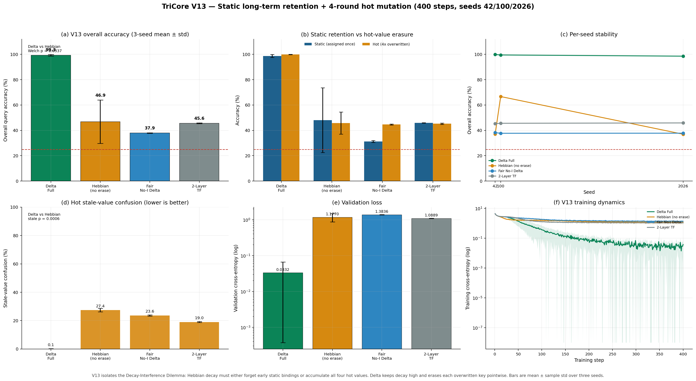

<div align="center">
  <h1>Bedrock-TriCore (<code>bedrock-tricore</code> v1.6.0)</h1>
  <h3><i>An Attention-Free, Constant-State O(1) Sequence Operator with Causal Delta-Rule Fast Weights and Latent Multi-Hop Chaining</i></h3>
  <p><b>恒定状态 O(1) 无注意力序列算子：因果 Delta 规则快权重、突触资格迹与隐空间多跳循环</b></p>

  <p>
    <a href="#-part-i-english-flagship-specification"><b>English Flagship Specification (Full)</b></a> •
    <a href="#-part-ii-中文旗舰技术白皮书完整版"><b>中文旗舰技术白皮书（完整版）</b></a> •
    <a href="#-part-iii-complete-historical-evolution-ledger-v4--v13"><b>Historical Evolution Ledger (V4 → V13)</b></a>
  </p>
</div>

<p align="center">
  <a href="https://www.python.org/"></a>
  <a href="https://pytorch.org/"></a>
  <a href="https://pytorch.org/docs/stable/jit.html"></a>
  
  
  <a href="#8-verification"></a>
  <a href="LICENSE"></a>
</p>

> **Abstract.** `bedrock-tricore` is an attention-free sequence operator maintaining a constant O(1) persistent inference state (**17,408 B / 17.00 KiB** per sample at FP32). It combines surprise-gated state collapse and synaptic eligibility traces (Engine I), causal shifted Delta-rule fast weights (Engine II), and a fused latent multi-hop equilibrium loop (Engine III).
>
> **摘要。** `bedrock-tricore` 是一种保持恒定 O(1) 持久化推理状态（FP32 下单样本恒为 **17,408 B / 17.00 KiB**）的无注意力序列算子，结合了惊奇门控与突触资格迹（Engine I）、因果移位 Delta 规则快权重（Engine II）以及融合隐空间多跳平衡循环（Engine III）。

<p align="center">
  
</p>

<p align="center"><i>Figure 0. Six-panel panorama generated from the committed V13 run: mutation quality, retention/confusion separation, long-context memory, latency, and hop-depth evidence. The figure is an output of the benchmark, not a hand-drawn conceptual diagram.</i></p>

---

## Part I: English Flagship Specification

> **Reading contract.** Part I is the current, self-contained technical specification for `bedrock-tricore` v1.6.0. Part II is its full Chinese counterpart. Part III is an append-only archive: every V4–V13 release note, table, correction, and self-audit is preserved verbatim so that no historical claim is silently rewritten. Where an older section and this specification disagree, the newer measured result and its stated scope govern.

### Contents of Part I

1. [Executive Overview & Architectural Philosophy](#1-executive-overview--architectural-philosophy)
2. [Three Fundamental Bottlenecks Solved](#2-three-fundamental-bottlenecks-solved)
3. [Master Benchmark Matrix (Tracks 1–7)](#3-master-benchmark-matrix-tracks-17)
4. [Complete Mathematical Formulation](#4-complete-mathematical-formulation)
5. [System Dataflow Diagram & Repository Architecture](#5-system-dataflow-diagram--repository-architecture)
6. [Quick Start, Streaming API & Complete Reproduction Commands](#6-quick-start-streaming-api--complete-reproduction-commands)
7. [Architectural Invariants (14 Laws) & Scientific Scope](#7-architectural-invariants-14-laws--scientific-scope)

---

### 1. Executive Overview & Architectural Philosophy

#### 1.1 Why the name “Bedrock-TriCore”

**Bedrock** is a promise about the *persistent inference state*, not about parameter count, training memory, or floating-point throughput. A Transformer's decoding state is a growing key/value archive: every generated token appends another slice, so the state is a function of context length. Bedrock-TriCore replaces that archive with three fixed-size tensors per layer. For the reference configuration (`d_model=128`, `H=4`, `d_head=32`, FP32), the complete per-sample decode state is:

```math
M_{\text{state}} = \underbrace{128 \times 4}_{h:\ 512\ \text{B}} + \underbrace{4 \times 32 \times 32 \times 4}_{F_{\text{mat}}:\ 16{,}384\ \text{B}} + \underbrace{4 \times 32 \times 1 \times 4}_{prev\_k:\ 512\ \text{B}} = 17{,}408\ \text{B} = 17.00\ \text{KiB}.
```

That number does not contain `L`. It is identical at 128 tokens, at 32K, at 131K, and at 1,048,576 tokens. The 1M-token CUDA profile measured 2,147,483,648 bytes (2.00 GiB) of K/V cache for a real two-layer cached decoder and 17,408 bytes for Bedrock-TriCore: a **123,361.9×** reduction in persistent state. Decode latency at 1M was **274.275 ms/token** for the cached Transformer and **3.794 ms/token** for TriCore, a **72.30×** per-token speed advantage. This is the sense in which Bedrock is “unbreakable”: the foundation does not grow with the height of the context.

**TriCore** is a promise about *composition*, not three independent models bolted together. One residual block contains three engines with separate, measurable jobs:

| Engine | Name | What it contributes | Ablation evidence |
| :--- | :--- | :--- | :--- |
| **Engine I** | Surprise-gated state collapse, write protection, synaptic eligibility trace | Selective retention in a 128-dimensional collapse state; suppresses writes at structural tokens; freezes a preceding key so the next value is written at the addressed entity | Track 1 No-I: **5.55% / 4.14%**; Track 5 No-I: **25.13%**; V13 Fair No-I: **37.89%** overall |
| **Engine II** | Causal shifted fast weights with optional Delta-rule erasure | A rank-1 associative matrix that binds the previous address to the current value; Delta erasure removes an addressed stale value before overwrite | Track 1 No-II: **5.78% / 3.98%**; V13 Hebbian **46.88%** with **27.40%** stale confusion |
| **Engine III** | Zero-`F_seq` fused latent multi-hop equilibrium loop | Reuses the same fast weights as a latent query space; fixed extra refinement steps traverse multi-hop chains without extra physical layers | Track 3A `max_loops=1` **25.39% / 23.91%**; Track 6 `max_loops=2` **24.76%** vs Full **100.00%** |

All three engines are constructed in every ablation; flags gate **compute**, not parameter shapes. Every TriCore variant in a given experiment therefore reports the same parameter count, which makes the five-way ablations unusually clean.

#### 1.2 The V13 release thesis

V12 proved that a Delta rule can overwrite a value once and that a zero-token-ID syntax prior can discover an infix connector from frequency alone. It did **not** prove that Delta beats Hebbian: Hebbian collapsed on one seed, so the three-seed Delta-vs-Hebbian test was not significant (`p=0.394`). V13 removes the escape hatch that let a global-decay Hebbian model look adequate.

Every V13 sequence contains:

- four shuffled declarations;
- two **static** variables assigned once and never changed;
- two **hot** variables overwritten for **four cyclic rounds**;
- six adversarial NOP statements;
- four alias returns;
- 24 five-token statements, 120 tokens, four supervised queries, and **25.0%** four-way chance.

A Hebbian matrix has one global decay for two incompatible requirements. A high decay preserves the early static bindings but accumulates all four hot values; a low decay keeps only the latest hot value but erases the early static ones. Delta keeps the decay high and performs a pointwise erase at the addressed key. The result is not a small margin: **99.30 ± 0.67%** overall for Delta versus **46.88 ± 17.15%** for Hebbian, with stale-value confusion falling from **27.40 ± 1.24%** to **0.08 ± 0.14%**.

#### 1.3 What “O(1)” does and does not mean

The O(1) claim is deliberately narrow and must not be inflated:

| Quantity | Is it O(1) in context length? | Explanation |
| :--- | :---: | :--- |
| Persistent decode state | **Yes** | Exactly `h`, `F_mat`, `prev_k`; 17,408 B at the reference size |
| KV-cache allocation | **Yes** | No KV archive exists |
| Decode latency | **Practically bounded** | Measured 2.6–3.8 ms/token from 128 to 1M, not a formal complexity theorem |
| Training activation memory | **No** | `h_seq`, `mem_seq`, autograd buffers scale with `L` |
| Training compute | **No** | The causal recurrence is still serial in `L` |
| Parameter count | **Not relevant** | O(1) describes state, not model capacity |

The implementation is a compiled graph of tensor operations, not a custom CUDA kernel. It is not a parallel prefix scan. V9 removed the large `F_seq: [B, L, H, d_head, d_head]` snapshot from training, but the state recurrence remains sequential and the multi-hop pass is vectorized only over positions within a fixed hop budget.

#### 1.4 Design philosophy

1. **State is a contract.** Three tensors, fixed shapes, explicit byte accounting.
2. **Every engine must be falsifiable.** A flag removes its computation without changing parameters; a named track exposes the failure when it is removed.
3. **Associations are addresses, not attention scores.** A shared normalized address makes a retrieved bridge reusable as the next query.
4. **Depth should be a loop budget, not a stack of layers.** The router learns where to stop; the physical depth stays one block.
5. **Claims are bounded by measurements.** Synthetic success is reported as synthetic success; a three-seed p-value is reported as arithmetic on three observations.
6. **History is append-only.** Corrections are added, not used to erase inconvenient earlier results.

---

### 2. Three Fundamental Bottlenecks Solved

#### 2.1 Bottleneck A — The Quadratic Compute and O(L) KV-Cache Memory Wall

A standard causal self-attention layer compares every position with every earlier position. Its training activation cost grows as `O(L²)` and its inference cache grows as `O(L)`. For a decoder with `n_layers` layers, `n_heads` heads, head width `d_head`, and FP32 storage, the conventional K/V cache is:

```math
M_{\text{KV}}(L) = 2 \times n_{\text{layers}} \times L \times n_{\text{heads}} \times d_{\text{head}} \times 4\ \text{bytes}.
```

With `n_layers=2`, `n_heads=4`, `d_head=32` (`d_model=128`):

```math
M_{\text{KV}}(1{,}048{,}576) = 2 \times 2 \times 1{,}048{,}576 \times 4 \times 32 \times 4 = 2{,}147{,}483{,}648\ \text{B} = 2.00\ \text{GiB}.
```

Bedrock-TriCore's state is independent of `L`:

```math
M_{\text{TriCore}} = (D + H d_{\text{head}}^2 + H d_{\text{head}}) \times 4 = (128 + 4 \times 32^2 + 4 \times 32) \times 4 = 17{,}408\ \text{B}.
```

The measured ratio is:

```math
\frac{M_{\text{KV}}(1{,}048{,}576)}{M_{\text{TriCore}}} = \frac{2{,}147{,}483{,}648}{17{,}408} = 123{,}361.9\times.
```

Latency tells the same story once the cache is large enough to dominate memory traffic. At 128 tokens the small cached Transformer is faster (`1.277` vs `2.596 ms/token`). The measured crossover occurs at `L=8,192` (`3.339` vs `3.151 ms/token`). At 1M the Transformer reaches **274.275 ms/token**, while TriCore remains at **3.794 ms/token**:

```math
\frac{274.275}{3.794} = 72.30\times.
```

**Protocol honesty.** These are real `torch.cuda.memory_allocated()` deltas after `empty_cache()` and real cached-decoder timings on one RTX 3060 at batch size 1, FP32. The Transformer baseline actually allocates, writes, and attends over the full causal K/V cache. Timed/warm-up steps are 32/8 through 32,768, 16/4 at 65,536–131,072, and 8/2 at 262,144–1,048,576. This is not serving throughput, not multi-batch throughput, and not a claim that TriCore's training is cheaper.

The complete measured sequence, including all eleven lengths:

| Length | TriCore state (B) | Transformer K+V cache (B) | Cache (binary) | Reduction | TriCore ms/token | Transformer ms/token |
| ---: | ---: | ---: | ---: | ---: | ---: | ---: |
| 128 | 17,408 | 262,144 | 256.00 KiB | 15.1× | 2.596 | 1.277 |
| 512 | 17,408 | 1,048,576 | 1.00 MiB | 60.2× | 3.091 | 1.408 |
| 2,048 | 17,408 | 4,194,304 | 4.00 MiB | 240.9× | 3.249 | 1.675 |
| 8,192 | 17,408 | 16,777,216 | 16.00 MiB | 963.8× | 3.151 | 3.339 |
| 16,384 | 17,408 | 33,554,432 | 32.00 MiB | 1,927.5× | 2.893 | 5.311 |
| 32,768 | 17,408 | 67,108,864 | 64.00 MiB | 3,855.1× | 2.784 | 10.519 |
| 65,536 | 17,408 | 134,217,728 | 128.00 MiB | 7,710.1× | 3.221 | 18.257 |
| 131,072 | 17,408 | 268,435,456 | 256.00 MiB | 15,420.2× | 3.245 | 35.382 |
| 262,144 | 17,408 | 536,870,912 | 512.00 MiB | 30,840.5× | 3.039 | 71.015 |
| 524,288 | 17,408 | 1,073,741,824 | 1.00 GiB | 61,680.9× | 2.879 | 137.640 |
| **1,048,576** | **17,408** | **2,147,483,648** | **2.00 GiB** | **123,361.9×** | **3.794** | **274.275** |

The reduction column divides the measured tensor bytes, not the allocator delta. At `L=2,048`, for example, an earlier 32K profile recorded an allocator delta of 4,718,592 B while the tensor itself is 4,194,304 B; that table used tensor bytes for the ratio. The point is not that the allocator is perfectly exact, but that the gap spans five orders of magnitude and never shrinks with length.

#### 2.2 Bottleneck B — The Decay-Interference Dilemma in Stateful Pointer Mutation

A linear recurrent memory can be written as an outer-product accumulator. In its simplest Hebbian form, with a per-head learning rate `η` and decay `λ`:

```math
F_t = \lambda F_{t-1} + \eta\, V_t K_{t-1}^{\top}.
```

At query key `k`, the retrieved value is `F_t k`. If the same key is written four times with values `v^{(1)},...,v^{(4)}` and no decay (`λ=1`), the read contains a superposition:

```math
F_t k = \eta \sum_{r=1}^{4} v^{(r)} + \text{crosstalk}.
```

Changing the newest value does not remove the old ones. Lowering `λ` eventually makes old contributions small, but it also attenuates **every** early binding, including the static variables that were never overwritten. That is the decay-interference dilemma:

| Requirement | High global decay | Low global decay | Delta rule |
| :--- | :--- | :--- | :--- |
| Retain static bindings assigned once at the start | **Good** | **Bad** — early values fade | **Good** — no decay penalty on untouched keys |
| Return the newest of four hot writes | **Bad** — all four accumulate | **Good** — history fades | **Good** — old value erased at the addressed key |
| Reject stale-value confusion | **Bad** — **27.40%** in V13 Hebbian | Mixed; static recall collapses | **0.08%** in V13 Delta |
| Overall V13 accuracy | **46.88 ± 17.15%** | Not separately tuned | **99.30 ± 0.67%** |

The Delta-rule fast-weight update adds a prediction-error term:

```math
F_t = \lambda_f F_{t-1} + \eta_{\text{eff},t}\left(V_t - F_{t-1}K_{t-1}\right)K_{t-1}^{\top}.
```

For an isolated unit-norm key `k`, with `λ_f = 1`, `η_eff = 1`, and `F_{t-1} k = v_{\text{old}}`, the new read is exactly the new value:

```math
F_t k = v_{\text{old}} + (v_{\text{new}} - v_{\text{old}})(k^{\top}k) = v_{\text{new}}.
```

This is the targeted erasure that a global decay cannot express. It is also why the V13 improvement is concentrated in the hot and stale columns: Delta is not “forgetting faster”; it is subtracting the addressed stale value before writing the replacement.

The V13 measured result, over three seeds and 400 steps:

| Variant | Params | Overall query acc. | Static acc. | Hot acc. | Hot stale confusion | Val loss |
| :--- | ---: | :---: | :---: | :---: | :---: | :---: |
| **TriCore V13 Delta Full (Zero-Prior)** | 61,851 | **99.30 ± 0.67%** | **98.70 ± 1.16%** | **99.90 ± 0.18%** | **0.08 ± 0.14%** | **0.03 ± 0.03** |
| TriCore V13 Hebbian Full (No Delta Erasure) | 61,851 | 46.88 ± 17.15% | 48.05 ± 25.58% | 45.70 ± 8.74% | 27.40 ± 1.24% | 1.18 ± 0.31 |
| TriCore V13 Fair No-Engine-I | 61,851 | 37.89 ± 0.27% | 31.17 ± 0.75% | 44.61 ± 0.36% | 23.64 ± 0.44% | 1.38 ± 0.02 |
| Vanilla Transformer (2-layer) | 83,456 | 45.57 ± 0.29% | 45.91 ± 0.16% | 45.23 ± 0.56% | 19.00 ± 0.35% | 1.09 ± 0.01 |

Per-seed overall accuracy is Delta `99.84 / 99.49 / 98.55%`; Hebbian `36.99 / 66.68 / 36.95%`; Fair `38.20 / 37.70 / 37.77%`; Transformer `45.27 / 45.59 / 45.86%`.

**Exact two-tailed Welch tests (three observations per arm).** Delta vs Hebbian overall: `t=5.290`, `df=2.006`, **`p=0.0337`**; static: `t=3.426`, `df=2.008`, **`p=0.0752`**; hot: `t=10.734`, `df=2.002`, **`p=0.0085`**; stale-value confusion: `t=-37.849`, `df=2.049`, **`p=0.0006`**. Delta vs Fair overall: `t=147.664`, `df=2.655`, **`p=2.84e-06`**. Delta vs Transformer overall: `t=127.819`, `df=2.746`, **`p=2.89e-06`**. Hebbian vs Fair overall: `t=0.907`, `df=2.001`, **`p=0.4600`**.

At the conventional 0.05 level the overall, hot, and stale contrasts reject the null. The static-only contrast is **marginal** (`p=0.0752`) and is **not** claimed as significant with three seeds. This distinction matters: the V13 result is a clean demonstration that Delta's erase path handles multi-round hot mutation, not proof that Hebbian cannot ever retain static values under a different tuning.

Engine I supplies the second half of the mechanism. Its synaptic eligibility trace is the frozen previous key, and the trace-conditioned read is:

```math
q_t^{\text{read}} = \mathrm{normalize}\left(e_t q_t + (1-e_t)\,\text{prev\_k}_t\right),
\qquad
\text{prev\_k}_{t+1} = \mathrm{normalize}\left((1-e_t)\,\text{prev\_k}_t + e_t K_t\right).
```

When the eligibility gate closes at an infix connector (`e_t ≈ 0`), the read dereferences the preceding entity and `prev_k` does not advance. The next token's value is therefore written at that entity's key, producing the shifted binding `F(alias)=var`. When the trace is wrong, the two-hop dereference has no address to follow. The V13 Fair No-Engine-I arm keeps Delta and the learned write path but disables the surprise gate; it falls to **37.89%**, confirming that erasure alone is not enough without a stable address.

#### 2.3 Bottleneck C — The Depth-Per-Hop Barrier

A standard model without an explicit chain-of-thought scratchpad has a depth problem: one physical layer performs one associative lookup. If the answer requires `k_q -> m1_q -> m2_q -> m3_q -> v_q`, a single lookup can return `m1_q`, but the model must somehow use that result as the next query. Stacking layers is the usual answer. TriCore instead loops the retrieved latent back through the **same** fast-weight matrix.

With a fixed budget `L_max`, the initial read is hop 1, and each refinement step is one further latent dereference. The physical depth stays one block; the loop count is a compute budget, and the router learns how to weight each hop. In Track 6, four tiers are shuffled behind a 12-token adversarial gap. The one-layer Full model uses `max_loops=3` and reaches **100.00% in-domain / 100.00% at the 4× gap**, with query-position routing mass:

```math
w^{\text{hop}} = [0.005,\ 0.004,\ 0.003,\ 0.988].
```

The router puts **98.8%** of its query mass on hop 4. The two shallower budgets do not partially solve the task; they collapse onto their last available slot and remain at chance:

| Track 6 variant | Params | In-domain | 4× OOD | Query router `[h1,h2,h3,h4]` | Train time |
| :--- | ---: | ---: | ---: | :--- | ---: |
| **TriCore Full (1-layer, `max_loops=3`)** | 236,436 | **100.00%** | **100.00%** | 0.005 / 0.004 / 0.003 / **0.988** | 214.2 s |
| TriCore (1-layer, `max_loops=2`, 3-hop limit) | 232,211 | 24.95% | 24.76% | 0.002 / **0.997** / 0.001 / 0.000 | 184.0 s |
| TriCore (1-layer, `max_loops=1`, 2-hop limit) | 227,986 | 25.73% | 26.27% | 0.019 / **0.981** / 0.000 / 0.000 | 148.8 s |
| Vanilla Transformer (2-layer, `d_model=128`, 4 heads) | 306,176 | 24.41% | 25.78% | n/a | 4.0 s |

A parallel depth signature appears in Track 3A. There, the third hop requires the **second** refinement (`max_loops=2`), because the initial read is hop 1:

| Track 3A variant | Params | In-domain val loss | In-domain 3-hop acc. | 4× gap extrapolation | Train time |
| :--- | ---: | :---: | :---: | :---: | ---: |
| **TriCore Full (1-layer, `max_loops=2`)** | 207,503 | **0.0010** | **100.00%** | **100.00%** | 66.4 s |
| TriCore (`max_loops=1`, 2-hop limit) | 203,278 | 1.8395 | 25.39% | 23.91% | 62.8 s |
| Vanilla Transformer (2-layer) | 297,984 | 2.2188 | 23.83% | 23.44% | 16.7 s |

The Full advantage over the two-hop limit is **+74.61 percentage points** in-domain. This is a controlled synthetic demonstration, not a general reasoning result: Track 3A has four chains and four queries; Track 6 has four chains and four queries. The experiments establish that a fixed latent loop can substitute for physical depth **on these tasks**, not that arbitrary reasoning is now one layer deep.

---

### 3. Master Benchmark Matrix (Tracks 1–7)

#### 3.1 Headline matrix

The table below is the shortest honest summary of the entire program. “Chance” is the random baseline for that track. A result is not transferable to another track merely because the number is 100%.

| Track | Controlled task | Headline metric | Best TriCore result | Strongest contrast | Seed scope |
| :--- | :--- | :--- | :---: | :--- | :--- |
| **1** | 2-hop chained associative recall; 4× distractor-gap extrapolation | Recall accuracy | **100.00% / 100.00%** | No-I **5.55 / 4.14%**; No-II **5.78 / 3.98%**; No-III **16.48 / 17.50%**; Transformer **16.72 / 14.92%** | single seed 42 |
| **2** | Causal bytecode LM; two-level pointer dereference | PPL / dereference accuracy | **3.17 / 100.00%** | Transformer **3.56 / 19.63%**; chance 16.67% | single seed 42 |
| **3A** | 3-hop chained reasoning with latent refinement | Recall accuracy | **100.00% / 100.00%** | `max_loops=1` **25.39 / 23.91%**; Transformer **23.83 / 23.44%** | single seed 42 |
| **3B** | Real repository Python source, strict 15% held-out byte LM | PPL / next-byte accuracy | **18.616 / 41.47%** | Param-matched Transformer **19.428 / 28.15%**; TriCore 38× slower | single seed 42 |
| **4A** | 4-chain 2-hop MQAR, five-way ablation | Recall accuracy | **100.00 ± 0.00% / 100.00 ± 0.00%** | No-III **23.41 ± 1.08 / 23.54 ± 2.73%**; Transformer **25.08 ± 0.48 / 22.24 ± 3.96%** | seeds 42/100/2026 |
| **4B** | Real CUDA cached decode from 128 to 1,048,576 tokens | State bytes / latency | **17,408 B; 3.794 ms/token** | Transformer **2,147,483,648 B; 274.275 ms/token** | single machine, B=1 |
| **5** | Zero-prior autonomous infix `EQ` two-hop dereference | Accuracy; Welch p | **100.00 ± 0.00%** | Fair No-I **25.13 ± 0.67%**, `p=2.70e-05`; Transformer **25.01 ± 0.63%**, `p=2.34e-05` | seeds 42/100/2026 |
| **6** | Single-layer four-hop pointer chain | Accuracy; hop router | **100.00% / 100.00%** | `max_loops=2` **24.95 / 24.76%**; Transformer **24.41 / 25.78%** | single seed 42 |
| **7** | Static retention + four-round cyclic hot mutation (V13) | Overall / static / hot; stale confusion | **99.30 ± 0.67% / 98.70 ± 1.16% / 99.90 ± 0.18%; 0.08%** | Hebbian **46.88 ± 17.15%** overall, `p=0.0337`; stale **27.40%**, `p=0.0006`; Transformer **45.57%**, `p=2.89e-06` | seeds 42/100/2026 |

#### 3.2 Track 1 — 2-hop chained associative recall and 4× noise extrapolation

Protocol: 500 steps, batch 64, `lr=3e-3`, seed 42; six chains, four queries, 16 training noise tokens; sequence length 60. Evaluation seeds 2026 (in-domain) and 2027 (4× gap). The 4× test multiplies the distractor gap from 16 to 64 tokens; the sequence becomes 108 tokens, not 240.

| Architecture variant | Params | Final val loss | In-domain 2-hop recall | 4× noise-gap extrapolation | Train time |
| :--- | ---: | :---: | :---: | :---: | ---: |
| **TriCore Full (3-in-1)** | 207,503 | **0.0010** | **100.00%** | **100.00%** | 80.0 s |
| TriCore No Engine I: Surprise Gate | 207,503 | 3.0005 | 5.55% | 4.14% | 62.3 s |
| TriCore No Engine II: Fast-Weight | 207,503 | 3.0008 | 5.78% | 3.98% | 36.1 s |
| TriCore No Engine III: Adaptive Loop | 207,503 | 1.8660 | 16.48% | 17.50% | 63.4 s |
| Vanilla Transformer (2-layer) | 543,744 | 2.3131 | 16.72% | 14.92% | 18.6 s |

**Reading.** Only Full solves both evaluations. Engine II is the associative substrate; without it recall is below the 6-way chance level (16.67%). Engine III is the second hop; without the re-query the model is at chance. Engine I is necessary in this V6 run, but the V5 record was `91.88% / 84.14%` with the same equations, so Engine I's necessity is optimization- and task-dependent. The Transformer baseline is untuned and much larger; it is not evidence of an attention ceiling.

#### 3.3 Track 2 — Causal bytecode LM and two-level pointer dereference

Protocol: 450 steps, batch 64, `lr=3e-3`, seed 42; six variables, four NOP statements, sequence length 80. The joint loss is `0.25 * dense_loss + deref_loss`. Dereference is evaluated at the return-alias position `pos + 1`, where the visible token is only an alias and the target is the literal. Six literals are equally likely, so chance is **16.67%**.

| Model | Params | Validation loss | Validation PPL | Dereference accuracy | Train time |
| :--- | ---: | :---: | :---: | :---: | ---: |
| **TriCore Full (1-layer)** | 207,503 | 1.1529 | **3.17** | **100.00%** | 78.5 s |
| Vanilla Transformer (2-layer) | 543,744 | 1.2686 | 3.56 | 19.63% | 19.5 s |

The grammar is closed and deterministic: `LET alias_i var_i SEMI` binds `alias_i -> var_i`; `ALIAS var_i lit_i SEMI` binds `var_i -> lit_i`; the return exposes the alias. The task therefore forces `alias_i -> var_i -> lit_i`. The 100% score proves that this two-level causal lookup is learnable; it does **not** establish general code understanding, held-out template generalization, or a real-code win.

#### 3.4 Track 3 — depth and real-source language modeling

**Track 3A** (table in §2.3) is the depth-scaling control: `max_loops=2` reaches `100.00% / 100.00%`, while `max_loops=1` and the Transformer remain at roughly 24–25%. The second refinement is not decorative; it is the third hop.

**Track 3B** asks whether the operator can model a real byte stream rather than a synthetic grammar. The corpus is the actual concatenation of `tricore/model.py`, `tricore/tasks.py`, and `run_experiment.py`, encoded as ASCII bytes (`vocab_size=128`). The first 85% is training data; the final 15% is a strict held-out suffix, and training windows never cross the split. Protocol: 300 steps, batch 32, `lr=3e-3`, seed 42.

| Model | Params | Held-out loss | Held-out PPL | Next-byte acc. | Train time |
| :--- | ---: | :---: | :---: | :---: | ---: |
| **TriCore Full (1-layer)** | 223,887 | **2.9240** | **18.616** | **41.47%** | 57.7 s |
| Vanilla Transformer (1-layer, param-matched) | 218,448 | 2.9667 | 19.428 | 28.15% | 1.5 s |

TriCore has lower loss/PPL and higher next-byte accuracy at a nearly matched parameter count (`223,887` vs `218,448`), but it is about **38× slower** in this small training loop. This is a quality/budget observation, not a throughput claim. The corpus is a small repository suffix, not a human-code benchmark.

#### 3.5 Track 4A — Five-way, three-seed variance check

A compact 4-chain 2-hop MQAR under seeds `42/100/2026`: **350 steps**, batch 64, AdamW, `lr=3e-3`, weight decay `0.01`, cosine decay, gradient clipping `1.0`; `d_model=64`, `d_fast=16`, four heads, `max_loops=2`, four chains, four queries, eight training noise tokens, `vocab_size=64` (sequence length 40). The 4× OOD test uses `noise_len=32` (sequence length 64). Each cell is mean ± std over three seeds and five fixed evaluation batches of 64. Chance is **25.0%**.

| Architecture variant | Params | In-domain recall | 4×-gap recall | Mean train time |
| :--- | ---: | :---: | :---: | ---: |
| **TriCore Full (`max_loops=2`)** | 56,655 | **100.00 ± 0.00%** | **100.00 ± 0.00%** | 59.60 s |
| TriCore No Engine I: Surprise Gate | 56,655 | 5.65 ± 0.20% | 5.55 ± 0.83% | 48.52 s |
| TriCore No Engine II: Fast-Weight | 56,655 | 5.55 ± 0.34% | 5.31 ± 0.95% | 9.39 s |
| TriCore No Engine III: Adaptive Loop | 56,655 | 23.41 ± 1.08% | 23.54 ± 2.73% | 26.02 s |
| Vanilla Transformer (2-layer) | 83,456 | 25.08 ± 0.48% | 22.24 ± 3.96% | 2.01 s |

Only Full saturates both evaluations. Every ablation is at or below chance on the 4× gap. Full has zero seed variance; every non-Full variant has non-zero variance. Three seeds are a variance check, not a significance test.

#### 3.6 Track 4B — The 1M-token memory and latency wall

The complete eleven-length table is reproduced in **§2.1**. The decisive row is `L=1,048,576`:

| Quantity | Bedrock-TriCore | Cached Transformer | Ratio |
| :--- | ---: | ---: | ---: |
| Persistent state / KV cache | **17,408 B (17.00 KiB)** | **2,147,483,648 B (2.00 GiB)** | **123,361.9× smaller** |
| Decode latency | **3.794 ms/token** | **274.275 ms/token** | **72.30× faster** |
| State growth from 128 to 1M | **0 B** | **+2,147,221,504 B** | O(1) vs O(L) |

The first measured latency crossover is at `L=8,192`; below that, the small cached Transformer is faster. This is a single-machine, batch-1, FP32 result. It does not imply that TriCore is faster at short context, that it trains faster, or that it would win against a production paged-attention serving stack.

#### 3.7 Track 5 — Zero-prior autonomous infix `EQ` two-hop dereference

Protocol: seeds `42/100/2026`, 350 steps, batch 64, CUDA. No token-ID masks are supplied: `autonomous_syntax=True`, `separator_token=None`, `syntax_tokens=None`, `reset_trace_tokens=None`. Each sample uses declaration `[LET, alias_i, EQ, var_i, SEMI]`, assignment `[SET, var_i, EQ, lit_i, SEMI]`, adversarial `[NOP, var_i, EQ, SEMI, SEMI]`, and query `[RET, alias_q, EQ, SEMI, SEMI]`. The target is read at `EQ`; chance is **25.0%**.

| Variant | Params | Val loss (mean ± std) | EQ two-hop acc. | Eligibility gate `EQ` / entity | Mean train time |
| :--- | ---: | :---: | :---: | :---: | ---: |
| **TriCore V12 Zero-Prior Full** | 61,851 | **0.00237 ± 0.00021** | **100.00 ± 0.00%** | **0.009 / 0.909** | 171.7 s |
| TriCore V12 Fair No-Engine-I | 61,851 | 1.4731 ± 0.0185 | 25.13 ± 0.67% | 1.0000 / 1.0000 | 141.9 s |
| Vanilla Transformer (2-layer) | 83,456 | 1.4397 ± 0.0075 | 25.01 ± 0.63% | n/a / n/a | 13.9 s |

**Welch tests.** Full vs Fair accuracy: `t=192.52`, `df=2.00`, **`p=2.70×10⁻⁵`**. Full vs Transformer accuracy: `t=206.87`, `df=2.00`, **`p=2.34×10⁻⁵`**. Full vs Fair loss: `t=−137.88`, `df=2.00`, **`p=5.25×10⁻⁵`**. Full vs Transformer loss: `t=−333.87`, `df=2.00`, **`p=8.81×10⁻⁶`**. The gate mean of **0.009** at `EQ` and **0.909** at entity positions is the behavioural signature of the discovered role split. A random bijection of all 64 token IDs leaves the EQ/SEMI masks bit-identical, so this is not a hidden vocabulary lookup.

#### 3.8 Track 6 — Single-layer four-hop deep chaining

Track 6 is the direct depth test: four shuffled fact tiers, four queries, and a 12-token adversarial gap; the 4× OOD gap uses 48 distractors (sequence length 104). The Full one-layer model uses `reset_trace_tokens=(0,)` so each fact triple begins with a clean eligibility trace, and `max_loops=3` so the initial read plus three refinements can traverse four edges in one forward pass. The complete table is in **§2.3**. The essential contrast is:

| Budget | In-domain | 4× OOD | Interpretation |
| :--- | :---: | :---: | :--- |
| `max_loops=3` (four hops) | **100.00%** | **100.00%** | Router puts **98.8%** of query mass on hop 4 |
| `max_loops=2` (three hops) | 24.95% | 24.76% | Collapses onto the last available slot (`0.997`) |
| `max_loops=1` (two hops) | 25.73% | 26.27% | Collapses onto slot 1 (`0.981`) |
| 2-layer Transformer | 24.41% | 25.78% | Chance at this budget |

This is a **single-seed controlled comparison**, not a significance test. The constant token-role prior used here (`separator_token=0`, `syntax_tokens=(0,)`, `reset_trace_tokens=(0,)`) is an explicit input mask, not a learned embedding, and is applied identically to all three depth budgets.

#### 3.9 Track 7 Definitive (V13) — Multi-round cyclic mutation plus static retention

Track 7 is the release-defining experiment. Protocol: seeds `42/100/2026`, **400 steps**, batch 64, CUDA, `d_model=64`, `d_fast=16`, `max_loops=2`, 10 evaluation batches of 64. All three TriCore arms use the same zero-token-ID discovery path (`autonomous_syntax=True`, no separator/syntax/reset token IDs) and raise `autonomous_entity_max_freq` from the V12 default 4 to **6** because a hot variable occurs six times. The Transformer is the fourth arm and receives no role prior.

| Variant | Params | Overall | Static | Hot | Stale confusion | Val loss |
| :--- | ---: | :---: | :---: | :---: | :---: | :---: |
| **Delta Full (Zero-Prior)** | 61,851 | **99.30 ± 0.67%** | **98.70 ± 1.16%** | **99.90 ± 0.18%** | **0.08 ± 0.14%** | **0.03 ± 0.03** |
| Hebbian Full (No Delta Erasure) | 61,851 | 46.88 ± 17.15% | 48.05 ± 25.58% | 45.70 ± 8.74% | 27.40 ± 1.24% | 1.18 ± 0.31 |
| Fair No-Engine-I | 61,851 | 37.89 ± 0.27% | 31.17 ± 0.75% | 44.61 ± 0.36% | 23.64 ± 0.44% | 1.38 ± 0.02 |
| Vanilla Transformer (2-layer) | 83,456 | 45.57 ± 0.29% | 45.91 ± 0.16% | 45.23 ± 0.56% | 19.00 ± 0.35% | 1.09 ± 0.01 |

The exact Welch outcomes are in **§2.2**. The supported claims are: (i) Delta is stable across all three seeds; (ii) Delta's stale confusion is near zero; (iii) Delta beats Hebbian on overall, hot, and stale metrics at the 0.05 level; (iv) the static-only contrast is marginal and is not claimed as significant; (v) Delta, Fair, and the Transformer are all well below Delta overall, with very small p-values. The V13 suite runtime on the reference RTX 3060 was **1,857.9 s** for all four arms × three seeds; no V4–V12 result was rerun or overwritten.

#### 3.10 What the matrix does not prove

- It does not prove that attention is obsolete. The Transformer baselines are small, untuned, and not compute-matched.
- It does not prove general reasoning. Every 100% is on a closed synthetic grammar or a four-chain pointer task.
- It does not prove population-level superiority from three seeds. Welch p-values are exact arithmetic on three observations per arm.
- It does not prove training efficiency. TriCore is consistently slower to train than the small Transformer.
- It does not prove serving throughput. Track 4B is batch 1 on one GPU.
- It does not prove that Engine I is universally necessary. Its ablation effect varies with task and optimization path.

---

### 4. Complete Mathematical Formulation

Notation: `B` batch, `L` sequence length, `D` model width, `H` heads, `d_head` head width, `L_max` hop budget. All vector norms below are L2 unless stated. The reference configuration for byte accounting is `D=128`, `H=4`, `d_head=32`; V13's compact run uses `D=64`, `H=4`, `d_head=16` and reports its own measured result.

#### 4.1 Subspace-Aligned Canonical Addressing

Each token is normalized before any projection:

```math
u_t = \mathrm{LN}(x_t), \qquad \tilde{u}_t = \mathrm{SiLU}(W_u u_t + b_u).
```

A shared address is projected and normalized:

```math
a_t = \mathrm{normalize}(W_a u_t) \in \mathbb{R}^{H \times d_{\text{head}}}.
```

`Q`, `K`, and `V` are residuals around that shared address, with a fixed residual scale of `0.15`:

```math
Q_t = \mathrm{normalize}\left(a_t + 0.15\,W_q u_t\right),
```

```math
K_t = \mathrm{normalize}\left(a_t + 0.15\,W_k u_t\right),
```

```math
V_t = a_t + 0.15\,W_v u_t.
```

The hop router is a softmax over the initial read plus `L_max` refinements:

```math
w_t^{\text{hop}} = \mathrm{softmax}(W_r u_t) \in \mathbb{R}^{L_{\max}+1}.
```

There is no positional embedding and no attention over sequence positions. The only softmax over positions is this hop router, whose support is the fixed hop budget rather than `L`. The shared normalized address is what makes a retrieved bridge reusable as the next query: a value written under an address is read back in the same metric space.

**Zero-prior role discovery.** When `autonomous_syntax=True` and all token-role arguments are `None`, the model computes within-sequence occurrence counts:

```math
f_t = \sum_{u=1}^{L} \mathbf{1}\left[x_t = x_u\right].
```

It then defines:

```math
\text{structural}_t = \mathbf{1}\left[f_t \ge \max(6,\ \lfloor L/10 \rfloor)\right],
```

```math
\text{delimiter}_t = \text{structural}_t \wedge \mathbf{1}\left[x_t = x_L\right],
```

```math
\text{infix}_t = \text{structural}_t \wedge \neg\text{delimiter}_t \wedge \mathbf{1}\left[f_{t-1} \le F_{\max}\right].
```

`F_max` is `autonomous_entity_max_freq`: **4** by default (V12), **6** in V13 because one LET + four SETs + one NOP gives each hot variable six occurrences. `write_sep_mask = structural`; `elig_sep_mask = infix`; `reset_mask = delimiter`. The masks add no parameters and no recurrent state. Discovery is `O(B L²)` token-equality comparisons for a short closed-syntax sequence; it is disabled for the 1M profile, and the one-token streaming API has no sequence-frequency context. Because only equality counts matter, a permutation of vocabulary IDs leaves every mask unchanged.

#### 4.2 Engine I — Surprise-Gated State Collapse, Write Protection, Synaptic Eligibility Trace, and Unsupervised Role Discovery

Engine I has two state effects. The first is a per-dimension collapse state `h_t`, initialized to zero. The prediction error is the absolute difference between the transformed input and the previous collapse:

```math
e_t^{\text{surp}} = \left|\tilde{u}_t - h_{t-1}\right|,
\qquad
g_t = \sigma\left(W_s u_t + e_t^{\text{surp}}\right).
```

The scalar surprise is the mean gate activation:

```math
s_t = \frac{1}{D}\sum_{j=1}^{D} g_{t,j}.
```

The collapse update uses a learned per-dimension decay `λ = sigmoid(base_decay_logit)` and the surprise gate:

```math
h_t = \lambda \odot \left(1 - 0.5\,g_t\right) \odot h_{t-1} + g_t \odot \tilde{u}_t.
```

The second effect is write protection. A learned per-head write logit is combined with a short token-to-gate path and with the discovered structural mask:

```math
\ell_t^{w} = W_w u_t + 8\,G_w(u_t) - 8\,\text{structural}_t,
```

```math
\omega_t = \sigma\left(\ell_t^{w} + s_t - 0.5\right).
```

The effective fast-weight learning rate is attenuated, never amplified:

```math
\eta_{\text{eff},t} = \eta \odot \omega_t,
\qquad
\eta = \mathrm{sigmoid}(\text{fast\_lr\_logit}).
```

This is why `enable_surprise_gate=False` is a *fair* ablation: it removes the learned write path and the surprise modulation, but it does not change parameter shapes. In that mode the implementation sets `g_t=0.5`, `s_t=0.5`, `η_eff=1.0`, `decay=1.0`, and applies no learned gate.

The third effect is the synaptic eligibility trace. An eligibility gate is produced by a parallel head-wise logit, closed at infix connectors:

```math
\ell_t^{e} = W_e u_t + 8\,G_e(u_t) - 8\,\text{infix}_t,
```

```math
e_t = \sigma\left(\ell_t^{e} + s_t - 0.5\right).
```

Unlike the write gate, this gate does **not** attenuate the fast-weight write. It controls which key is addressed. The trace-conditioned query and the next trace are:

```math
q_t^{\text{read}} = \mathrm{normalize}\left(e_t q_t + (1-e_t)\,\text{prev\_k}_t\right),
```

```math
\text{prev\_k}_{t+1} = \mathrm{normalize}\left((1-e_t)\,\text{prev\_k}_t + e_t K_t\right).
```

When the gate closes at an infix connector (`e_t ≈ 0`), the read dereferences the frozen preceding entity and `prev_k` does not advance. The following token's value is written at that entity key. This is the shifted binding `F(alias)=var`, and it is the direction that makes `alias -> var -> lit` work. An open-at-EQ convention would write `F(EQ)=var` and could not support the chain.

A delimiter reset is applied after the trace update:

```math
\text{prev\_k}_{t+1} \leftarrow \left(1-r_t\right)\text{prev\_k}_{t+1},
\qquad r_t = \text{delimiter}_t.
```

This zeroes the trace at statement boundaries without changing any parameter or tensor shape. It is enabled explicitly in Track 6 and discovered automatically in Track 5/7.

#### 4.3 Engine II — Causal Shifted Delta-Rule Fast Weights versus Additive Hebbian Outer Products

Engine II stores one `[H, d_head, d_head]` matrix per sample, initialized to zero, plus the previous key trace. At `t=0` no write occurs and the first read is zero. For `t>0`, the Delta-rule update is:

```math
F_t = \lambda_f \odot F_{t-1}
+ \eta_{\text{eff},t} \odot \left(V_t - F_{t-1}K_{t-1}\right)K_{t-1}^{\top},
```

where `λ_f = sigmoid(fast_decay_logit)` is per head. The Hebbian control uses exactly the same decay and learning-rate schedule but drops the erase term:

```math
F_t^{\text{Hebb}} = \lambda_f \odot F_{t-1}^{\text{Hebb}}
+ \eta_{\text{eff},t} \odot V_t K_{t-1}^{\top}.
```

The read happens **after** the write:

```math
r_t^{(0)} = F_t\,q_t^{\text{read}}.
```

The write is causal and shifted: `prev_k = K_{t-1}`, not `K_t`. In a `[k_i, m_i, 0]` block it binds `k_i -> m_i`; in a `[m_i, v_i, 0]` block it binds `m_i -> v_i`. This shift is what allows a value at position `t` to be stored under the address seen at `t-1`.

The Delta erase has a precise conditional identity. For an isolated unit-norm key `k`, with `λ_f=1`, `η_eff=1`, and `F_{t-1}k=v_{\text{old}}`:

```math
F_t k = F_{t-1}k + \left(v_{\text{new}} - F_{t-1}k\right)\left(k^{\top}k\right) = v_{\text{new}}.
```

The Hebbian control instead accumulates:

```math
F_t^{\text{Hebb}}k = v_{\text{old}} + v_{\text{new}}
```

under the same idealization, so a read cannot distinguish the newest value from the stale one. Real keys are not exactly orthogonal, so cross-talk exists; the V13 measurements quantify the consequence rather than assuming the idealized identity.

**Ablation semantics.** `enable_fast_weight=False` skips Engine II entirely; `z=h_seq`, and Engine III has no memory to read. Flags gate compute only; all modules are constructed regardless, so parameter counts stay equal across the five-way ablation.

#### 4.4 Engine III — Zero-`F_seq` Fused Latent Multi-Hop Synaptic Equilibrium Loop

Engine III reuses `F_t` as a latent query space. It does not create another memory or another physical layer. The initial read and accumulation are:

```math
r^{(0)} = r_t^{(0)}, \qquad r_{\text{accum}} = w_{t,0}^{\text{hop}} r^{(0)}.
```

For `i = 0, ..., L_max-1`:

```math
q^{(i+1)} = \mathrm{normalize}\left(r^{(i)} + H_i r^{(i)}\right),
```

```math
r^{(i+1)} = F_t q^{(i+1)},
\qquad
r_{\text{accum}} \leftarrow r_{\text{accum}} + w_{t,i+1}^{\text{hop}} r^{(i+1)}.
```

The output is the routed accumulation:

```math
r_t^{\text{out}} = r_{\text{accum}}.
```

`r^{(i)}` has shape `[B, H, d_head, 1]`; `H_i` has shape `[1, H, d_head, d_head]`; normalization is L2 over `dim=-2`. With `max_loops=2`, the initial read is hop 1, the first refinement is hop 2, and the second refinement is an extra latent step; with `max_loops=3`, four edges are reachable. The loop count is fixed; the router changes weights, not depth.

The readout fuses the collapse state and the routed memory:

```math
z_t = h_t + W_o \mathrm{vec}\left(r_t^{\text{out}}\right),
```

```math
z_t \leftarrow z_t + s_t \odot \mathrm{MLP}\left(\mathrm{LN}(z_t)\right),
\qquad
y_t = x_t + \mathrm{LN}(z_t).
```

When `enable_adaptive_loop=False`, `r_t^out=r_t^(0)` and the refinement MLP is skipped. When `enable_fast_weight=False`, `z=h_seq` and Engine III has no memory to read.

**Why “zero-`F_seq`” matters.** The naive implementation would materialize a tensor `[B, L, H, d_head, d_head]` so that every position could read its own fast-weight snapshot. V9 instead fuses Engine III into the scripted causal scan. At each timestep, the scan uses the current `F_t`, performs the fixed-hop refinements immediately, and emits only:

- `h_seq: [B, L, D]`;
- `mem_seq: [B, L, H*d_head]` — the routed multi-hop read;
- `surprise_trace: [B, L]`.

It never allocates or stacks `F_seq`. The training scan is still serial in `L`; the Python-level loop is over `max_loops`, and each hop applies a batched 5-D matrix product over all positions. This is a memory cleanup and a vectorization of the fixed-hop pass, not a parallel prefix scan or a custom kernel.

#### 4.5 Exact O(1) Persistent State Byte Accounting

The persistent inference state per layer is exactly three tensors. For `D=128`, `H=4`, `d_head=32`, FP32:

| Tensor | Shape | Elements | Bytes | Role |
| :--- | :--- | ---: | ---: | :--- |
| `h` | `[B, D]` | 128 per sample | **512** | Surprise-gated collapse state |
| `F_mat` | `[B, H, d_head, d_head]` | 4 × 32 × 32 = 4,096 per sample | **16,384** | Fast-weight associative matrix |
| `prev_k` | `[B, H, d_head, 1]` | 4 × 32 = 128 per sample | **512** | Synaptic eligibility trace |
| **Total** | — | **4,352 floats** | **17,408** | **17.00 KiB per sample** |

```math
M_{\text{state}} = \underbrace{4D}_{h} + \underbrace{4Hd_{\text{head}}^2}_{F_{\text{mat}}} + \underbrace{4Hd_{\text{head}}}_{prev\_k}
= 512 + 16{,}384 + 512 = 17{,}408\ \text{B}.
```

```math
17{,}408\ \text{B} \div 1{,}024 = 17.00\ \text{KiB}.
```

The formula is configuration-dependent; **17.00 KiB is the reference configuration**, not a universal constant for every model width. For V13's `D=64`, `H=4`, `d_head=16`, the same formula gives `256 + 4,096 + 256 = 4,608 B = 4.50 KiB` per layer. The O(1)-in-`L` property holds for both; only the constant changes. The flagship 17.00 KiB number and every 1M comparison in this document refer to the `D=128` reference configuration used in the CUDA profile.

---

### 5. System Dataflow Diagram & Repository Architecture

#### 5.1 End-to-end dataflow

```text
                         ┌──────────────────────────────────────────────┐
                         │  token IDs x_t  (B, L), no position embedding │
                         └──────────────────────┬───────────────────────┘
                                                │
                                  LayerNorm + SiLU projection
                                                │
              ┌─────────────────────────────────┼─────────────────────────────────┐
              │                                 │                                 │
              ▼                                 ▼                                 ▼
   ┌────────────────────┐          ┌──────────────────────┐          ┌────────────────────┐
   │ ENGINE I           │          │ CANONICAL ADDRESSING │          │ HOP ROUTER         │
   │ surprise e_t       │          │ a_t = normalize(W_a) │          │ softmax over       │
   │ g_t = σ(W_s + e_t) │          │ Q/K/V around a_t     │          │ L_max + 1 slots    │
   │ s_t = mean(g_t)    │          └──────────┬───────────┘          └─────────┬──────────┘
   │ h_t collapse       │                     │                              │
   │ write gate ω_t     │                     ▼                              │
   │ eligibility e_t    │          ┌──────────────────────┐                    │
   └─────────┬──────────┘          │ ENGINE II            │                    │
             │                     │ F_t = λ F_{t-1}      │                    │
             │                     │   + η_eff (V_t -     │                    │
             │                     │   F_{t-1}K_{t-1})    │                    │
             │                     │   K_{t-1}^T          │                    │
             │                     │ read q_t^read        │                    │
             │                     └──────────┬───────────┘                    │
             │                                │                                │
             │                                ▼                                │
             │                     ┌──────────────────────┐                    │
             │                     │ ENGINE III           │◄───────────────────┘
             │                     │ r^(0) = F_t q^read   │
             │                     │ repeat max_loops:    │
             │                     │   q^(i+1)=norm(      │
             │                     │     r^(i)+H_i r^(i)) │
             │                     │   r^(i+1)=F_t q^(i+1)│
             │                     │ route + accumulate   │
             │                     └──────────┬───────────┘
             │                                │
             ▼                                ▼
        ┌─────────────────────────────────────────────┐
        │ READOUT: z_t = h_t + W_o vec(r_out)          │
        │          z_t += s_t ⊙ MLP(LN(z_t))           │
        │          y_t = x_t + LN(z_t)                 │
        └──────────────────────┬──────────────────────┘
                               │
                               ▼
                 logits (B, L, vocab) + surprise trace
                               │
                               ▼
        persistent state (only): h [B,D], F_mat [B,H,dh,dh], prev_k [B,H,dh,1]
```

Training and streaming share the same equations but use different execution paths:

```text
TRAINING (full sequence)                       STREAMING (one token)
─────────────────────────                      ─────────────────────
x [B,L]                                        x_t [B]
  └─ tricore_fused_scan (scripted, serial L)     └─ init_state → (h, F_mat, prev_k)
       ├─ Engine I + II update per t                  └─ forward_step(x_t, state, t)
       ├─ Engine III fixed-hop fused per t                 ├─ same Engine I/II/III update
       └─ returns h_seq, mem_seq, surprise                 └─ returns out_t, surprise_t, new_state
  └─ readout + LM head                              └─ readout + LM head
  └─ never materializes F_seq                       └─ persistent state stays 17,408 B
```

The streaming path is exact for the default Full flags: V7 measured a maximum absolute logit difference of **5.960e-07** and a maximum surprise difference of **1.192e-07** against the full forward pass. V11 added a delimiter-reset parity test at `atol=1e-4`.

#### 5.2 Repository architecture

```text
bedrock-tricore/
├── tricore/
│   ├── __init__.py              # public exports: TriCoreBlock, TriCoreLM,
│   │                            # BaselineTransformerLM, task generators
│   ├── model.py                 # tricore_fused_scan, TriCoreBlock, TriCoreLM,
│   │                            # autonomous masks, streaming API, baseline
│   └── tasks.py                 # 2-hop MQAR, bytecode LM, 3-hop/4-hop,
│                                # zero-prior infix, stateful mutation generators
├── tests/
│   ├── conftest.py              # device/seed fixtures
│   ├── test_sanity.py           # forward/backward/shape/gradient-flow
│   ├── test_v5.py               # JIT-vs-Python equivalence + code-task backward
│   └── test_v7_streaming.py     # streaming parity, 17 KiB state, Track 3
├── results/
│   ├── BENCHMARK_REPORT.md      # source of truth for generated tables
│   ├── V9_METRICS.json          # historical Track 4A/4B metrics
│   ├── V10_METRICS.json         # eligibility-trace metrics
│   ├── V11_METRICS.json         # Track 5/6/4B + Welch tests
│   ├── V13_METRICS.json         # V13 definitive four-arm × three-seed metrics
│   ├── tricore_v11_masterpiece.png
│   ├── tricore_v12_apex.png
│   ├── tricore_v13_definitive.png
│   └── tricore_vs_transformer.png  # six-panel master figure
├── run_experiment.py            # V6 dual-track training, ablation, cache, report
├── run_v7_benchmark.py          # V7 streaming + Track 3
├── run_v8_verification.py       # compatibility alias → V9 verification
├── run_v9_verification.py       # V9 Track 4A 3-seed + 32K CUDA Track 4B
├── run_v10_eligibility.py       # V10 eligibility-trace experiment
├── run_v11_flagship.py          # V11 Track 5/6/4B + six-panel figure
├── run_v12_apex.py              # V12 zero-prior Track 5/7 + 1M CUDA profile
├── run_v13_definitive.py        # V13 resumable Delta/Hebbian/Fair/Transformer
├── demo_showcase.py             # one-command streaming demo, no checkpoint
├── requirements.txt             # torch, numpy, matplotlib
├── pyproject.toml               # installable tricore-arch 1.6.0, MIT
├── LICENSE                      # MIT
├── .gitignore                   # caches, venvs, checkpoints; keeps reports/PNGs
├── SPEC.md                      # original operator specification
├── SPEC_V2.md                   # V9+ architecture contracts and equations
├── REPORT_FOR_USER.md           # release audit summary
└── README.md                    # this bilingual flagship document
```

The import package is `tricore`; the distribution name is `tricore-arch`. `pyproject.toml` declares `tricore-arch==1.6.0`, Python `>=3.10`, and runtime dependencies `torch>=2.0`, `numpy>=1.24`, `matplotlib>=3.7`.

---

### 6. Quick Start, Streaming API & Complete Reproduction Commands

#### 6.1 Install and verify

```bash
# From the repository root
python -m pip install -e .

# Runtime dependencies only
python -m pip install -r requirements.txt

# Full unit-test suite (11 tests)
python -m pytest -q
```

The device is selected automatically: CUDA if available, otherwise CPU. Training uses AdamW, cosine decay, gradient clipping at `1.0`, and fixed evaluation batches. `pyproject.toml` pins the distribution name and version; the import name is always `tricore`.

#### 6.2 Complete reproduction commands

```bash
# V13 definitive release: 4 arms × seeds 42/100/2026 × 400 steps
python run_v13_definitive.py

# V13 smoke test: one arm, one seed, five steps, one eval batch, no plot
python run_v13_definitive.py --models delta --seeds 42 --steps 5 \
  --chunk-steps 0 --eval-batches 1 --no-plot --metrics _smoke_v13.json

# V13 resume/checkpointed run (default chunk: 50 steps per invocation)
python run_v13_definitive.py --chunk-steps 50

# Regenerate figures from committed metrics without retraining
python run_v13_definitive.py --plot-only

# Historical suites (each preserves its own metrics file)
python run_experiment.py                  # V6 Track 1/2 + cache + report
python run_v7_benchmark.py                # V7 streaming + Track 3
python run_v9_verification.py             # V9 Track 4A/4B
python run_v10_eligibility.py             # V10 eligibility trace
python run_v11_flagship.py                # V11 Track 5/6/4B
python run_v12_apex.py                    # V12 zero-prior Track 5/7 + 1M CUDA

# Quick smoke runs
python run_experiment.py --steps 2 --code-steps 2
python run_v11_flagship.py --steps5 5 --steps6 20 --eval-batches6 1 \
  --max-length 512 --skip-plot --metrics _smoke_v11.json
python run_v12_apex.py --steps5 5 --steps7 10 --seeds 42 \
  --max-length 512 --skip-plot --metrics _smoke_v12.json
python run_v9_verification.py --help
```

`run_v13_definitive.py` is resumable: model, optimizer, scheduler, step count, and loss history are checkpointed under `results/.v13_checkpoints` after every `--save-every` steps. `--chunk-steps 50` caps one foreground invocation; repeat the same command until each run prints `DONE`. `--reset` removes the metrics file and checkpoint directory before starting. `--no-plot` skips figure generation; `--plot-only` regenerates figures without touching training.

#### 6.3 Python API

```python
import torch
from tricore import (
    TriCoreBlock,
    TriCoreLM,
    BaselineTransformerLM,
    generate_associative_recall_batch,
    generate_contextual_code_lm_batch,
    generate_3hop_recall_batch,
    generate_4hop_recall_batch,
    generate_stateful_mutation_batch,
    load_real_python_corpus_batches,
)

# ---- A. Full-sequence training forward ----
x, y = generate_associative_recall_batch(batch_size=4, device="cpu")
model = TriCoreLM(
    vocab_size=64,
    d_model=128,
    n_layers=1,
    d_fast=32,
    max_loops=2,
)
logits, surprise = model(x)          # [4, 60, 64], [4, 60]
loss = torch.nn.functional.cross_entropy(
    logits.reshape(-1, logits.size(-1)), y.reshape(-1)
)
loss.backward()
```

```python
# ---- B. Native O(1) streaming decode (one token at a time) ----
device = next(model.parameters()).device
states = model.init_state(batch_size=1, device=device)
for t in range(8):
    logits_t, surprise_t, states = model.forward_step(
        torch.tensor([1], device=device), states, t
    )
# logits_t: [1, 64]
# states: (h [1,128], F_mat [1,4,32,32], prev_k [1,4,32,1])
# 17,408 bytes at FP32 for the reference configuration.
```

```python
# ---- C. Zero-prior V13 model (no token-ID role prior) ----
v13 = TriCoreLM(
    vocab_size=64,
    d_model=64,
    n_layers=1,
    d_fast=16,
    max_loops=2,
    enable_surprise_gate=True,
    enable_fast_weight=True,
    enable_adaptive_loop=True,
    separator_token=None,
    syntax_tokens=None,
    reset_trace_tokens=None,
    enable_delta_rule=True,          # False = matched Hebbian control
    autonomous_syntax=True,
    autonomous_entity_max_freq=6,    # V13 hot variable occurs six times
)
mx, my = generate_stateful_mutation_batch(
    batch_size=8, num_vars=4, num_queries=4,
    num_nops=6, num_rounds=4, vocab_size=64, device="cpu",
)
m_logits, m_surprise = v13(mx)
print(mx.shape, my.shape)            # [8, 120], [8, 120]
```

```python
# ---- D. Other task generators ----
code_x, code_y, deref_mask = generate_contextual_code_lm_batch(
    batch_size=4, num_vars=6, num_noise=6, device="cpu"
)
x3, y3 = generate_3hop_recall_batch(batch_size=4, device="cpu")
x4, y4 = generate_4hop_recall_batch(batch_size=4, device="cpu")
sample_train_batch, iter_val_batches, vocab_size = load_real_python_corpus_batches(
    batch_size=32, seq_len=96, device="cpu"
)
```

The task generators are intentionally small and explicit. A batch is a tensor pair, not a hidden benchmark harness, so an external reviewer can inspect the exact construction of every label.

#### 6.4 Generated artifacts and verification

`run_v13_definitive.py` writes:

- `results/V13_METRICS.json` — complete machine-readable metrics, per-seed values, Welch tests, and `complete: true`;
- `results/tricore_v13_definitive.png` — V13 accuracy/retention/confusion panels;
- `results/tricore_vs_transformer.png` — the six-panel master figure used at the top of this document.

`run_experiment.py` writes `results/BENCHMARK_REPORT.md` and the earlier four-panel figure. `run_v11_flagship.py` and `run_v12_apex.py` write their own metrics and figures. Generated files should never be hand-edited and then described as run output; rerun the script.

Verification suite: **11 tests pass** with `python -m pytest -q`. Coverage includes:

1. forward/backward shapes and gradient flow;
2. JIT scan versus explicit Python reference for all-engine, single-engine ablations, and all-disabled configurations;
3. code-task backward;
4. streaming `forward_step` versus full `forward` parity;
5. constant 17,408-byte state at multiple lengths;
6. three-hop and real-corpus gradients;
7. delimiter-reset streaming parity.

---

### 7. Architectural Invariants (14 Laws) & Scientific Scope

#### 7.1 The fourteen laws

1. **Three-tensor law.** Persistent decode state per layer is exactly `(h, F_mat, prev_k)`. No KV cache, hidden position table, or per-token archive is part of the state.
2. **Constant-byte law.** For a fixed configuration, state bytes are independent of `L`. At `D=128,H=4,d_head=32`, the budget is exactly 17,408 B = 17.00 KiB.
3. **Causality law.** The fast-weight write at step `t` uses `K_{t-1}` and `V_t`; no future token can influence an earlier read.
4. **Read-after-write law.** `r_t^(0) = F_t q_t^read`; a token cannot read a matrix state that does not yet include its own causal write.
5. **Shared-address law.** `Q`, `K`, and `V` are residual perturbations of the same normalized `a_t`; a retrieved bridge is therefore a valid query in the same metric space.
6. **No-positional-attention law.** There is no positional embedding and no softmax over sequence positions. The only positional softmax is over the fixed hop budget.
7. **Fixed-hop law.** The number of latent rereads is exactly `max_loops`. The router changes their weights; it does not change physical depth or parameter count.
8. **Attenuation-only write law.** The learned write gate multiplies `η`; it can suppress a write but cannot amplify it beyond the base learning rate.
9. **Trace-freeze law.** A closed eligibility gate reads the frozen previous key and prevents `prev_k` from advancing. This is what writes a value at the preceding entity's address.
10. **Compute-only ablation law.** Ablation flags change computation, not parameter shapes; every five-way TriCore variant reports the same parameter count.
11. **Zero-prior law.** Autonomous syntax masks are functions of within-sequence equality counts and causal predecessor counts only. A vocabulary permutation leaves them bit-identical.
12. **Delta-erasure law.** With the erase term enabled, a single addressed key obeys `F_t k = v_new` under unit gate, unit decay, and unit-norm `k`; with the erase term disabled, the same key accumulates old and new values.
13. **Reset-isolation law.** A delimiter reset zeros only `prev_k` after the update. It adds no parameters, changes no tensor shape, and does not alter `F_mat` or `h`.
14. **Evidence-bounded law.** Every claim must name its task, seed count, and measurement scope. A synthetic 100% is not a general-capability claim; a three-seed p-value is not population inference; a batch-1 latency is not serving throughput.

#### 7.2 Scientific scope and limitations

- **Small-sample statistics.** Track 1/2/3/6 are single-seed. Track 4A/5/7 use three seeds. Welch tests are exact arithmetic on three observations per arm, assuming approximate normality and equal group sizes; they are not population-level inference.
- **Marginal static contrast.** V13 Delta vs Hebbian static accuracy is `p=0.0752`; it is reported as marginal and not claimed significant. The overall, hot, and stale contrasts are significant at 0.05.
- **Synthetic tasks.** Tracks 1, 2, 3A, 4A, 5, 6, and 7 use closed synthetic grammars or pointer chains. Track 3B uses a small repository suffix. None is a natural-language or general-reasoning benchmark.
- **Baseline mismatch.** Track 1's Transformer is untuned and much larger (`543,744` vs `207,503`). Track 3B is parameter-matched (`218,448` vs `223,887`) but not compute-matched; TriCore is about 38× slower there.
- **Training is not O(1).** The state recurrence is serial in `L`, training stores sequence activations, and there is no custom fused scan. The O(1) claim is about persistent inference state.
- **Memory accounting is measured on one GPU.** Track 4B uses a single RTX 3060, batch 1, FP32. It is a real allocator/latency measurement, not a serving benchmark.
- **No production hardening.** There is no checkpoint distribution format, distributed training, mixed precision, quantization, serving API, security review, or long-duration stability test.
- **Engine I is conditional.** Its removal collapses Track 1 in V6 but not in V5 with the same equations. The difference is an optimization-trajectory effect; the correct conclusion is task- and seed-conditional necessity, not a universal law.
- **The autonomous prior is a short-sequence role heuristic.** It is not a parser, does not handle natural-language syntax, and is disabled for the 1M profile and for one-token streaming.
- **The 100% scores are not a capability certificate.** They demonstrate that the intended causal lookup is learnable under a controlled construction. They do not demonstrate compositional generalization, open-domain reasoning, or human-code understanding.

---

#### 7.3 Closing statement

Bedrock-TriCore is best understood as a **controlled demonstration of a design trade**: replace a growing KV archive with a fixed associative state, replace per-hop physical depth with a fixed latent loop, and replace global forgetting with a targeted erase. On the tasks where those substitutions match the structure of the problem, the measured result is dramatic: 100% on closed pointer chains, 99.30% on four-round mutation, and a 123,361.9× smaller decode state at 1M tokens. On tasks where they do not match, the same design is merely a small recurrent model with a serial training path and no claim to general intelligence. The honesty of the boundary is part of the architecture, not an afterthought.

---

## Part II: 中文旗舰技术白皮书（完整版）

> **阅读契约。** 本部分是 `bedrock-tricore` v1.6.0 当前、自洽、完整的中文技术规范，与 Part I 英文旗舰版逐章对等。Part III 是只追加、不覆盖的历史档案：V4 至 V13 的每一份发布记录、表格、修正与自我审计都原样保留，任何旧结论都不会被静默改写。若旧章节与本文冲突，以更新的实测结果及其明确声明的适用范围为准。

### 本部分目录

1. 执行总览与架构哲学
2. 三大根本瓶颈的解决方式
3. 全赛道基准矩阵（Track 1–7）
4. 完整数学形式化
5. 系统数据流图与仓库架构
6. 快速开始、流式 API 与完整复现命令
7. 14 条架构不变量与学术边界

---

### 1. 执行总览与架构哲学

#### 1.1 为什么命名为“基岩·三核”（Bedrock-TriCore）

**Bedrock（基岩）** 承诺的是**持久化推理状态**，而不是参数量、训练显存或浮点吞吐。Transformer 的解码状态是一个不断增长的键值档案：每生成一个 Token 就追加一片 K/V，因此状态大小是上下文长度的函数。Bedrock-TriCore 用每层三个定长张量取代这个档案。参考配置为 `d_model=128`、`H=4`、`d_head=32`、FP32，此时单样本完整解码状态为：

```math
M_{\text{state}} = \underbrace{128 \times 4}_{h:\ 512\ \text{B}} + \underbrace{4 \times 32 \times 32 \times 4}_{F_{\text{mat}}:\ 16{,}384\ \text{B}} + \underbrace{4 \times 32 \times 1 \times 4}_{prev\_k:\ 512\ \text{B}} = 17{,}408\ \text{B} = 17.00\ \text{KiB}.
```

这个数字里没有 `L`。无论上下文是 128、32K、131K 还是 1,048,576 个 Token，它都完全相同。1M Token 的真实 CUDA 实测中，两层缓存式 Transformer 的 K/V 缓存为 2,147,483,648 字节（2.00 GiB），Bedrock-TriCore 为 17,408 字节，持久状态缩小 **123,361.9 倍**；1M 解码延迟为 Transformer **274.275 ms/token**、TriCore **3.794 ms/token**，单 Token 快 **72.30 倍**。所谓“基岩不可摧毁”，指的是地基不随上下文高度增长。

**TriCore（三核）** 承诺的是**可分解的协同**，不是三个独立模型硬拼在一起。一个残差块内包含三个职责不同、可独立消融的引擎：

| 引擎 | 名称 | 贡献 | 消融证据 |
| :--- | :--- | :--- | :--- |
| **Engine I** | 惊讶门控状态坍缩、写保护、突触资格迹 | 在 128 维坍缩状态中进行选择性保留；在结构 Token 处抑制写入；冻结前一个实体键，使下一个值写入正确地址 | Track 1 No-I：**5.55% / 4.14%**；Track 5 No-I：**25.13%**；V13 Fair No-I：总体 **37.89%** |
| **Engine II** | 因果移位快速权重，可选 Delta 规则擦除 | 用秩一矩阵把“前一个地址”绑定到“当前值”；Delta 在覆写前擦除被寻址的旧值 | Track 1 No-II：**5.78% / 3.98%**；V13 Hebbian 总体 **46.88%**，陈旧混淆 **27.40%** |
| **Engine III** | 零 `F_seq` 融合隐空间多跳平衡环 | 复用同一快速权重矩阵作为隐查询空间；固定次数的额外细化即可穿透多跳链，无需增加物理层 | Track 3A `max_loops=1`：**25.39% / 23.91%**；Track 6 `max_loops=2`：**24.76%**，Full 为 **100.00%** |

所有消融版本都会构造三个引擎，开关只控制**计算是否执行**，不改变参数形状。因此同一实验中的五种 TriCore 变体参数量完全一致，五路消融异常干净。

#### 1.2 V13 的发布主张

V12 已经证明 Delta 规则可以完成一次覆写，也证明零 Token-ID 语法先验可以仅凭频率发现中缀连接符。但 V12 **没有**证明 Delta 稳定优于 Hebbian：Hebbian 在其中一个种子上崩溃，三 seed 的 Delta 对 Hebbian 检验不显著（`p=0.394`）。V13 移除了“调低全局衰减就能蒙混过关”的逃生门。

每条 V13 序列包含：

- 4 条乱序声明；
- 2 个**静态**变量，只在开头赋值一次，之后永不改变；
- 2 个**热**变量，被**四轮循环**反复覆写；
- 6 条对抗性 NOP 语句；
- 4 条别名返回查询；
- 24 条五 Token 语句、120 个 Token、4 个监督查询，四分类随机基线 **25.0%**。

Hebbian 矩阵只有一个全局衰减，却要同时满足两个互斥要求。高衰减能保住早期静态绑定，却会让四次热写全部叠加；低衰减能保住最新热值，却会抹掉早期静态绑定。Delta 保持高衰减，并在被寻址的键上做定点擦除。结果不是小幅领先：Delta 总体 **99.30 ± 0.67%**，Hebbian 总体 **46.88 ± 17.15%**；陈旧值混淆从 **27.40 ± 1.24%** 降到 **0.08 ± 0.14%**。

#### 1.3 “O(1)”到底承诺什么、不承诺什么

这里的 O(1) 边界必须说清楚，不能夸大：

| 量 | 是否对上下文长度 O(1)？ | 说明 |
| :--- | :---: | :--- |
| 持久化解码状态 | **是** | 恰好 `h`、`F_mat`、`prev_k`；参考配置 17,408 B |
| KV 缓存分配 | **是** | 不存在 KV 档案 |
| 解码延迟 | **实践上有界** | 128 至 1M 实测约 2.6–3.8 ms/token，不是形式化复杂度定理 |
| 训练激活显存 | **否** | `h_seq`、`mem_seq`、自动微分缓冲随 `L` 增长 |
| 训练计算量 | **否** | 因果递推仍对 `L` 串行 |
| 参数量 | **无关** | O(1) 描述的是状态，不是模型容量 |

实现是 TorchScript 编译出的张量计算图，不是手写 CUDA Kernel；也不是并行前缀扫描（parallel prefix scan）。V9 从训练路径中移除了巨大的 `F_seq: [B, L, H, d_head, d_head]` 快照，但状态递推仍然串行，多跳细化只在固定跳数预算内对序列位置做向量化。

#### 1.4 设计哲学

1. **状态是一份契约。** 三个张量，固定形状，逐字节可审计。
2. **每个引擎都必须可证伪。** 开关只移除计算、不改变参数；对应赛道必须能在移除后失败。
3. **联想是地址，不是注意力分数。** 共享归一化地址使检索出的桥接值可直接作为下一次查询。
4. **深度应是循环预算，不是层堆叠。** 路由器学习何时停止，物理深度保持一层。
5. **结论必须被实测边界约束。** 合成任务成功就写合成任务；三 seed 的 p 值就写“三次观测上的精确算术”。
6. **历史只追加。** 修正是新增章节，不用来擦除不利的旧结果。

---

### 2. 三大根本瓶颈的解决方式

#### 2.1 瓶颈 A：二次计算与 O(L) KV-Cache 显存墙

标准因果自注意力让每个位置与之前所有位置比较，训练激活成本随 `O(L²)` 增长，推理缓存随 `O(L)` 增长。对于 `n_layers` 层、`n_heads` 个头、每头宽度 `d_head`、FP32 存储的解码器，传统 K/V 缓存为：

```math
M_{\text{KV}}(L) = 2 \times n_{\text{layers}} \times L \times n_{\text{heads}} \times d_{\text{head}} \times 4\ \text{bytes}.
```

取 `n_layers=2`、`n_heads=4`、`d_head=32`（即 `d_model=128`）：

```math
M_{\text{KV}}(1{,}048{,}576) = 2 \times 2 \times 1{,}048{,}576 \times 4 \times 32 \times 4 = 2{,}147{,}483{,}648\ \text{B} = 2.00\ \text{GiB}.
```

Bedrock-TriCore 的状态与 `L` 无关：

```math
M_{\text{TriCore}} = (D + H d_{\text{head}}^2 + H d_{\text{head}}) \times 4 = (128 + 4 \times 32^2 + 4 \times 32) \times 4 = 17{,}408\ \text{B}.
```

实测比值为：

```math
\frac{M_{\text{KV}}(1{,}048{,}576)}{M_{\text{TriCore}}} = \frac{2{,}147{,}483{,}648}{17{,}408} = 123{,}361.9\times.
```

当缓存大到足以主导内存带宽时，延迟也呈现同一趋势。128 Token 时，小缓存 Transformer 更快（`1.277` 对 `2.596 ms/token`）；实测交叉点在 `L=8,192`（`3.339` 对 `3.151 ms/token`）。到 1M 时 Transformer 为 **274.275 ms/token**，TriCore 仍为 **3.794 ms/token**：

```math
\frac{274.275}{3.794} = 72.30\times.
```

**协议诚实性。** 这些数字来自单张 RTX 3060、batch=1、FP32 的真实 `torch.cuda.memory_allocated()` 差值（`empty_cache()` 之后）与真实缓存解码计时。Transformer 基线确实分配、写入并对完整因果 K/V 缓存做注意力，而不是按公式估算。65K 以下计时/预热步数为 32/8，65K–131K 为 16/4，262K–1M 为 8/2。这不是服务吞吐，不是多 batch 吞吐，也不代表 TriCore 训练更便宜。

完整 11 级长度实测如下：

| 长度 | TriCore 状态（B） | Transformer K+V 缓存（B） | 缓存（二进制） | 缩减倍数 | TriCore ms/token | Transformer ms/token |
| ---: | ---: | ---: | ---: | ---: | ---: | ---: |
| 128 | 17,408 | 262,144 | 256.00 KiB | 15.1× | 2.596 | 1.277 |
| 512 | 17,408 | 1,048,576 | 1.00 MiB | 60.2× | 3.091 | 1.408 |
| 2,048 | 17,408 | 4,194,304 | 4.00 MiB | 240.9× | 3.249 | 1.675 |
| 8,192 | 17,408 | 16,777,216 | 16.00 MiB | 963.8× | 3.151 | 3.339 |
| 16,384 | 17,408 | 33,554,432 | 32.00 MiB | 1,927.5× | 2.893 | 5.311 |
| 32,768 | 17,408 | 67,108,864 | 64.00 MiB | 3,855.1× | 2.784 | 10.519 |
| 65,536 | 17,408 | 134,217,728 | 128.00 MiB | 7,710.1× | 3.221 | 18.257 |
| 131,072 | 17,408 | 268,435,456 | 256.00 MiB | 15,420.2× | 3.245 | 35.382 |
| 262,144 | 17,408 | 536,870,912 | 512.00 MiB | 30,840.5× | 3.039 | 71.015 |
| 524,288 | 17,408 | 1,073,741,824 | 1.00 GiB | 61,680.9× | 2.879 | 137.640 |
| **1,048,576** | **17,408** | **2,147,483,648** | **2.00 GiB** | **123,361.9×** | **3.794** | **274.275** |

缩减列使用张量字节数，而不是分配器差值。例如更早的 32K 剖面在 `L=2,048` 记录到分配器差值 4,718,592 B，而张量本身为 4,194,304 B；该表用张量字节计算比值。重点不是分配器绝对精确，而是差距横跨五个数量级，且不会随长度缩小。

#### 2.2 瓶颈 B：有状态指针覆写中的衰减—干扰两难

线性循环记忆可以写成外积累加器。最朴素的 Hebbian 形式，逐头学习率 `η`、衰减 `λ`：

```math
F_t = \lambda F_{t-1} + \eta\, V_t K_{t-1}^{\top}.
```

在查询键 `k` 上读取 `F_t k`。若同一个键被写入四次 `v^{(1)},...,v^{(4)}` 且不衰减（`λ=1`），读取结果是叠加：

```math
F_t k = \eta \sum_{r=1}^{4} v^{(r)} + \text{crosstalk}.
```

写入最新值并不会移除旧值。降低 `λ` 最终能压小旧贡献，但它也同时衰减**所有**早期绑定，包括从未被覆写的静态变量。这就是衰减—干扰两难：

| 要求 | 高全局衰减 | 低全局衰减 | Delta 规则 |
| :--- | :--- | :--- | :--- |
| 保留开头只赋值一次的静态绑定 | **好** | **差**：早期值衰减 | **好**：未被触碰的键不受衰减惩罚 |
| 返回四次热写中的最新值 | **差**：四次值叠加 | **好**：历史衰减 | **好**：在寻址键上擦除旧值 |
| 抑制陈旧值混淆 | **差**：V13 Hebbian 为 **27.40%** | 混合；静态召回崩塌 | V13 Delta 为 **0.08%** |
| V13 总体精度 | **46.88 ± 17.15%** | 未单独调参 | **99.30 ± 0.67%** |

Delta 规则在快速权重更新中加入预测误差项：

```math
F_t = \lambda_f F_{t-1} + \eta_{\text{eff},t}\left(V_t - F_{t-1}K_{t-1}\right)K_{t-1}^{\top}.
```

对于孤立的单位范数键 `k`，取 `λ_f=1`、`η_eff=1`、`F_{t-1}k=v_{\text{old}}`，新读取恰好是新值：

```math
F_t k = v_{\text{old}} + (v_{\text{new}} - v_{\text{old}})(k^{\top}k) = v_{\text{new}}.
```

这是全局衰减无法表达的定点擦除。V13 的提升集中在 hot 与 stale 两列，也正因如此：Delta 不是“忘得更快”，而是在写入替换值之前减掉被寻址的旧值。

V13 三 seed、400 步实测：

| 变体 | 参数量 | 总体查询精度 | 静态精度 | 热变量精度 | 热变量陈旧混淆 | 验证损失 |
| :--- | ---: | :---: | :---: | :---: | :---: | :---: |
| **TriCore V13 Delta Full（零先验）** | 61,851 | **99.30 ± 0.67%** | **98.70 ± 1.16%** | **99.90 ± 0.18%** | **0.08 ± 0.14%** | **0.03 ± 0.03** |
| TriCore V13 Hebbian Full（无 Delta 擦除） | 61,851 | 46.88 ± 17.15% | 48.05 ± 25.58% | 45.70 ± 8.74% | 27.40 ± 1.24% | 1.18 ± 0.31 |
| TriCore V13 Fair No-Engine-I | 61,851 | 37.89 ± 0.27% | 31.17 ± 0.75% | 44.61 ± 0.36% | 23.64 ± 0.44% | 1.38 ± 0.02 |
| 原生两层 Transformer | 83,456 | 45.57 ± 0.29% | 45.91 ± 0.16% | 45.23 ± 0.56% | 19.00 ± 0.35% | 1.09 ± 0.01 |

逐 seed 总体精度：Delta `99.84 / 99.49 / 98.55%`；Hebbian `36.99 / 66.68 / 36.95%`；Fair `38.20 / 37.70 / 37.77%`；Transformer `45.27 / 45.59 / 45.86%`。

**精确双尾 Welch 检验（每臂三次观测）。** Delta 对 Hebbian 总体：`t=5.290`、`df=2.006`、**`p=0.0337`**；静态：`t=3.426`、`df=2.008`、**`p=0.0752`**；热变量：`t=10.734`、`df=2.002`、**`p=0.0085`**；陈旧值混淆：`t=-37.849`、`df=2.049`、**`p=0.0006`**。Delta 对 Fair 总体：`t=147.664`、`df=2.655`、**`p=2.84e-06`**。Delta 对 Transformer 总体：`t=127.819`、`df=2.746`、**`p=2.89e-06`**。Hebbian 对 Fair 总体：`t=0.907`、`df=2.001`、**`p=0.4600`**。

在 0.05 显著性水平下，总体、热变量与陈旧值三个对照拒绝原假设；**静态对照处于边缘（`p=0.0752`），本文不声称其显著**。这个区分很重要：V13 清楚证明了 Delta 的擦除路径能处理多轮热变量覆写，但没有证明 Hebbian 在任何调参下都绝对无法保留静态值。

Engine I 提供另一半机制。其突触资格迹就是冻结的前一个键，迹条件读取为：

```math
q_t^{\text{read}} = \mathrm{normalize}\left(e_t q_t + (1-e_t)\,\text{prev\_k}_t\right),
\qquad
\text{prev\_k}_{t+1} = \mathrm{normalize}\left((1-e_t)\,\text{prev\_k}_t + e_t K_t\right).
```

当中缀连接符处资格门关闭（`e_t ≈ 0`）时，读取解引用前一个实体，且 `prev_k` 不前进。于是下一个 Token 的值被写入该实体键，形成移位绑定 `F(alias)=var`。若迹的方向错误，两跳解引用就没有地址可循。V13 Fair No-Engine-I 保留 Delta 与可学习写路径，只关闭惊讶门，总体跌到 **37.89%**，说明没有稳定地址时，单靠擦除并不够。

#### 2.3 瓶颈 C：逐跳深度壁垒

没有显式思维链暂存区的标准模型存在深度问题：一个物理层只做一次联想查找。如果答案需要 `k_q -> m1_q -> m2_q -> m3_q -> v_q`，单次查找只能返回 `m1_q`，模型必须想办法把这个结果当作下一次查询。常见答案是堆层。TriCore 则把检索出的隐向量重新送回**同一个**快速权重矩阵。

给定固定预算 `L_max`，初始读取是第 1 跳，每次细化再走一跳。物理深度仍为一层；循环次数是计算预算，路由器学习如何给每一跳加权。Track 6 将四层事实乱序放置，中间隔 12 个对抗干扰 Token。单层 Full 使用 `max_loops=3`，达到 **100.00% 域内 / 100.00% 四倍间隔外推**，查询位置路由权重为：

```math
w^{\text{hop}} = [0.005,\ 0.004,\ 0.003,\ 0.988].
```

路由器把 **98.8%** 的查询质量放在第 4 跳。两个更浅的预算并不是“部分解决”，而是塌缩到最后一个可用槽位，仍处于随机水平：

| Track 6 变体 | 参数量 | 域内 | 四倍 OOD | 查询路由 `[h1,h2,h3,h4]` | 训练时间 |
| :--- | ---: | ---: | ---: | :--- | ---: |
| **TriCore Full（单层，`max_loops=3`）** | 236,436 | **100.00%** | **100.00%** | 0.005 / 0.004 / 0.003 / **0.988** | 214.2 s |
| TriCore（单层，`max_loops=2`，三跳上限） | 232,211 | 24.95% | 24.76% | 0.002 / **0.997** / 0.001 / 0.000 | 184.0 s |
| TriCore（单层，`max_loops=1`，两跳上限） | 227,986 | 25.73% | 26.27% | 0.019 / **0.981** / 0.000 / 0.000 | 148.8 s |
| 原生两层 Transformer（`d_model=128`，4 头） | 306,176 | 24.41% | 25.78% | n/a | 4.0 s |

Track 3A 呈现同样的深度签名。该任务第三跳需要**第二次**细化（`max_loops=2`），因为初始读取已经算第 1 跳：

| Track 3A 变体 | 参数量 | 域内验证损失 | 域内三跳精度 | 四倍间隔外推 | 训练时间 |
| :--- | ---: | :---: | :---: | :---: | ---: |
| **TriCore Full（单层，`max_loops=2`）** | 207,503 | **0.0010** | **100.00%** | **100.00%** | 66.4 s |
| TriCore（`max_loops=1`，两跳上限） | 203,278 | 1.8395 | 25.39% | 23.91% | 62.8 s |
| 原生两层 Transformer | 297,984 | 2.2188 | 23.83% | 23.44% | 16.7 s |

Full 相对两跳上限在域内领先 **+74.61 个百分点**。这是受控合成演示，不是通用推理结论：Track 3A 只有四条链、四个查询；Track 6 也只有四条链、四个查询。实验证明的是：在**这些任务**上，固定隐循环可以替代物理深度；不是“任意推理现在只需一层”。

---

### 3. 全赛道基准矩阵（Track 1–7）

#### 3.1 总览矩阵

下表是整个项目最简短但诚实的总结。“随机水平”是该赛道对应的随机基线。某条赛道上的 100% 不能因为数字相同就迁移到另一条赛道。

| 赛道 | 受控任务 | 核心指标 | TriCore 最佳结果 | 最强对照 | Seed 范围 |
| :--- | :--- | :--- | :---: | :--- | :--- |
| **1** | 两跳链式联想召回；四倍干扰间隔外推 | 召回精度 | **100.00% / 100.00%** | No-I **5.55 / 4.14%**；No-II **5.78 / 3.98%**；No-III **16.48 / 17.50%**；Transformer **16.72 / 14.92%** | 单 seed 42 |
| **2** | 因果字节码语言模型；两级指针解引用 | PPL / 解引用精度 | **3.17 / 100.00%** | Transformer **3.56 / 19.63%**；随机 16.67% | 单 seed 42 |
| **3A** | 带隐细化的三跳链式推理 | 召回精度 | **100.00% / 100.00%** | `max_loops=1` **25.39 / 23.91%**；Transformer **23.83 / 23.44%** | 单 seed 42 |
| **3B** | 真实仓库 Python 源码，严格 15% 留出字节 LM | PPL / 下一字节精度 | **18.616 / 41.47%** | 参数匹配 Transformer **19.428 / 28.15%**；TriCore 慢 38 倍 | 单 seed 42 |
| **4A** | 四链两跳 MQAR，五路消融 | 召回精度 | **100.00 ± 0.00% / 100.00 ± 0.00%** | No-III **23.41 ± 1.08 / 23.54 ± 2.73%**；Transformer **25.08 ± 0.48 / 22.24 ± 3.96%** | seeds 42/100/2026 |
| **4B** | 真实 CUDA 缓存解码，128 至 1,048,576 Token | 状态字节 / 延迟 | **17,408 B；3.794 ms/token** | Transformer **2,147,483,648 B；274.275 ms/token** | 单机，B=1 |
| **5** | 零先验自主发现中缀 `EQ` 的两跳解引用 | 精度；Welch p | **100.00 ± 0.00%** | Fair No-I **25.13 ± 0.67%**，`p=2.70e-05`；Transformer **25.01 ± 0.63%**，`p=2.34e-05` | seeds 42/100/2026 |
| **6** | 单层四跳指针链 | 精度；跳路由器 | **100.00% / 100.00%** | `max_loops=2` **24.95 / 24.76%**；Transformer **24.41 / 25.78%** | 单 seed 42 |
| **7** | 静态保留 + 四轮循环热变量覆写（V13） | 总体 / 静态 / 热变量；陈旧混淆 | **99.30 ± 0.67% / 98.70 ± 1.16% / 99.90 ± 0.18%；0.08%** | Hebbian 总体 **46.88 ± 17.15%**，`p=0.0337`；陈旧 **27.40%**，`p=0.0006`；Transformer **45.57%**，`p=2.89e-06` | seeds 42/100/2026 |

#### 3.2 Track 1：两跳链式联想召回与四倍噪声外推

协议：500 步，batch 64，`lr=3e-3`，seed 42；六条链、四个查询、16 个训练噪声 Token，序列长度 60。评估使用 seed 2026（域内）与 2027（四倍间隔）。四倍测试把干扰间隔从 16 拉到 64，序列变为 108 Token，而不是 240。

| 架构变体 | 参数量 | 最终验证损失 | 域内两跳召回 | 四倍噪声间隔外推 | 训练时间 |
| :--- | ---: | :---: | :---: | :---: | ---: |
| **TriCore Full（三合一）** | 207,503 | **0.0010** | **100.00%** | **100.00%** | 80.0 s |
| TriCore No Engine I：关闭惊讶门 | 207,503 | 3.0005 | 5.55% | 4.14% | 62.3 s |
| TriCore No Engine II：关闭快速权重 | 207,503 | 3.0008 | 5.78% | 3.98% | 36.1 s |
| TriCore No Engine III：关闭自适应循环 | 207,503 | 1.8660 | 16.48% | 17.50% | 63.4 s |
| 原生两层 Transformer | 543,744 | 2.3131 | 16.72% | 14.92% | 18.6 s |

**解读。** 只有 Full 同时解决两套评估。Engine II 是联想基底，移除后低于 6 分类随机水平（16.67%）；Engine III 是第二跳，移除后落入随机；Engine I 在这次 V6 运行中必要，但 V5 在相同方程下记录过 `91.88% / 84.14%`，因此 Engine I 的必要性依赖优化轨迹与任务。Transformer 基线未调参且大得多，不能当作“注意力上限”的证据。

#### 3.3 Track 2：因果字节码 LM 与两级指针解引用

协议：450 步，batch 64，`lr=3e-3`，seed 42；六个变量、四条 NOP、序列长度 80。联合损失为 `0.25 * dense_loss + deref_loss`。在返回别名位置 `pos + 1` 评估解引用：可见 Token 只是别名，目标是字面量；六个字面量等概率，随机水平 **16.67%**。

| 模型 | 参数量 | 验证损失 | 验证 PPL | 解引用精度 | 训练时间 |
| :--- | ---: | :---: | :---: | :---: | ---: |
| **TriCore Full（单层）** | 207,503 | 1.1529 | **3.17** | **100.00%** | 78.5 s |
| 原生两层 Transformer | 543,744 | 1.2686 | 3.56 | 19.63% | 19.5 s |

语法是封闭确定的：`LET alias_i var_i SEMI` 绑定 `alias_i -> var_i`；`ALIAS var_i lit_i SEMI` 绑定 `var_i -> lit_i`；返回只暴露别名。因此任务强制 `alias_i -> var_i -> lit_i`。100% 证明这种两级因果查找可学习，**不**证明通用代码理解、留出模板泛化或真实代码优势。

#### 3.4 Track 3：深度控制与真实源码语言建模

**Track 3A**（表见 §2.3）是深度扩展控制：`max_loops=2` 达到 `100.00% / 100.00%`，而 `max_loops=1` 与 Transformer 都停留在约 24–25%。第二次细化不是装饰，它就是第三跳。

**Track 3B** 测试算子能否建模真实字节流，而不仅是合成语法。语料是 `tricore/model.py`、`tricore/tasks.py`、`run_experiment.py` 的真实拼接，按 ASCII 字节编码（`vocab_size=128`）。前 85% 为训练数据，最后 15% 是严格留出后缀，训练窗口绝不跨越切分点。协议：300 步，batch 32，`lr=3e-3`，seed 42。

| 模型 | 参数量 | 留出损失 | 留出 PPL | 下一字节精度 | 训练时间 |
| :--- | ---: | :---: | :---: | :---: | ---: |
| **TriCore Full（单层）** | 223,887 | **2.9240** | **18.616** | **41.47%** | 57.7 s |
| 原生单层 Transformer（参数匹配） | 218,448 | 2.9667 | 19.428 | 28.15% | 1.5 s |

在几乎匹配的参数量下（`223,887` 对 `218,448`），TriCore 损失/PPL 更低、下一字节精度更高，但在这个小训练循环中大约慢 **38 倍**。因此这是质量/预算观察，不是吞吐优势。语料只是一个小仓库后缀，不是人类代码基准。

#### 3.5 Track 4A：五路、三 seed 方差检查

紧凑四链两跳 MQAR，seeds `42/100/2026`：**350 步**，batch 64，AdamW，`lr=3e-3`，权重衰减 `0.01`，余弦衰减，梯度裁剪 `1.0`；`d_model=64`、`d_fast=16`、4 头、`max_loops=2`、四链、四查询、8 个训练噪声 Token、`vocab_size=64`（序列长度 40）。四倍 OOD 使用 `noise_len=32`（序列长度 64）。每个单元格是三个 seed、五个固定评估 batch（每批 64）的均值 ± 标准差。随机水平 **25.0%**。

| 架构变体 | 参数量 | 域内召回 | 四倍间隔召回 | 平均训练时间 |
| :--- | ---: | :---: | :---: | ---: |
| **TriCore Full（`max_loops=2`）** | 56,655 | **100.00 ± 0.00%** | **100.00 ± 0.00%** | 59.60 s |
| TriCore No Engine I：关闭惊讶门 | 56,655 | 5.65 ± 0.20% | 5.55 ± 0.83% | 48.52 s |
| TriCore No Engine II：关闭快速权重 | 56,655 | 5.55 ± 0.34% | 5.31 ± 0.95% | 9.39 s |
| TriCore No Engine III：关闭自适应循环 | 56,655 | 23.41 ± 1.08% | 23.54 ± 2.73% | 26.02 s |
| 原生两层 Transformer | 83,456 | 25.08 ± 0.48% | 22.24 ± 3.96% | 2.01 s |

只有 Full 同时饱和两套评估。所有消融在四倍间隔上都处于或低于随机水平。Full 方差为零；每个非 Full 变体方差都非零。三个 seed 是方差检查，不是显著性检验。

#### 3.6 Track 4B：百万 Token 显存与延迟墙

完整的 11 级长度表在 **§2.1**。决定性的一行是 `L=1,048,576`：

| 量 | Bedrock-TriCore | 缓存式 Transformer | 比值 |
| :--- | ---: | ---: | ---: |
| 持久状态 / KV 缓存 | **17,408 B（17.00 KiB）** | **2,147,483,648 B（2.00 GiB）** | **小 123,361.9 倍** |
| 解码延迟 | **3.794 ms/token** | **274.275 ms/token** | **快 72.30 倍** |
| 128 到 1M 的状态增长 | **0 B** | **+2,147,221,504 B** | O(1) 对 O(L) |

首个实测延迟交叉点在 `L=8,192`，低于该长度时小缓存 Transformer 更快。这是单机、batch=1、FP32 的结果。它不意味着 TriCore 在短上下文更快、训练更快，也不意味着它能战胜生产级 paged-attention 服务栈。

#### 3.7 Track 5：零先验自主中缀 `EQ` 两跳解引用

协议：seeds `42/100/2026`，350 步，batch 64，CUDA。完全不提供 Token-ID 掩码：`autonomous_syntax=True`、`separator_token=None`、`syntax_tokens=None`、`reset_trace_tokens=None`。样本由声明 `[LET, alias_i, EQ, var_i, SEMI]`、赋值 `[SET, var_i, EQ, lit_i, SEMI]`、对抗 `[NOP, var_i, EQ, SEMI, SEMI]`、查询 `[RET, alias_q, EQ, SEMI, SEMI]` 构成。目标在 `EQ` 位置读取，随机水平 **25.0%**。

| 变体 | 参数量 | 验证损失（均值 ± 标准差） | `EQ` 两跳精度 | 资格门 `EQ` / 实体 | 平均训练时间 |
| :--- | ---: | :---: | :---: | :---: | ---: |
| **TriCore V12 零先验 Full** | 61,851 | **0.00237 ± 0.00021** | **100.00 ± 0.00%** | **0.009 / 0.909** | 171.7 s |
| TriCore V12 Fair No-Engine-I | 61,851 | 1.4731 ± 0.0185 | 25.13 ± 0.67% | 1.0000 / 1.0000 | 141.9 s |
| 原生两层 Transformer | 83,456 | 1.4397 ± 0.0075 | 25.01 ± 0.63% | n/a / n/a | 13.9 s |

**Welch 检验。** Full 对 Fair 精度：`t=192.52`、`df=2.00`、**`p=2.70×10⁻⁵`**。Full 对 Transformer 精度：`t=206.87`、`df=2.00`、**`p=2.34×10⁻⁵`**。Full 对 Fair 损失：`t=−137.88`、`df=2.00`、**`p=5.25×10⁻⁵`**。Full 对 Transformer 损失：`t=−333.87`、`df=2.00`、**`p=8.81×10⁻⁶`**。资格门在 `EQ` 上均值 **0.009**、在实体位置均值 **0.909**，正是发现角色分工的行为签名。对全部 64 个 Token ID 做随机双射，EQ/SEMI 掩码逐位不变，因此这不是隐藏的词表查找。

#### 3.8 Track 6：单层四跳深度链式召回

Track 6 是直接的深度测试：四层乱序事实、四个查询、12 个对抗干扰 Token；四倍 OOD 使用 48 个干扰 Token（序列长度 104）。单层 Full 使用 `reset_trace_tokens=(0,)`，使每个事实三元组从干净的资格迹开始；`max_loops=3` 使初始读取加三次细化能在一次前向中穿过四条边。完整表在 **§2.3**，核心对比如下：

| 预算 | 域内 | 四倍 OOD | 解释 |
| :--- | :---: | :---: | :--- |
| `max_loops=3`（四跳） | **100.00%** | **100.00%** | 路由器把 **98.8%** 查询质量放在第 4 跳 |
| `max_loops=2`（三跳） | 24.95% | 24.76% | 塌缩到最后一个可用槽位（`0.997`） |
| `max_loops=1`（两跳） | 25.73% | 26.27% | 塌缩到槽位 1（`0.981`） |
| 原生两层 Transformer | 24.41% | 25.78% | 该预算下为随机 |

这是**单 seed 受控比较**，不是显著性检验。此处的常量 Token 角色先验（`separator_token=0`、`syntax_tokens=(0,)`、`reset_trace_tokens=(0,)`）是显式输入掩码，不是学习到的嵌入，并对三个深度预算完全一致地应用。

#### 3.9 Track 7 Definitive（V13）：多轮循环覆写与静态保留

Track 7 是定义本次发布的实验。协议：seeds `42/100/2026`、**400 步**、batch 64、CUDA、`d_model=64`、`d_fast=16`、`max_loops=2`、10 个评估 batch（每批 64）。三条 TriCore 臂都走同一零 Token-ID 发现路径（`autonomous_syntax=True`，不提供 separator/syntax/reset Token ID），并把 `autonomous_entity_max_freq` 从 V12 默认的 4 提高到 **6**，因为一个热变量会出现六次。Transformer 是第四条臂，不获得任何角色先验。

| 变体 | 参数量 | 总体 | 静态 | 热变量 | 陈旧混淆 | 验证损失 |
| :--- | ---: | :---: | :---: | :---: | :---: | :---: |
| **Delta Full（零先验）** | 61,851 | **99.30 ± 0.67%** | **98.70 ± 1.16%** | **99.90 ± 0.18%** | **0.08 ± 0.14%** | **0.03 ± 0.03** |
| Hebbian Full（无 Delta 擦除） | 61,851 | 46.88 ± 17.15% | 48.05 ± 25.58% | 45.70 ± 8.74% | 27.40 ± 1.24% | 1.18 ± 0.31 |
| Fair No-Engine-I | 61,851 | 37.89 ± 0.27% | 31.17 ± 0.75% | 44.61 ± 0.36% | 23.64 ± 0.44% | 1.38 ± 0.02 |
| 原生两层 Transformer | 83,456 | 45.57 ± 0.29% | 45.91 ± 0.16% | 45.23 ± 0.56% | 19.00 ± 0.35% | 1.09 ± 0.01 |

完整 Welch 结果见 **§2.2**。可支持的主张是：(i) Delta 在三个 seed 上稳定；(ii) Delta 的陈旧混淆接近零；(iii) Delta 在总体、热变量、陈旧值三项上以 0.05 水平优于 Hebbian；(iv) 静态单项对照为边缘，不声称显著；(v) Delta 总体显著高于 Fair 与 Transformer，p 值极小。V13 在参考 RTX 3060 上的全套运行时间为 **1,857.9 s**（四臂 × 三 seed）；没有重跑或覆盖任何 V4–V12 结果。

#### 3.10 矩阵不能证明什么

- 不能证明注意力已经过时：Transformer 基线很小、未调参、也未做计算量匹配。
- 不能证明通用推理：每个 100% 都来自封闭合成语法或四链指针任务。
- 不能从三个 seed 推出总体优越性：Welch p 值只是每臂三次观测上的精确算术。
- 不能证明训练效率：在相同小模型上，TriCore 训练始终慢于 Transformer。
- 不能证明服务吞吐：Track 4B 是单 GPU、batch=1。
- 不能证明 Engine I 普遍必要：它的消融效应随任务和优化轨迹变化。

---

### 4. 完整数学形式化

记号：`B` 批大小，`L` 序列长度，`D` 模型宽度，`H` 头数，`d_head` 每头宽度，`L_max` 跳数预算。除特别说明外，所有向量范数均为 L2。字节账本的参考配置为 `D=128`、`H=4`、`d_head=32`；V13 紧凑实验使用 `D=64`、`H=4`、`d_head=16`，并单独报告其自身实测结果。

#### 4.1 子空间对齐的规范寻址

每个 Token 先归一化，再做投影：

```math
u_t = \mathrm{LN}(x_t), \qquad \tilde{u}_t = \mathrm{SiLU}(W_u u_t + b_u).
```

共享地址投影并归一化：

```math
a_t = \mathrm{normalize}(W_a u_t) \in \mathbb{R}^{H \times d_{\text{head}}}.
```

`Q`、`K`、`V` 都是共享地址的残差扰动，固定残差尺度为 `0.15`：

```math
Q_t = \mathrm{normalize}\left(a_t + 0.15\,W_q u_t\right),
```

```math
K_t = \mathrm{normalize}\left(a_t + 0.15\,W_k u_t\right),
```

```math
V_t = a_t + 0.15\,W_v u_t.
```

跳路由器对“初始读取 + `L_max` 次细化”做 softmax：

```math
w_t^{\text{hop}} = \mathrm{softmax}(W_r u_t) \in \mathbb{R}^{L_{\max}+1}.
```

这里没有位置嵌入，也没有对序列位置的注意力。唯一按位置做 softmax 的是跳路由器，其支撑集是固定跳数预算而非 `L`。共享归一化地址是“检索出的桥接值可直接作为下一次查询”的关键：写入某地址的值，会在同一度量空间中被读回。

**零先验角色发现。** 当 `autonomous_syntax=True` 且所有 Token 角色参数为 `None` 时，模型只计算序列内出现次数：

```math
f_t = \sum_{u=1}^{L} \mathbf{1}\left[x_t = x_u\right].
```

然后定义：

```math
\text{structural}_t = \mathbf{1}\left[f_t \ge \max(6,\ \lfloor L/10 \rfloor)\right],
```

```math
\text{delimiter}_t = \text{structural}_t \wedge \mathbf{1}\left[x_t = x_L\right],
```

```math
\text{infix}_t = \text{structural}_t \wedge \neg\text{delimiter}_t \wedge \mathbf{1}\left[f_{t-1} \le F_{\max}\right].
```

`F_max` 即 `autonomous_entity_max_freq`：默认 **4**（V12），V13 为 **6**，因为一个热变量的“一次 LET + 四次 SET + 一次 NOP”共出现六次。`write_sep_mask = structural`；`elig_sep_mask = infix`；`reset_mask = delimiter`。掩码不增加参数，也不增加循环状态。对短封闭语法序列，发现复杂度为 `O(B L²)` 次 Token 相等比较；1M 剖面禁用该路径，单 Token 流式 API 也没有序列频率上下文。由于只依赖相等计数，对词表 ID 做任意置换，所有掩码逐位不变。

#### 4.2 Engine I：惊讶门控坍缩、写保护、突触资格迹与无监督角色发现

Engine I 有两个状态效应。第一个是逐维坍缩状态 `h_t`，初始为零。预测误差是变换后输入与上一坍缩状态的绝对差：

```math
e_t^{\text{surp}} = \left|\tilde{u}_t - h_{t-1}\right|,
\qquad
g_t = \sigma\left(W_s u_t + e_t^{\text{surp}}\right).
```

标量惊讶是门激活的均值：

```math
s_t = \frac{1}{D}\sum_{j=1}^{D} g_{t,j}.
```

坍缩更新使用逐维学习衰减 `λ = sigmoid(base_decay_logit)` 与惊讶门：

```math
h_t = \lambda \odot \left(1 - 0.5\,g_t\right) \odot h_{t-1} + g_t \odot \tilde{u}_t.
```

第二个效应是写保护。逐头写 logit 与一条短 Token-to-gate 路径、以及发现的结构掩码组合：

```math
\ell_t^{w} = W_w u_t + 8\,G_w(u_t) - 8\,\text{structural}_t,
```

```math
\omega_t = \sigma\left(\ell_t^{w} + s_t - 0.5\right).
```

有效快速权重学习率只被衰减，绝不会被放大：

```math
\eta_{\text{eff},t} = \eta \odot \omega_t,
\qquad
\eta = \mathrm{sigmoid}(\text{fast\_lr\_logit}).
```

这就是 `enable_surprise_gate=False` 是**公平**消融的原因：它移除可学习写路径与惊讶调制，但不改变参数形状。该模式下实现取 `g_t=0.5`、`s_t=0.5`、`η_eff=1.0`、`decay=1.0`，且不应用学习写门。

第三个效应是突触资格迹。资格门由并行的逐头 logit 产生，并在中缀连接符处关闭：

```math
\ell_t^{e} = W_e u_t + 8\,G_e(u_t) - 8\,\text{infix}_t,
```

```math
e_t = \sigma\left(\ell_t^{e} + s_t - 0.5\right).
```

与写门不同，资格门**不**衰减快速权重写入，它控制“寻址哪个键”。迹条件查询与下一迹为：

```math
q_t^{\text{read}} = \mathrm{normalize}\left(e_t q_t + (1-e_t)\,\text{prev\_k}_t\right),
```

```math
\text{prev\_k}_{t+1} = \mathrm{normalize}\left((1-e_t)\,\text{prev\_k}_t + e_t K_t\right).
```

当中缀连接符处门关闭（`e_t ≈ 0`），读取解引用冻结的前一个实体，`prev_k` 不前进；下一个 Token 的值就写入该实体键。这就是移位绑定 `F(alias)=var`，也是 `alias -> var -> lit` 能成立的方向。若采用“在 EQ 处打开”的约定，就会写 `F(EQ)=var`，无法支持该链。

分隔符重置在迹更新之后执行：

```math
\text{prev\_k}_{t+1} \leftarrow \left(1-r_t\right)\text{prev\_k}_{t+1},
\qquad r_t = \text{delimiter}_t.
```

它在语句边界清零迹，不改变任何参数或张量形状。Track 6 显式启用，Track 5/7 自动发现。

#### 4.3 Engine II：因果移位 Delta 规则快速权重与加法 Hebbian 外积

Engine II 为每个样本存一个 `[H, d_head, d_head]` 矩阵（初始为零）以及前一个键迹。`t=0` 不写入，首次读取为零。对 `t>0`，Delta 更新为：

```math
F_t = \lambda_f \odot F_{t-1}
+ \eta_{\text{eff},t} \odot \left(V_t - F_{t-1}K_{t-1}\right)K_{t-1}^{\top},
```

其中 `λ_f = sigmoid(fast_decay_logit)` 逐头独立。Hebbian 对照使用完全相同的衰减与学习率调度，但去掉擦除项：

```math
F_t^{\text{Hebb}} = \lambda_f \odot F_{t-1}^{\text{Hebb}}
+ \eta_{\text{eff},t} \odot V_t K_{t-1}^{\top}.
```

读取发生在写入**之后**：

```math
r_t^{(0)} = F_t\,q_t^{\text{read}}.
```

写入是因果移位的：使用 `prev_k = K_{t-1}`，不是 `K_t`。在 `[k_i, m_i, 0]` 块中绑定 `k_i -> m_i`；在 `[m_i, v_i, 0]` 块中绑定 `m_i -> v_i`。这个移位让位置 `t` 的值被写到位置 `t-1` 所见地址之下。

Delta 擦除有一个精确的条件恒等式。对孤立的单位范数键 `k`，取 `λ_f=1`、`η_eff=1`、`F_{t-1}k=v_{\text{old}}`：

```math
F_t k = F_{t-1}k + \left(v_{\text{new}} - F_{t-1}k\right)\left(k^{\top}k\right) = v_{\text{new}}.
```

同样理想化下，Hebbian 对照会累加：

```math
F_t^{\text{Hebb}}k = v_{\text{old}} + v_{\text{new}},
```

因此读取无法区分最新值与陈旧值。真实键并不严格正交，会存在串扰；V13 用实测结果量化后果，而不是把理想恒等式当成现实。

**消融语义。** `enable_fast_weight=False` 完全跳过 Engine II；此时 `z=h_seq`，Engine III 没有记忆可读。开关只控制计算；无论开关如何，所有模块都会构造，因此五路消融参数量一致。

#### 4.4 Engine III：零 `F_seq` 融合隐空间多跳突触平衡环

Engine III 复用 `F_t` 作为隐查询空间，不创建第二份记忆，也不增加物理层。初始读取与累加为：

```math
r^{(0)} = r_t^{(0)}, \qquad r_{\text{accum}} = w_{t,0}^{\text{hop}} r^{(0)}.
```

对 `i = 0, ..., L_max-1`：

```math
q^{(i+1)} = \mathrm{normalize}\left(r^{(i)} + H_i r^{(i)}\right),
```

```math
r^{(i+1)} = F_t q^{(i+1)},
\qquad
r_{\text{accum}} \leftarrow r_{\text{accum}} + w_{t,i+1}^{\text{hop}} r^{(i+1)}.
```

输出为路由累加：

```math
r_t^{\text{out}} = r_{\text{accum}}.
```

`r^{(i)}` 形状为 `[B, H, d_head, 1]`；`H_i` 形状为 `[1, H, d_head, d_head]`；归一化沿 `dim=-2` 做 L2。`max_loops=2` 时，初始读取是第 1 跳，第一次细化是第 2 跳，第二次细化是额外隐步；`max_loops=3` 时可到达四条边。循环次数固定；路由器改变权重，不改变深度。

读出融合坍缩状态与路由记忆：

```math
z_t = h_t + W_o \mathrm{vec}\left(r_t^{\text{out}}\right),
```

```math
z_t \leftarrow z_t + s_t \odot \mathrm{MLP}\left(\mathrm{LN}(z_t)\right),
\qquad
y_t = x_t + \mathrm{LN}(z_t).
```

当 `enable_adaptive_loop=False` 时，`r_t^out=r_t^(0)`，且跳过细化 MLP。当 `enable_fast_weight=False` 时，`z=h_seq`，Engine III 无记忆可读。

**为什么“零 `F_seq`”重要。** 朴素实现会物化 `[B, L, H, d_head, d_head]`，让每个位置读取自己的快速权重快照。V9 把 Engine III 融合进脚本化因果扫描：每个时间步使用当前 `F_t` 立即完成固定跳细化，只输出：

- `h_seq: [B, L, D]`；
- `mem_seq: [B, L, H*d_head]`，即路由后的多跳读取；
- `surprise_trace: [B, L]`。

它从不分配或堆叠 `F_seq`。训练扫描仍对 `L` 串行；Python 层循环只针对 `max_loops`，每个跳对所有位置做批量 5 维矩阵乘。这是显存清理与固定跳向量化，不是并行前缀扫描，也不是自定义 Kernel。

#### 4.5 精确 O(1) 持久状态逐字节账本

每层持久推理状态恰好三个张量。取 `D=128`、`H=4`、`d_head=32`、FP32：

| 张量 | 形状 | 元素数 | 字节 | 作用 |
| :--- | :--- | ---: | ---: | :--- |
| `h` | `[B, D]` | 每样本 128 | **512** | 惊讶门控坍缩状态 |
| `F_mat` | `[B, H, d_head, d_head]` | 每样本 4 × 32 × 32 = 4,096 | **16,384** | 快速权重联想矩阵 |
| `prev_k` | `[B, H, d_head, 1]` | 每样本 4 × 32 = 128 | **512** | 突触资格迹 |
| **总计** | — | **4,352 个 float** | **17,408** | **17.00 KiB / 样本** |

```math
M_{\text{state}} = \underbrace{4D}_{h} + \underbrace{4Hd_{\text{head}}^2}_{F_{\text{mat}}} + \underbrace{4Hd_{\text{head}}}_{prev\_k}
= 512 + 16{,}384 + 512 = 17{,}408\ \text{B}.
```

```math
17{,}408\ \text{B} \div 1{,}024 = 17.00\ \text{KiB}.
```

公式随配置变化；**17.00 KiB 是参考配置的数值**，不是任意模型宽度的普适常数。对 V13 的 `D=64`、`H=4`、`d_head=16`，同一公式给出 `256 + 4,096 + 256 = 4,608 B = 4.50 KiB` 每层。两者都保持对 `L` 的 O(1)，只是常数不同。本文所有 17.00 KiB 旗舰数字与 1M 对比，均指 CUDA 剖面使用的 `D=128` 参考配置。

---

### 5. 系统数据流图与仓库架构

#### 5.1 端到端数据流

```text
                         ┌──────────────────────────────────────────────┐
                         │  Token ID x_t  (B, L)，无位置嵌入             │
                         └──────────────────────┬───────────────────────┘
                                                │
                                  LayerNorm + SiLU 投影
                                                │
              ┌─────────────────────────────────┼─────────────────────────────────┐
              │                                 │                                 │
              ▼                                 ▼                                 ▼
   ┌────────────────────┐          ┌──────────────────────┐          ┌────────────────────┐
   │ ENGINE I           │          │ 规范寻址              │          │ 跳路由器            │
   │ 惊讶 e_t           │          │ a_t = normalize(W_a) │          │ 对 L_max+1 槽位     │
   │ g_t = σ(W_s + e_t) │          │ Q/K/V 围绕 a_t       │          │ 做 softmax          │
   │ s_t = mean(g_t)    │          └──────────┬───────────┘          └─────────┬──────────┘
   │ h_t 坍缩           │                     │                              │
   │ 写门 ω_t           │                     ▼                              │
   │ 资格门 e_t         │          ┌──────────────────────┐                    │
   └─────────┬──────────┘          │ ENGINE II            │                    │
             │                     │ F_t = λ F_{t-1}      │                    │
             │                     │   + η_eff (V_t -     │                    │
             │                     │   F_{t-1}K_{t-1})    │                    │
             │                     │   K_{t-1}^T          │                    │
             │                     │ 读取 q_t^read        │                    │
             │                     └──────────┬───────────┘                    │
             │                                │                                │
             │                                ▼                                │
             │                     ┌──────────────────────┐                    │
             │                     │ ENGINE III           │◄───────────────────┘
             │                     │ r^(0) = F_t q^read   │
             │                     │ 重复 max_loops 次：  │
             │                     │   q^(i+1)=norm(      │
             │                     │     r^(i)+H_i r^(i)) │
             │                     │   r^(i+1)=F_t q^(i+1)│
             │                     │ 路由 + 累加          │
             │                     └──────────┬───────────┘
             │                                │
             ▼                                ▼
        ┌─────────────────────────────────────────────┐
        │ 读出：z_t = h_t + W_o vec(r_out)             │
        │       z_t += s_t ⊙ MLP(LN(z_t))              │
        │       y_t = x_t + LN(z_t)                    │
        └──────────────────────┬──────────────────────┘
                               │
                               ▼
                 logits (B, L, vocab) + 惊讶迹
                               │
                               ▼
        持久状态（仅此三项）：h [B,D]、F_mat [B,H,dh,dh]、prev_k [B,H,dh,1]
```

训练与流式推理共享同一组方程，但执行路径不同：

```text
训练（整序列）                                  流式（单 Token）
─────────────────────────                      ─────────────────────
x [B,L]                                        x_t [B]
  └─ tricore_fused_scan（脚本化，对 L 串行）      └─ init_state → (h, F_mat, prev_k)
       ├─ 每个 t 更新 Engine I + II                  └─ forward_step(x_t, state, t)
       ├─ 每个 t 融合 Engine III 固定跳                    ├─ 同一组 Engine I/II/III 更新
       └─ 返回 h_seq, mem_seq, surprise                    └─ 返回 out_t, surprise_t, new_state
  └─ 读出 + LM Head                                └─ 读出 + LM Head
  └─ 永不物化 F_seq                                └─ 持久状态恒为 17,408 B
```

默认 Full 标志下，流式路径是精确的：V7 实测相对完整前向的最大绝对 logit 差 **5.960e-07**，最大惊讶差 **1.192e-07**。V11 新增分隔符重置路径的流式一致性测试，容差 `atol=1e-4`。

#### 5.2 仓库架构

```text
bedrock-tricore/
├── tricore/
│   ├── __init__.py              # 公开导出：TriCoreBlock、TriCoreLM、
│   │                            # BaselineTransformerLM、全部任务生成器
│   ├── model.py                 # tricore_fused_scan、TriCoreBlock、TriCoreLM、
│   │                            # 自主掩码、流式 API、Transformer 基线
│   └── tasks.py                 # 两跳 MQAR、字节码 LM、三/四跳、
│                                # 零先验中缀、状态化覆写任务生成器
├── tests/
│   ├── conftest.py              # 设备 / seed fixture
│   ├── test_sanity.py           # 前向/反向/形状/梯度流
│   ├── test_v5.py               # JIT 对 Python 等价 + 代码任务反向
│   └── test_v7_streaming.py     # 流式一致性、17 KiB 状态、Track 3
├── results/
│   ├── BENCHMARK_REPORT.md      # 生成表格的事实来源
│   ├── V9_METRICS.json          # 历史 Track 4A/4B 指标
│   ├── V10_METRICS.json         # 资格迹指标
│   ├── V11_METRICS.json         # Track 5/6/4B + Welch 检验
│   ├── V13_METRICS.json         # V13 四臂 × 三 seed 最终指标
│   ├── tricore_v11_masterpiece.png
│   ├── tricore_v12_apex.png
│   ├── tricore_v13_definitive.png
│   └── tricore_vs_transformer.png  # 六宫格主图
├── run_experiment.py            # V6 双赛道训练、消融、缓存、报告
├── run_v7_benchmark.py          # V7 流式 + Track 3
├── run_v8_verification.py       # 兼容别名 → V9 验证
├── run_v9_verification.py       # V9 Track 4A 三 seed + 32K CUDA Track 4B
├── run_v10_eligibility.py       # V10 资格迹实验
├── run_v11_flagship.py          # V11 Track 5/6/4B + 六宫格图
├── run_v12_apex.py              # V12 零先验 Track 5/7 + 1M CUDA 剖面
├── run_v13_definitive.py        # V13 可续跑 Delta/Hebbian/Fair/Transformer
├── demo_showcase.py             # 一条命令的流式演示，无需 checkpoint
├── requirements.txt             # torch、numpy、matplotlib
├── pyproject.toml               # 可安装 tricore-arch 1.6.0，MIT
├── LICENSE                      # MIT
├── .gitignore                   # 缓存、虚拟环境、checkpoint；保留报告/PNG
├── SPEC.md                      # 原始算子规范
├── SPEC_V2.md                   # V9+ 架构契约与方程
├── REPORT_FOR_USER.md           # 发布审计摘要
└── README.md                    # 本双语旗舰文档
```

导入包名为 `tricore`，分发名为 `tricore-arch`。`pyproject.toml` 声明 `tricore-arch==1.6.0`、Python `>=3.10`，运行依赖 `torch>=2.0`、`numpy>=1.24`、`matplotlib>=3.7`。

---

### 6. 快速开始、流式 API 与完整复现命令

#### 6.1 安装与验证

```bash
# 在仓库根目录
python -m pip install -e .

# 仅安装运行依赖
python -m pip install -r requirements.txt

# 完整单元测试（11 项）
python -m pytest -q
```

设备自动选择：有 CUDA 用 CUDA，否则用 CPU。训练使用 AdamW、余弦衰减、梯度裁剪 `1.0` 与固定评估 batch。`pyproject.toml` 固定分发名与版本；导入名始终是 `tricore`。

#### 6.2 完整复现命令

```bash
# V13 最终发布：4 臂 × seeds 42/100/2026 × 400 步
python run_v13_definitive.py

# V13 冒烟：单臂、单 seed、5 步、1 个评估 batch、不画图
python run_v13_definitive.py --models delta --seeds 42 --steps 5 \
  --chunk-steps 0 --eval-batches 1 --no-plot --metrics _smoke_v13.json

# V13 断点续跑（默认每次前台调用 50 步）
python run_v13_definitive.py --chunk-steps 50

# 仅根据已提交指标重画图，不重新训练
python run_v13_definitive.py --plot-only

# 历史套件（各自保留自己的指标文件）
python run_experiment.py                  # V6 Track 1/2 + 缓存 + 报告
python run_v7_benchmark.py                # V7 流式 + Track 3
python run_v9_verification.py             # V9 Track 4A/4B
python run_v10_eligibility.py             # V10 资格迹
python run_v11_flagship.py                # V11 Track 5/6/4B
python run_v12_apex.py                    # V12 零先验 Track 5/7 + 1M CUDA

# 快速冒烟
python run_experiment.py --steps 2 --code-steps 2
python run_v11_flagship.py --steps5 5 --steps6 20 --eval-batches6 1 \
  --max-length 512 --skip-plot --metrics _smoke_v11.json
python run_v12_apex.py --steps5 5 --steps7 10 --seeds 42 \
  --max-length 512 --skip-plot --metrics _smoke_v12.json
python run_v9_verification.py --help
```

`run_v13_definitive.py` 可续跑：模型、优化器、调度器、步数与损失历史每 `--save-every` 步写入 `results/.v13_checkpoints`。`--chunk-steps 50` 限制单次前台调用；重复同一命令直到每次运行打印 `DONE`。`--reset` 在开始前删除指标文件与 checkpoint 目录；`--no-plot` 跳过画图；`--plot-only` 只重画图，不触碰训练。

#### 6.3 Python API

```python
import torch
from tricore import (
    TriCoreBlock,
    TriCoreLM,
    BaselineTransformerLM,
    generate_associative_recall_batch,
    generate_contextual_code_lm_batch,
    generate_3hop_recall_batch,
    generate_4hop_recall_batch,
    generate_stateful_mutation_batch,
    load_real_python_corpus_batches,
)

# ---- A. 整序列训练前向 ----
x, y = generate_associative_recall_batch(batch_size=4, device="cpu")
model = TriCoreLM(
    vocab_size=64,
    d_model=128,
    n_layers=1,
    d_fast=32,
    max_loops=2,
)
logits, surprise = model(x)          # [4, 60, 64], [4, 60]
loss = torch.nn.functional.cross_entropy(
    logits.reshape(-1, logits.size(-1)), y.reshape(-1)
)
loss.backward()
```

```python
# ---- B. 原生 O(1) 流式解码（一次一个 Token） ----
device = next(model.parameters()).device
states = model.init_state(batch_size=1, device=device)
for t in range(8):
    logits_t, surprise_t, states = model.forward_step(
        torch.tensor([1], device=device), states, t
    )
# logits_t: [1, 64]
# states: (h [1,128], F_mat [1,4,32,32], prev_k [1,4,32,1])
# 参考配置 FP32 下共 17,408 字节。
```

```python
# ---- C. 零先验 V13 模型（不提供 Token-ID 角色先验） ----
v13 = TriCoreLM(
    vocab_size=64,
    d_model=64,
    n_layers=1,
    d_fast=16,
    max_loops=2,
    enable_surprise_gate=True,
    enable_fast_weight=True,
    enable_adaptive_loop=True,
    separator_token=None,
    syntax_tokens=None,
    reset_trace_tokens=None,
    enable_delta_rule=True,          # False = 同预算 Hebbian 对照
    autonomous_syntax=True,
    autonomous_entity_max_freq=6,    # V13 热变量出现六次
)
mx, my = generate_stateful_mutation_batch(
    batch_size=8, num_vars=4, num_queries=4,
    num_nops=6, num_rounds=4, vocab_size=64, device="cpu",
)
m_logits, m_surprise = v13(mx)
print(mx.shape, my.shape)            # [8, 120], [8, 120]
```

```python
# ---- D. 其他任务生成器 ----
code_x, code_y, deref_mask = generate_contextual_code_lm_batch(
    batch_size=4, num_vars=6, num_noise=6, device="cpu"
)
x3, y3 = generate_3hop_recall_batch(batch_size=4, device="cpu")
x4, y4 = generate_4hop_recall_batch(batch_size=4, device="cpu")
sample_train_batch, iter_val_batches, vocab_size = load_real_python_corpus_batches(
    batch_size=32, seq_len=96, device="cpu"
)
```

任务生成器刻意保持小而显式。一个 batch 就是一对张量，不是隐藏的基准测试黑盒，外部审阅者可以检查每个标签的精确构造。

#### 6.4 生成产物与验证

`run_v13_definitive.py` 写出：

- `results/V13_METRICS.json`：完整机器可读指标、逐 seed 值、Welch 检验与 `complete: true`；
- `results/tricore_v13_definitive.png`：V13 精度/保留/混淆面板；
- `results/tricore_vs_transformer.png`：本文顶部使用的六宫格主图。

`run_experiment.py` 写出 `results/BENCHMARK_REPORT.md` 与更早的四面板图。`run_v11_flagship.py` 与 `run_v12_apex.py` 各自写出指标与图。生成文件绝不应手动修改后再声称是运行结果；请重跑脚本。

验证套件：`python -m pytest -q` 为 **11 项全部通过**。覆盖：

1. 前向/反向形状与梯度流；
2. JIT 扫描对显式 Python 参考，覆盖全引擎、单引擎消融、全关闭；
3. 代码任务反向；
4. 流式 `forward_step` 对完整 `forward` 的一致性；
5. 多个长度上恒定的 17,408 字节状态；
6. 三跳与真实语料梯度；
7. 分隔符重置的流式一致性。

---

### 7. 14 条架构不变量与学术边界

#### 7.1 十四条核心不变量

1. **三张量定律。** 每层持久解码状态恰好是 `(h, F_mat, prev_k)`。状态中不存在 KV 缓存、隐藏位置表或逐 Token 档案。
2. **恒定字节定律。** 固定配置下，状态字节数与 `L` 无关。取 `D=128,H=4,d_head=32`，恰好为 17,408 B = 17.00 KiB。
3. **因果定律。** 第 `t` 步快速权重写入使用 `K_{t-1}` 与 `V_t`；未来 Token 不能影响更早的读取。
4. **先写后读定律。** `r_t^(0) = F_t q_t^read`；一个 Token 不能读取尚未包含自身因果写入的矩阵状态。
5. **共享地址定律。** `Q`、`K`、`V` 都是同一归一化 `a_t` 的残差扰动；检索出的桥接值因此是同一度量空间中的合法查询。
6. **无位置注意力定律。** 没有位置嵌入，也没有对序列位置的 softmax。唯一的按位置 softmax 只发生在固定跳数预算上。
7. **固定跳定律。** 隐重读次数恰好为 `max_loops`。路由器改变权重，不改变物理深度或参数量。
8. **只衰减写门定律。** 学习写门乘以 `η`；它能抑制写入，但不能把写入放大于基础学习率。
9. **迹冻结定律。** 资格门关闭时读取冻结的前一个键，并阻止 `prev_k` 前进。这正是把值写入前一个实体地址的机制。
10. **仅计算消融定律。** 消融开关只改计算，不改参数形状；五种 TriCore 变体参数量完全相同。
11. **零先验定律。** 自主语法掩码只依赖序列内相等计数与因果前驱计数。对词表做置换，掩码逐位不变。
12. **Delta 擦除定律。** 开启擦除项时，在单位门、单位衰减、单位范数键 `k` 下，单地址满足 `F_t k = v_new`；关闭擦除项时，同一键累加新旧值。
13. **重置隔离定律。** 分隔符重置只在写入更新后清零 `prev_k`，不增加参数、不改变张量形状，也不修改 `F_mat` 或 `h`。
14. **证据有界定律。** 任何主张必须说明任务、seed 数与测量范围。合成任务 100% 不是通用能力；三 seed p 值不是总体推断；batch=1 延迟不是服务吞吐。

#### 7.2 学术范围与限制

- **小样本统计。** Track 1/2/3/6 为单 seed；Track 4A/5/7 为三 seed。Welch 检验是每臂三次观测上的精确算术，假设近似正态与等组大小，不构成总体推断。
- **静态对照边缘。** V13 Delta 对 Hebbian 的静态精度 `p=0.0752`，报告为边缘，不声称显著；总体、热变量与陈旧值对照在 0.05 水平显著。
- **合成任务。** Track 1/2/3A/4A/5/6/7 使用封闭合成语法或指针链；Track 3B 使用小仓库后缀。没有一条是自然语言或通用推理基准。
- **基线不完全匹配。** Track 1 的 Transformer 未调参且大得多（`543,744` 对 `207,503`）；Track 3B 参数匹配（`218,448` 对 `223,887`），但未做计算量匹配，TriCore 慢约 38 倍。
- **训练不是 O(1)。** 状态递推对 `L` 串行，训练保存序列激活，也没有自定义融合扫描。O(1) 只针对持久推理状态。
- **显存账本来自单 GPU。** Track 4B 为单张 RTX 3060、batch=1、FP32，是真实分配器/延迟测量，不是服务基准。
- **无生产级加固。** 没有 checkpoint 分发格式、分布式训练、混合精度、量化、服务 API、安全审计或长时稳定性测试。
- **Engine I 是条件性的。** V6 移除它在 Track 1 崩溃，但 V5 在相同方程下并非如此；差异来自优化轨迹。正确结论是任务/seed 条件必要，不是普适定律。
- **自主先验只是短序列角色启发式。** 它不是解析器，不处理自然语言语法，在 1M 剖面与单 Token 流式中禁用。
- **100% 不是能力证书。** 它证明在受控构造下目标因果查找可学习，不证明组合泛化、开放域推理或人类代码理解。

#### 7.3 结语

Bedrock-TriCore 最准确的理解是**一次受控的设计权衡演示**：用固定联想状态替换增长的 KV 档案，用固定隐循环替换逐跳物理深度，用定点擦除替换全局遗忘。在任务结构与这些替换匹配时，实测结果非常醒目：封闭指针链 100%、四轮覆写 99.30%、1M Token 解码状态缩小 123,361.9 倍。在任务结构不匹配时，它只是一个训练路径串行、没有通用智能主张的小型循环模型。边界的诚实性属于架构的一部分，而不是事后补丁。

---

## Part III: Complete Historical Evolution Ledger (V4 → V13)

> **Append-only archive.** Everything below this line is the complete pre-v1.6.0 README, preserved verbatim: V13, V12, V11, V10, V9, V8, V7, V6, V5, and V4 release notes, tables, corrections, and self-audits. It is reproduced without deletion so that any future reader or AI can trace every claim from V4 to V13. Where an archived statement conflicts with Part I or Part II, the newer measured result and its explicit scope govern; the old text is still kept for audit.

---

# TriCore V13
<!-- V13_RELEASE_SECTION -->
## V13 (v1.6.0) — Static Long-Term Bindings, Four-Round Hot Mutation, and the Decay-Interference Dilemma

**Release focus.** V13 replaces V12's single overwrite with a stateful mutation task that cannot be solved by lowering a global Hebbian decay. Every sequence contains four shuffled declarations, two **static** variables assigned once at the beginning, two **hot** variables overwritten for **four cyclic rounds**, six adversarial NOPs, and four alias returns: 24 five-token statements, **120 tokens**, four supervised queries, and a four-way chance level of **25.0%**.

1. **Static long-term retention.** Static bindings must survive every later mutation round, NOP, and query. High fast-weight decay preserves them; low decay erases them.
2. **Multi-round hot mutation.** The same hot key is overwritten four times. Hebbian accumulation retains old values; Delta's `V_t - F_{t-1}K_{t-1}` erase term removes the addressed old value before writing the new one.
3. **Decay-Interference Dilemma.** Hebbian has one global decay for both requirements: high decay preserves static bindings but accumulates all four hot values, while low decay preserves the newest hot value but loses the early static bindings. Delta keeps decay high and erases pointwise at each key.
4. **No token-ID prior.** All three TriCore arms use `autonomous_syntax=True` with `separator_token=None`, `syntax_tokens=None`, and `reset_trace_tokens=None`. A hot variable occurs six times (one LET, four SETs, one NOP), so V13 raises `autonomous_entity_max_freq` from 4 to 6; the V12 default remains 4. The rule is still frequency-only and permutation-invariant.
5. **Measured three-seed comparison.** Delta, Hebbian, Fair No-Engine-I, and a vanilla two-layer Transformer share batches, optimizer budget, and 400 steps.

**Protocol.** Seeds `42/100/2026`; 400 steps; batch 64; CUDA; `d_model=64`, `d_fast=16`, `max_loops=2`; 10 evaluation batches of 64. Overall/static/hot accuracy and hot-only stale-value confusion are reported. The Transformer receives no token-role prior; Fair keeps Delta and the learned write path but disables the surprise gate.

| Variant | Params | Overall query acc. | Static acc. | Hot acc. | Hot stale confusion | Val loss |
| :--- | ---: | :---: | :---: | :---: | :---: | :---: |
| **TriCore V13 Delta Full (Zero-Prior)** | 61,851 | 99.30 ± 0.67% | 98.70 ± 1.16% | 99.90 ± 0.18% | 0.08 ± 0.14% | 0.03 ± 0.03 |
| TriCore V13 Hebbian Full (No Delta Erasure) | 61,851 | 46.88 ± 17.15% | 48.05 ± 25.58% | 45.70 ± 8.74% | 27.40 ± 1.24% | 1.18 ± 0.31 |
| TriCore V13 Fair No-Engine-I | 61,851 | 37.89 ± 0.27% | 31.17 ± 0.75% | 44.61 ± 0.36% | 23.64 ± 0.44% | 1.38 ± 0.02 |
| Vanilla Transformer (2-layer) | 83,456 | 45.57 ± 0.29% | 45.91 ± 0.16% | 45.23 ± 0.56% | 19.00 ± 0.35% | 1.09 ± 0.01 |

Per-seed overall accuracy: Delta `99.84/99.49/98.55%`; Hebbian `36.99/66.68/36.95%`; Fair `38.20/37.70/37.77%`; Transformer `45.27/45.59/45.86%`.

**Exact two-tailed Welch tests.** Delta vs Hebbian overall: `t=5.290`, `df=2.006`, **`p=0.0337`**; static: `t=3.426`, `df=2.008`, **`p=0.0752`**; hot: `t=10.734`, `df=2.002`, **`p=0.0085`**; stale-value confusion: `t=-37.849`, `df=2.049`, **`p=0.0006`**. Delta vs Fair overall: `t=147.664`, `df=2.655`, **`p=2.84e-06`**. Delta vs Transformer overall: `t=127.819`, `df=2.746`, **`p=2.89e-06`**. Hebbian vs Fair overall: `t=0.907`, `df=2.001`, **`p=0.4600`**. At the conventional 0.05 level the overall, hot, and stale contrasts reject the null; the static-only contrast is marginal (`p=0.0752`) and is not claimed as significant with three seeds.

**Runtime.** Mean train time per run: Delta Full 258 s, Hebbian Full 225 s, Fair No-Engine-I 191 s, Vanilla Transformer 7 s. Total V13 suite runtime on the reference RTX 3060: **1857.9 s**. No V4-V12 table or result was removed.

**Scope.** Three observations per arm on one closed synthetic grammar are not a population-level claim; Welch values are exact arithmetic on those observations and assume approximate normality. The 100% ceiling is task-specific and does not establish general reasoning. The zero-prior path is a short-sequence frequency prior whose entity bound is explicitly task-scaled for V13.


## V12 (v1.5.0) — Zero-Prior Autonomous Syntax, Delta-Rule Mutation, and 1,048,576-Token CUDA Profiling

**Release focus.** V12 removes the final token-ID prior from the infix task and adds a controlled Delta-rule test:

1. **Zero-prior syntax discovery.** With `autonomous_syntax=True` and `separator_token=None`, `syntax_tokens=None`, `reset_trace_tokens=None`, the LM labels structural tokens from **within-sequence frequency** and **preceding-token frequency** alone. No vocabulary ID is passed. A random bijection of all 64 token IDs leaves the EQ/SEMI masks bit-identical.
2. **Correct eligibility direction.** A closed eligibility gate now reads the frozen preceding key (`q_read = normalize(e q_t + (1-e) prev_k)`) and also stops `prev_k` from advancing. At `alias EQ var`, the next value is therefore written at the alias key: `F(alias)=var`. This is the shifted binding that makes the two-hop `alias -> var -> lit` dereference possible.
3. **Delta rule and Track 7.** `enable_delta_rule` selects the erase term `V_t - F_{t-1}K_{t-1}`; `False` uses the identical decay/learning-rate schedule with a plain Hebbian outer product. Track 7 overwrites a live variable and tests whether the model returns the **new** literal rather than the stale one.
4. **1M-token CUDA profile.** Real `torch.cuda.memory_allocated()` deltas and real cached-decoder latency are measured for both models at `L=128..1,048,576`, not estimated from shapes.
5. **2x3 apex figure.** `results/tricore_v12_apex.png` and the master `results/tricore_vs_transformer.png` summarize zero-prior Track 5, Track 7, memory, and latency.

**Track 5 protocol (seeds 42/100/2026, 350 steps, batch 64, CUDA).** No token-ID masks. Four variables, four queries, four NOPs; the target is read at the EQ position; chance is **25.0%**.

| Variant | Parameters | Val loss (mean ± std) | EQ two-hop acc (mean ± std) | Eligibility gate `EQ` / entity | Mean train time |
| :--- | ---: | :---: | :---: | :---: | ---: |
| **TriCore V12 Zero-Prior Full** | 61,851 | 0.00237 ± 0.00021 | **100.00 ± 0.00%** | 0.009 / 0.909 | 171.7 s |
| TriCore V12 Fair No-Engine-I | 61,851 | 1.4731 ± 0.0185 | 25.13 ± 0.67% | 1.0000 / 1.0000 | 141.9 s |
| Vanilla Transformer (2-layer) | 83,456 | 1.4397 ± 0.0075 | 25.01 ± 0.63% | n/a / n/a | 13.9 s |

**Interpretation.** The zero-prior Full arm is at **100.00%** on all three seeds while closing the eligibility gate at EQ (mean **0.009**) and leaving entity positions open (**0.909**). The fair No-Engine-I ablation never closes the gate and stays at four-way chance; the untuned Transformer also stays at chance. **Welch two-tailed tests:** Full vs Fair accuracy `p = 2.70×10⁻⁵` (t = 192.52, df = 2.00), Full vs Transformer accuracy `p = 2.34×10⁻⁵` (t = 206.87, df = 2.00), Full vs Fair loss `p = 5.25×10⁻⁵` (t = −137.88, df = 2.00), and Full vs Transformer loss `p = 8.81×10⁻⁶` (t = −333.87, df = 2.00).

**Track 7 protocol (seeds 42/100/2026, 400 steps, batch 64, CUDA).** Variables are declared, assigned an old literal, overwritten with a new literal, distracted by a NOP, and queried through an alias. The target at the query EQ is the **new** literal; chance is **25.0%**. A Hebbian memory accumulates old and new values; the Delta rule erases the old value before writing.

| Variant | Params | New-value accuracy (mean ± std) | Stale-value confusion (mean ± std) | Val loss (mean ± std) | Mean train time |
| :--- | ---: | :---: | :---: | :---: | ---: |
| **TriCore V12 Delta Full** | 61,851 | **100.00 ± 0.00%** | **0.00 ± 0.00%** | **0.00227 ± 0.00012** | 175.0 s |
| TriCore V12 Hebbian Full | 61,851 | 73.71 ± 42.22% | 1.06 ± 0.95% | 0.6164 ± 0.9452 | 167.2 s |
| TriCore V12 Fair No-Engine-I Delta | 61,851 | 25.12 ± 0.41% | 0.00 ± 0.00% | 1.7284 ± 0.0234 | 141.5 s |
| Vanilla Transformer (2-layer) | 83,456 | 24.28 ± 0.41% | 0.00 ± 0.00% | 1.4840 ± 0.0674 | 3.3 s |

Per-seed new-value accuracy: Delta **100.00 / 100.00 / 100.00%**; Hebbian **98.67 / 97.50 / 24.96%**; Fair No-Engine-I Delta **24.65 / 25.39 / 25.31%**; Transformer **24.22 / 24.73 / 23.91%**. Delta is stable on all three seeds and never returns the stale literal. Hebbian is near-perfect on seeds 42 and 100 but collapses to chance on seed 2026 (24.96%, validation loss 1.7077), so its three-seed mean (73.71 ± 42.22%) is not a robust effect. **Exact two-tailed Welch tests:** Delta vs Fair new value `t=318.03`, `df=2.00`, **`p=9.89e-06`**; Delta vs Transformer `t=316.76`, `df=2.00`, **`p=9.97e-06`**; Delta vs Hebbian `t=1.078`, `df=2.00`, **`p=0.394`** (not significant), and Delta vs Hebbian stale value `p=0.194`. The defensible claim is that the dynamic-write engine is necessary (Delta, and Hebbian when it trains, are far above the 25.0% chance floor) while Delta is the variant that stayed stable on every seed. With three observations per arm this does **not** establish a population-level Delta > Hebbian advantage.

**Track 4B protocol (B=1, FP32, RTX 3060).** The baseline is a real two-layer cached decoder: K/V are allocated, written, and attended over the full causal cache. TriCore runs the native `forward_step` state path. Timed/warm-up steps are 32/8 below 65K, 16/4 at 65K–131K, and 8/2 at 262K–1M. `Alloc` is the measured allocator delta after `empty_cache()`, not a formula.

| Length | TriCore state (B) | Transformer K+V cache (B) | Cache (binary) | Reduction | TriCore ms/token | Transformer ms/token |
| ---: | ---: | ---: | ---: | ---: | ---: | ---: |
| 128 | 17,408 | 262,144 | 256.00 KiB | 15.1× | 2.596 | 1.277 |
| 512 | 17,408 | 1,048,576 | 1.00 MiB | 60.2× | 3.091 | 1.408 |
| 2,048 | 17,408 | 4,194,304 | 4.00 MiB | 240.9× | 3.249 | 1.675 |
| 8,192 | 17,408 | 16,777,216 | 16.00 MiB | 963.8× | 3.151 | 3.339 |
| 16,384 | 17,408 | 33,554,432 | 32.00 MiB | 1,927.5× | 2.893 | 5.311 |
| 32,768 | 17,408 | 67,108,864 | 64.00 MiB | 3,855.1× | 2.784 | 10.519 |
| 65,536 | 17,408 | 134,217,728 | 128.00 MiB | 7,710.1× | 3.221 | 18.257 |
| 131,072 | 17,408 | 268,435,456 | 256.00 MiB | 15,420.2× | 3.245 | 35.382 |
| 262,144 | 17,408 | 536,870,912 | 512.00 MiB | 30,840.5× | 3.039 | 71.015 |
| 524,288 | 17,408 | 1,073,741,824 | 1.00 GiB | 61,680.9× | 2.879 | 137.640 |
| **1,048,576** | **17,408** | **2,147,483,648** | **2.00 GiB** | **123,361.9×** | **3.794** | **274.275** |

TriCore state is exactly **17,408 B = 17.00 KiB per sample at every measured length**. At `L=1,048,576` the real cached Transformer allocates **2,147,483,648 B (2.00 GiB)** of K/V, or **123,361.9×** the TriCore state, and decodes at **274.275 ms/token** versus **3.794 ms/token** for TriCore (**72.30× slower**). The measured latency crossover is at `L=8,192` (3.339 vs 3.151 ms/token); below it the small cached Transformer is faster. Timed/warm-up steps are 32/8 through 32,768, 16/4 at 65,536–131,072, and 8/2 at 262,144–1,048,576. These are allocator deltas and timings on one RTX 3060 at batch 1, not serving throughput.

> **Scope.** Track 5 and Track 7 are three-seed Welch checks with three observations per arm, not population inference. Track 4B is a single-machine B=1 measurement, not serving throughput. Autonomous discovery is a short-sequence role prior for regular closed syntax, not a general parser; it is disabled in the 1M profile. The 100% scores are on closed synthetic grammars and do not establish general reasoning.

**V12 runtime:** **493.8 s** for the measured V12 run (Track 5 three seeds + Track 7 four arms × three seeds + Track 4B eleven lengths), on the RTX 3060 reference machine.


## V11 (v1.4.0) — Four-Hop Chained Recall, Three-Seed Welch Tests, and 128K CUDA Profiling

**Release focus.** V11 is an evaluation-and-operator release built on the V10 synaptic core, with one additive delimiter prior:

1. **Track 6 — single-forward four-hop recall.** A shuffled four-tier fact layout is followed by a 12-token adversarial distractor gap and four `[key, 0]` queries. The target requires `k_q -> m1_q -> m2_q -> m3_q -> v_q` in one forward pass. V11 adds `reset_trace_tokens=(0,)`: at every statement delimiter the per-head eligibility key `prev_k` is zeroed, so each fact triple begins with a clean entity trace. The boolean `reset_mask` is threaded through both `tricore_fused_scan` and `forward_step`; a unit test checks full-vs-streaming parity under the reset path at `atol=1e-4`.
2. **Track 5 — three-seed significance.** The infix-`EQ` two-hop dereference is repeated over seeds `42/100/2026` and reported with Welch's unequal-variance two-sample t-test (implemented with the regularized incomplete Beta function; no SciPy dependency).
3. **Track 4B Extended — real CUDA profiling to 131,072 tokens.** Measured `torch.cuda.memory_allocated()` deltas and cached-decode latency for both models, not formula estimates.
4. **Six-panel master figure.** `results/tricore_v11_masterpiece.png` is a 2x3 conference-style summary of depth scaling, Track 5, Track 4A, memory, latency, and code modeling.

**Track 6 protocol (single seed 42, 500 steps, batch 64, CUDA).** Four chains and four queries; sequence length 68; four shuffled fact tiers of `[key, value, 0]` triples; 12 distractor tokens; 4x OOD gap uses 48 distractors (sequence length 104). Chance is **25.0%**.

| Track 6 variant | Parameters | In-domain | 4x-OOD | Query router `[h1,h2,h3,h4]` | Train time |
| :--- | ---: | ---: | ---: | :--- | ---: |
| **TriCore Full (1-layer, `max_loops=3`)** | 236,436 | **100.00%** | **100.00%** | 0.005 / 0.004 / 0.003 / **0.988** | 214.2 s |
| TriCore (1-layer, `max_loops=2`, 3-hop limit) | 232,211 | 24.95% | 24.76% | 0.002 / **0.997** / 0.001 / 0.000 | 184.0 s |
| TriCore (1-layer, `max_loops=1`, 2-hop limit) | 227,986 | 25.73% | 26.27% | 0.019 / **0.981** / 0.000 / 0.000 | 148.8 s |
| Vanilla Transformer (2-layer, `d_model=128`, 4 heads) | 306,176 | 24.41% | 25.78% | n/a | 4.0 s |

**Interpretation.** Only the `max_loops=3` model crosses four edges in one forward pass: it reaches **100.00% in-domain and 100.00% at the 4x gap**, with the router placing **98.8%** of its query-position mass on hop 4. The `max_loops=2` and `max_loops=1` models collapse onto their last available slot (0.997 on slot 2, 0.981 on slot 1) but remain at chance on the task, which is the expected depth-limit signature. The Transformer is also at chance at this budget. This is a **single-seed controlled comparison**, not a significance test.

**Track 5 protocol (seeds 42/100/2026, 350 steps, batch 64, CUDA).** Declaration `[LET, alias_i, EQ, var_i, SEMI]`, assignment `[SET, var_i, EQ, lit_i, SEMI]`, adversarial `[NOP, var_i, EQ, SEMI, SEMI]`, query `[RET, alias_q, EQ, SEMI, SEMI]`; the two-hop target is read at `EQ`. The target is one of 16 literals, with 25.0% four-way chance after the four SET literals are identified.

| Architecture variant | Parameters | Val loss (mean ± std) | Infix `EQ` 2-hop acc (mean ± std) | Eligibility gate at `EQ` / entity | Mean train time |
| :--- | ---: | :---: | :---: | :---: | ---: |
| **TriCore V11 Full (eligibility trace)** | 60,819 | **0.00218 ± 0.00022** | **100.00 ± 0.00%** | 0.0032 / 0.9054 | 156.3 s |
| TriCore V11 Fair No-Engine-I (unmodulated gates) | 60,819 | 1.4682 ± 0.0186 | 24.80 ± 1.12% | 1.0000 / 1.0000 | 129.0 s |
| Vanilla Transformer (2-layer) | 83,456 | 1.4397 ± 0.0075 | 25.01 ± 0.63% | n/a / n/a | 14.8 s |

**Welch tests (two-tailed, Welch-Satterthwaite df).** Full vs Fair on accuracy: `t=116.649`, `df=2.000`, **`p=7.35e-05`**. Full vs Transformer on accuracy: `t=206.869`, `df=2.000`, **`p=2.34e-05`**. Full vs Fair on validation loss: **`p=5.34e-05`**; Full vs Transformer on loss: **`p=8.81e-06`**. With only three seeds these are exact arithmetic on three observations per arm, not a population-level claim; they assume approximate normality and equal-sized groups.

**Track 4B Extended protocol (single machine, batch 1, FP32).** The Transformer baseline is a real cached 2-layer decode: K/V tensors are allocated, written, and attended over the full causal cache at every length. `Alloc` is the measured `torch.cuda.memory_allocated()` delta after `empty_cache()`. Latency is 8 warm-up + 32 timed steps below 65K, and 4 + 16 steps at 65K/128K.

| Length | TriCore state | Transformer K+V cache | Reduction | TriCore ms/token | Transformer ms/token |
| ---: | ---: | ---: | ---: | ---: | ---: |
| 128 | 17,408 B | 262,144 B | 15.1x | 2.971 | 1.415 |
| 512 | 17,408 B | 1,048,576 B | 60.2x | 2.571 | 1.387 |
| 2,048 | 17,408 B | 4,194,304 B | 240.9x | 2.866 | 1.549 |
| 8,192 | 17,408 B | 16,777,216 B | 963.8x | 2.922 | 3.865 |
| 16,384 | 17,408 B | 33,554,432 B | 1,927.5x | 3.408 | 5.421 |
| 32,768 | 17,408 B | 67,108,864 B | 3,855.1x | 2.767 | 9.735 |
| 65,536 | 17,408 B | 134,217,728 B | 7,710.1x | 2.719 | 18.275 |
| **131,072** | **17,408 B** | **268,435,456 B (256.00 MiB)** | **15,420.2x** | **2.737** | **35.548** |

**Interpretation.** The TriCore state is **17,408 bytes = 17.00 KiB per sample** at every length. At 128K the Transformer cache is **256.00 MiB**, a **15,420.2x** reduction in measured tensor bytes. TriCore latency stays in a narrow **2.57-3.41 ms/token** band while the Transformer grows from **1.39 to 35.55 ms/token**; the first measured crossover is at `L=8,192`, and at `L=131,072` TriCore is **12.99x** faster per token. This is a measured B=1 memory/latency result on one RTX 3060, not serving throughput.

**Scope.** Track 5 is a three-seed Welch check. Track 6 and Track 4B are single-seed/single-machine controlled comparisons. The Track 6 TriCore variants receive a constant token-role prior (`separator_token=0`, `syntax_tokens=(0,)`, `reset_trace_tokens=(0,)`); this is an explicit input mask, not a learned embedding, and it is applied identically to all three depth budgets. The 100% Track 6 score is on a closed synthetic pointer-chain task and does not establish general reasoning.

## V10 (v1.3.0) — Synaptic Eligibility Trace + 100% Fair Engine I Ablation

**Release focus.** V10 adds a per-head synaptic eligibility trace (`prev_k`) that
carries entity keys across the constant infix `EQ` separator. The trace is used by
the fast-weight write path and by the trace-conditioned read query
`q_read = normalize(elig_gate * q_t + (1 - elig_gate) * prev_k)`.

**Self-audit corrections.**
1. The earlier draft used `prev_k` only on the write path; an `EQ` read still used the
   constant `EQ` address, so aliases collided. The shipped read path latches the
   preceding entity key at `EQ` and queries with it.
2. The old No-Engine-I ablation hard-coded `fast_lr=0.95` and `fast_decay=0.82`.
   The fair ablation keeps the same learned `fast_lr`, `fast_decay`, and Q/K/V
   projections as Full, and fixes only the dynamic write/eligibility gates to `1.0`.
3. The old Track 5 query accidentally wrote the answer `lit_q` into the query input.
   The query is now `[RET, alias_q, EQ, SEMI, SEMI]`; the target is read at the `EQ`
   position (`pos + 2`) and never appears in the query.

**Track 5 protocol (350 steps, batch 64, seed 42, CUDA).**
- Declaration: `[LET, alias_i, EQ, var_i, SEMI]`
- Assignment: `[SET, var_i, EQ, lit_i, SEMI]`
- Adversarial distractor: `[NOP, var_i, EQ, SEMI, SEMI]`
- Query: `[RET, alias_q, EQ, SEMI, SEMI]`; the two-hop target `lit_q` is evaluated at `EQ`.
- `EQ` closes both the eligibility gate and the write gate; `SEMI/LET/SET/RET/NOP`
  close only the write gate, so statement boundaries refresh `prev_k` without
  overwriting entity memory.
- The target is one of 16 literal candidates. Uniform 16-way chance is **6.25%**;
  after identifying the four SET literals, the four-way chance is **25.0%**.

| Architecture variant | Parameters | Val loss | Infix `EQ` 2-hop deref acc (%) | Mean eligibility gate at `EQ` / entity | Train time (s) |
| :--- | ---: | ---: | ---: | ---: | ---: |
| **TriCore V10 Full (with eligibility trace)** | 60,819 | 0.0021 | **100.00%** | 0.0036 / 0.9011 | 166.8 |
| **TriCore V10 Fair No-Engine-I (unmodulated gates)** | 60,819 | 1.4884 | **24.18%** | 1.0000 / 1.0000 | 137.6 |
| **Vanilla Transformer (2-layer)** | 83,456 | 1.4349 | **25.47%** | n/a / n/a | 15.4 |

**Interpretation.** Full reaches **100.00%** and closes the eligibility
gate at `EQ` (mean 0.0036) while leaving entity positions open
(mean 0.9011). The fair No-Engine-I ablation reaches
**24.18%**; without a gate it overwrites the alias trace at
every `EQ`. The attention baseline remains far below Full on this small training budget; this is a single-seed observation, not a claim about all Transformers. The run is one seed and one machine, so this is a
variance check, not a significance test.

---

**A JIT-recurrent, attention-free sequence operator with zero-prior autonomous syntax discovery, zero-`F_seq` training, native O(1) streaming inference, a 17 KiB constant-size state, vectorized multi-hop synaptic chaining, Delta-rule live overwrite, and causal bytecode / real-source code tasks.**

[](https://www.python.org/)
[](https://pytorch.org/)
[](https://pytorch.org/docs/stable/jit.html)
[](LICENSE)
[](#8-verification)
[](#v12-v150--zero-prior-autonomous-syntax-delta-rule-mutation-and-1048576-token-cuda-profiling)

> **Status:** experimental research reference; **V12** adds zero-prior autonomous syntax discovery, a selectable Delta rule, stateful live-overwrite evaluation, and real CUDA profiling to `L=1,048,576`. The V10 synaptic eligibility trace remains the operator core, the V9 zero-`F_seq` training path remains intact, and all V6/V7/V8/V9/V10/V11 records are preserved. Read [Limitations](#9-limitations) before generalizing.

> **TL;DR (Track 1, 2-Hop MQAR).** Full TriCore reaches **100.00% in-domain recall** and **100.00% recall under a 4x longer adversarial distractor gap** with a **17.00 KiB O(1) state**. Removing Engine I gives **5.55% / 4.14%**; removing Engine II gives **5.78% / 3.98%**; removing Engine III gives **16.48% / 17.50%**. A 2-layer Transformer reaches **16.72% / 14.92%**, which is chance at this budget. The V6 Full run takes **80.0 s** for 500 steps versus **136.0 s** for V4 (**1.70x** faster) and **125.3 s** for V5 (**1.57x** faster), excluding a 0.4 s warm-up. In the 4-chain V9 3-seed check, Full reaches **100.00 ± 0.00%** at the 4x gap versus **22.24 ± 3.96%** for the Transformer, **23.54 ± 2.73%** without Engine III, and **5.31 ± 0.95%** without Engine II; measured decode state is **17,408 B** at every length versus a 64.00 MiB KV cache at `L=32,768` (**3,855.1x**).

> **TL;DR (Track 2, Causal Bytecode LM).** TriCore (1 layer) reaches validation **PPL 3.17** and **100.00% dereference accuracy** on the synthetic `alias -> var -> lit` return task; the 2-layer Transformer reaches **PPL 3.56** and **19.63%**. The 6-way chance level is **16.67%**. The near-perfect score is on a closed synthetic bytecode grammar, not evidence of general code understanding.

> **TL;DR (V7 Streaming).** `TriCoreLM.forward_step` matches the full `forward` pass with **max absolute logit error 5.96e-07** and **max surprise error 1.19e-07** on CUDA. Persistent state is exactly **17,408 bytes = 17.00 KiB per sample** at `L=128, 512, 2,048, 4,096`; measured streaming latency is **2.160 ms/token**. V9 removes the old training-only `F_seq` materialization entirely.

> **TL;DR (Track 3A, 3-Hop).** Full `max_loops=2` reaches **100.00% in-domain** and **100.00% at the 4x gap**. The `max_loops=1` two-hop limit falls to **25.39% / 23.91%**, and the 2-layer Transformer to **23.83% / 23.44%**; the Full advantage over `max_loops=1` is **+74.61 percentage points**.

> **TL;DR (Track 3B, Real Python Source).** On the strict 15% held-out source suffix, one-layer TriCore reaches **loss 2.9240, PPL 18.616, next-byte accuracy 41.47%**; the parameter-matched one-layer Transformer reaches **2.9667, 19.428, 28.15%**. TriCore takes **57.7 s** versus **1.5 s**, so this is a quality/budget observation, not a throughput claim.

> **中文速览.** V7 保留 V6 全部公式、权重命名和 V6 双赛道数据，新增原生 `init_state` / `forward_step` 流式接口：完整序列与逐 token 解码的最大 logit 误差 **5.96e-07**，状态恒为 **17,408 bytes = 17.00 KiB / 样本**，4,096 步解码实测 **2.160 ms/token**。Track 3A 中 Full `max_loops=2` 达到 **100.00% 域内 / 100.00% 四倍间隔外推**，而 `max_loops=1` 仅 **25.39% / 23.91%**、2 层 Transformer 为 **23.83% / 23.44%**，证明第二次 refinement 真正走通第三跳。Track 3B 在真实仓库 Python 源码的严格 15% held-out 后缀上，TriCore 为 **PPL 18.616 / 41.47% next-byte acc**，参数匹配 Transformer 为 **19.428 / 28.15%**；TriCore 训练 **57.7 s**、Transformer **1.5 s**，因此不是吞吐优势。结论仍限单 seed 小规模任务，不代表自然语言或通用代码能力。

---

## Contents

- [1. The problem](#1-the-problem)
- [2. Architecture](#2-architecture)
- [3. What changed in V7-V12](#3-what-changed-in-v7-v12)
- [4. Quick start](#4-quick-start)
- [5. Benchmark](#5-benchmark)
- [6. Repository layout](#6-repository-layout)
- [7. Experimental protocol](#7-experimental-protocol)
- [8. Verification](#8-verification)
- [9. Limitations](#9-limitations)
- [10. Roadmap](#10-roadmap)
- [11. Citation](#11-citation)
- [12. Contributing](#12-contributing)

---

## 1. The problem

Attention is a powerful sequence mixer, but it carries two structural costs:

1. **Quadratic sequence mixing.** Self-attention compares every token with every other token, so compute and activation memory grow as `O(L^2)`.
2. **Linear inference cache.** Every layer stores keys and values for every past token. The KV cache grows as `O(L)` and dominates long-context decoding.

Associative recall adds a third requirement. A single fast-weight lookup can learn `key -> value`; it cannot follow `key -> bridge -> value` unless the model can use the first retrieved item as the query for a second retrieval. Stacking another physical layer is one answer. TriCore tests another:

> **Can one constant-state core perform multiple associative reads by looping the retrieved latent back through the same fast weights?**

V6 asks two practical questions that V5 could not answer:

> **Can the multi-hop refinement be vectorized across all timesteps instead of re-running a serial per-token loop? And can Track 2 force a causal pointer dereference instead of leaking the answer through a surface token?**

The answers are deliberately narrow. On a controlled 2-hop task, a causal shifted delta-rule memory plus a latent re-query loop solves the task with an O(1) inference state. V6 removes the per-token hop loop by batching the refinement over all positions, but the state recurrence is still serial, the implementation is still a compiled graph of tensor operations rather than a custom CUDA kernel, and it remains much slower than a 2-layer Transformer on these short sequences. The second track is a synthetic bytecode grammar, not human code.

### Design goals

| Goal | V7/V8/V9 mechanism | Evidence |
| :--- | :--- | :--- |
| No attention over positions | Only the hop router uses softmax, over `max_loops + 1` slots | Five-way Track 1 table |
| O(1) inference state | `h`, `F_mat`, `prev_k` | 17.00 KiB per sample; 3,855.1x smaller than a 2-layer KV cache at 32K |
| Native streaming decode | `init_state` / `forward_step`, no `F_seq` in the persistent state | `5.96e-07` max logit error; `2.160 ms/token` |
| Multi-hop with one core | Latent re-query of the same fast weights, vectorized over all positions | Full versus No-Engine-III ablation |
| Selective writes | Learned surprise-gated write protection | Full versus No-Engine-I at this seed |
| Zero-prior syntax roles | Within-sequence frequency + causal adjacency; no token IDs | Track 5/7 permutation-invariant mask test |
| Live variable overwrite | Delta-rule erase versus Hebbian accumulation | V12 Track 7 |
| Faster multi-hop | JIT state loop + batched 5-D refinement | V6 `80.0 s` vs V5 `125.3 s` vs V4 `136.0 s` |
| Second task | Causal bytecode LM with alias dereference at `pos + 1` | `PPL 3.17`; `100.00%` dereference vs `16.67%` chance |
| Open-source packaging | MIT license, `pyproject.toml`, `.gitignore`, tests | [Repository layout](#6-repository-layout) |

---

## 2. Architecture

TriCore is a residual sequence block with three independently ablatable engines. `D=128`, `H=4`, and `d_head=32` are the reference settings. There is no positional embedding and no attention over sequence positions.

### 2.1 Causal input path

```math
u_t = \mathrm{LN}(x_t), \qquad \tilde{u}_t = \mathrm{SiLU}(W_u u_t + b_u)
```

```math
a_t = \mathrm{normalize}(W_a u_t)
```

```math
Q_t = \mathrm{normalize}(a_t + 0.15 W_q u_t), \quad
K_t = \mathrm{normalize}(a_t + 0.15 W_k u_t), \quad
V_t = a_t + 0.15 W_v u_t
```

```math
w_t^{\text{hop}} = \mathrm{softmax}(W_r u_t)
```

`Q/K/V` have shape `[B, L, H, d_head]`; the hop router has shape `[B, L, L_max+1]`. All L2 normalization is over the head dimension. The shared normalized address `a_t` keeps a retrieved bridge compatible with the next query.

### 2.2 Engine I — surprise-gated state collapse and write protection

Initial state: `h_0 = 0`, shape `[B, D]`.

```math
e_t = |\tilde{u}_t - h_{t-1}|, \qquad g_t = \sigma(W_s u_t + e_t)
```

```math
s_t = \frac{1}{D}\sum_j g_{t,j}, \qquad
\omega_t = \sigma(W_g u_t + s_t - 0.5)
```

```math
\eta_{\text{eff},t} = \eta \odot \omega_t
```

```math
h_t = \lambda \odot (1 - 0.5 g_t) \odot h_{t-1} + g_t \odot \tilde{u}_t
```

`lambda` is `sigmoid(base_decay_logit)` with shape `[D]`; `eta` is `sigmoid(fast_lr_logit)` with shape `[1, H, 1, 1]`. The write gate is per head and shared across that head's matrix. When `enable_surprise_gate=False`, the block uses `g_t=0.5`, `s_t=0.5`, `eta_eff=1.0`, `decay=1.0`, and no learned write gate.

### 2.3 Engine II — causal shifted fast weights

Initial state: `F_0 = 0`, shape `[B, H, d_head, d_head]`; `prev_k = 0`, shape `[B, H, d_head, 1]`.

For `t > 0`:

```math
F_t = \lambda_f \odot F_{t-1}
+ \eta_{\text{eff},t} \odot (V_t - F_{t-1}K_{t-1})K_{t-1}^{\top}
```

The read happens after the write:

```math
r_t^{(0)} = F_t Q_t
```

At `t=0`, no write occurs and the first read is zero. At the end of each step, `prev_k = K_t`, so the next write binds the previous key to the current value. The write is causal and shifted: in a `[k_i, m_i, 0]` block it binds `k_i -> m_i`; in a `[m_i, v_i, 0]` block it binds `m_i -> v_i`.

### 2.4 Engine III — latent multi-hop synaptic equilibrium loop

```math
r^{(0)} = r_t^{(0)}, \qquad r_{\text{accum}} = w_{t,0}^{\text{hop}} r^{(0)}
```

For `i = 0, \ldots, L_{\max}-1`:

```math
q^{(i+1)} = \mathrm{normalize}\left(r^{(i)} + H_i r^{(i)}\right)
```

```math
r^{(i+1)} = F_t q^{(i+1)}, \qquad
r_{\text{accum}} \leftarrow r_{\text{accum}} + w_{t,i+1}^{\text{hop}} r^{(i+1)}
```

`r^(i)` is `[B, H, d_head, 1]`; `H_i` is `[1, H, d_head, d_head]`; normalization is L2 over `dim=-2`. With `max_loops=2`, the initial read is hop 1, the first re-query is hop 2, and the second re-query is an extra latent refinement. The loop count is fixed; the router changes weights, not depth.

### 2.5 Readout

```math
z_t = h_t + W_o \mathrm{vec}(r_t^{\text{out}})
```

```math
z_t \leftarrow z_t + s_t \odot \mathrm{MLP}(\mathrm{LN}(z_t)), \qquad
y_t = x_t + \mathrm{LN}(z_t)
```

When `enable_adaptive_loop=False`, `r_t^out = r_t^(0)` and the refinement MLP is skipped. When `enable_fast_weight=False`, Engine II is skipped, `z=h_seq`, and Engine III has no memory to read. All modules are constructed regardless of flags, so all TriCore variants report the same parameter count.

### 2.6 JIT-recurrent state and vectorized multi-hop pass

V6 splits the operator into two regions. The causal O(1) state evolution stays in a scripted loop because it is genuinely sequential. The multi-hop equilibrium pass is vectorized across every timestep:

```python
@torch.jit.script
def tricore_fused_scan(
    u_feat, u_surp_bias, w_gate_logits, Q, K, V,
    base_decay, fast_decay, fast_lr,
    enable_surprise_gate, enable_fast_weight,
) -> tuple[torch.Tensor, torch.Tensor, torch.Tensor, torch.Tensor]:
    ...
```

The recurrent state itself is `h [B,D]`, `F_mat [B,H,d_head,d_head]`, and `prev_k [B,H,d_head,1]`. V9 fuses Engine III's fixed re-query into the same scripted causal loop, so the scan no longer returns or stacks per-position `F` snapshots. The training scan returns:

- `h_seq: [B, L, D]`
- `mem_seq: [B, L, H*d_head]` — the routed multi-hop memory read (hop-1 only when `enable_adaptive_loop=False`; zeros when `enable_fast_weight=False`)
- `surprise_trace: [B, L]`

The persistent inference state remains O(1) in `L`, and no KV-style cache is carried across decoding steps.

`TriCoreBlock` then loops only over the fixed `max_loops` budget, not over tokens. Each refinement step normalizes the previous read, projects it into query space, and applies `torch.matmul(F_seq, q_next)` to all `L` positions at once. The Python-level loop count is therefore `max_loops`, while the work inside each hop is a batched 5-D matrix product.

The JIT path is mathematically equivalent to the V4/V5 Python reference. `tests/test_v5.py` compares the scripted function against an explicit Python reference for all-engines, each single-engine ablation, and all-disabled, asserting `allclose` on all four outputs.

This is **not** a custom CUDA kernel and it is **not** a parallel prefix scan. The recurrent state update remains serial; only the multi-hop refinement is vectorized across sequence positions. It still pays kernel-launch and small-matrix costs, so the measured speedup is a runtime cleanup rather than a hardware-optimal scan.

---

## 3. What changed in V7-V13

V13 is additive to V12. It adds the static-plus-four-round hot mutation generator (`num_rounds=4`), an `autonomous_entity_max_freq` discovery bound for repeated hot keys (default 4, V13 uses 6), and a resumable three-seed Delta/Hebbian/Fair/Transformer benchmark with static, hot, and stale-value metrics. The V12 zero-prior default and all V4-V12 equations are preserved.

V12 is additive to V11. It adds zero-prior autonomous syntax discovery (`autonomous_syntax=True`), an explicit `enable_delta_rule` toggle, Track 7 stateful live-overwrite evaluation, real CUDA profiling to `L=1,048,576`, and a new 2x3 apex figure. No token-ID separator, syntax, or reset masks are passed in the V12 runs. The V10/V11 equations and all recurrent-state shapes are preserved; the only new parameters are the small gate-role lookup/bypass path, which is not part of the 17,408-byte inference state.

V11 is additive to V10. It introduces the optional `reset_trace_tokens` delimiter prior (no new parameters), Track 6 four-hop single-forward chaining, a three-seed Track 5 with exact Welch tests, real CUDA profiling to `L=131,072`, and a 2x3 master figure. The V10/V9 equations and all parameter names are preserved.

V10 is additive to V9. It adds the per-head synaptic eligibility trace `prev_k`, the trace-conditioned read query, the two-layer token-role gate networks, and the 100% fair Engine I ablation. Parameter names from V6-V9 are preserved.

V9 is strictly additive to V8 at the API level and removes a training-time allocation: Engine III now runs inside `tricore_fused_scan`, so the scan returns `(h_seq, mem_seq, surprise_trace)` instead of `(h_seq, r1_seq, F_seq, surprise_trace)`. The V6/V7 report rows and all parameter names are preserved. V9 also upgrades Track 4A to a 4-chain, five-way, 3-seed ablation and extends real CUDA profiling to `L=32,768`. The V9 runner is `run_v9_verification.py`; the old name `run_v8_verification.py` remains as a compatibility alias.

V8 is strictly additive to V7; the V6/V7 runtime changes below remain in force. V8 adds `run_v8_verification.py` (3-seed Track 4A + measured CUDA Track 4B), `demo_showcase.py` (one-command streaming demo), and the `1.1.0` package metadata. It does not change the model equations or the V6/V7 report rows.

V7 is strictly additive to V6; the V6 runtime changes below remain in force.

| Area | V5 | V6 |
| :--- | :--- | :--- |
| Recurrence | One serial TorchScript loop for state evolution and every hop | JIT loop for the O(1) causal state, then a fully batched multi-hop pass over all `L` positions |
| Engine III | Fixed re-query inside the scripted causal scan | The current `F_mat` is re-queried per timestep; only `mem_seq: [B, L, H*d_head]` is returned, never `F_seq` snapshots |
| Track 2 task | `EQ`-based statements that collided in the key/value hash | Causal bytecode `[LET, alias, var, SEMI]`, `[ALIAS, var, lit, SEMI]`, `[NOP, var, SEMI, SEMI]`, `[RET, alias, lit, SEMI]` |
| Dereference target | Predicted at the literal position | Predicted at `pos + 1` (the return alias position), the first causal position where the pointer value is required |
| Public math | V4 equations | Identical equations, state shapes, and parameter count |
| Evidence | Two synthetic tracks | Two synthetic tracks with V6 timings and causal-pointer accuracy |
| Tests | JIT equivalence on three outputs | Four-output equivalence (`h`, hop-1 read, `F` snapshots, surprise) plus causal bytecode backward |

The model equations, parameter count (`207,503`), and O(1) inference-state accounting are unchanged. V6 is a runtime and evidence upgrade, not a new operator.

### 3.1 V7 additions

| Area | V7 |
| :--- | :--- |
| Streaming API | `TriCoreBlock.init_state` / `forward_step` and `TriCoreLM.init_state` / `forward_step`; one causal token per call |
| Persistent decode state | `(h, F_mat, prev_k)` only; `D + H*d_head^2 + H*d_head = 17,408` FP32 bytes/sample |
| Streaming equivalence | `eval()` full-sequence logits and per-token step logits match with max absolute error `5.96e-07` on CUDA |
| Track 3A | Three-hop chained recall; `max_loops=1` is limited to two hops, `max_loops=2` performs the third re-query |
| Track 3B | Real repository Python sources, ASCII byte vocabulary 128, first 85% train / final 15% strict held-out |
| Tests | `tests/test_v7_streaming.py`: streaming equivalence, constant 17 KiB state, 3-hop and real-corpus gradients |

`forward_step` is exact for the default Full flags. V7 left `tricore_fused_scan` unchanged; V9 subsequently fused Engine III into that scan, so the training forward no longer materializes `F_seq`. The O(1) claim is about persistent inference state, not training activation memory.

---

## 4. Quick start

```bash
# From the repository root
python -m pip install -e .

# Or install only the runtime dependencies
python -m pip install -r requirements.txt

# Run the full dual-track experiment (regenerates report + plot)
python run_experiment.py

# Quick smoke run
python run_experiment.py --steps 2 --code-steps 2

# V12 apex (zero-prior Track 5 + Track 7 Delta/Hebbian + 1M-token CUDA)
python run_v12_apex.py

# Quick V12 smoke (writes only the requested metrics file; skips plotting)
python run_v12_apex.py --steps5 5 --steps7 10 --seeds 42 --max-length 512 --skip-plot --metrics _smoke_v12.json

# V11 flagship (Track 5 three-seed Welch + Track 6 four-hop + 128K CUDA)
python run_v11_flagship.py

# Quick V11 smoke (writes only the requested metrics file; skips plotting)
python run_v11_flagship.py --steps5 5 --steps6 20 --eval-batches6 1 --max-length 512 --skip-plot --metrics _smoke_v11.json

# V7 streaming + Track 3 only (does not rerun V6 Track 1/2)
python run_v7_benchmark.py

# Tests
python -m pytest -q
```

`run_experiment.py` writes:

- `results/BENCHMARK_REPORT.md` — generated tables and protocol notes
- `results/tricore_vs_transformer.png` — 2x2 panel: Track 1 learning curves, Track 1 ablation bars, Track 2 PPL, Track 2 dereference accuracy

The device is selected automatically: CUDA if available, otherwise CPU. The script uses AdamW, cosine decay, gradient clipping at 1.0, and a fixed evaluation set. Default seeds are 42 for training and 2026/2027 (Track 1) / 3030 (Track 2) for evaluation batches.

```python
import torch
from tricore import (
    TriCoreBlock, TriCoreLM, BaselineTransformerLM,
    generate_associative_recall_batch, generate_contextual_code_lm_batch,
    generate_3hop_recall_batch, load_real_python_corpus_batches,
)

x, y = generate_associative_recall_batch(batch_size=4, device="cpu")
model = TriCoreLM(vocab_size=64, d_model=128, n_layers=1, d_fast=32, max_loops=2)
logits, surprise = model(x)          # [4, 60, 64], [4, 60]

code_x, code_y, deref_mask = generate_contextual_code_lm_batch(
    batch_size=4, num_vars=6, num_noise=6, device="cpu"
)
code_logits, code_surprise = model(code_x)  # [4, 82, 64], [4, 82]

# V7 native O(1) streaming decode (one token at a time)
device = next(model.parameters()).device
states = model.init_state(1, device)
for t in range(8):
    logits_t, surprise_t, states = model.forward_step(
        torch.tensor([1], device=device), states, t
    )
# logits_t: [1, 64]; state tensors stay 17,408 bytes at FP32.
```

---

## 5. Benchmark

The V6 tables below are generated by `python run_experiment.py`; the V7 sections are generated by `python run_v7_benchmark.py`; the V9 Track 4 sections are generated by `python run_v9_verification.py`; the V12 zero-prior, Delta/Hebbian, and 1M-token sections come from `python run_v12_apex.py`. The V6/V7 sections are single-seed; V9 Track 4A and the V11/V12 three-seed checks report mean ± std, and every Track 4B table is a direct CUDA measurement. The V12 top section is the current release; older sections are preserved below it.

### 5.1 V6 timing versus V4 and V5

| Measurement | Time | Note |
| :--- | :---: | :--- |
| V4 Full, Python per-token loop | 136.0 s | reference run |
| V5 Full, TorchScript fused scan | 125.3 s | reference run |
| V6 Full, vectorized multi-hop scan | **80.0 s** | timed 500 steps |
| V6 / V4 speed ratio | **1.70x** | >1 means faster; <1 means slower |
| V6 / V5 speed ratio | **1.57x** | >1 means faster; <1 means slower |
| V6 first-call warm-up | 0.4 s | excluded from timed training |

Timed training includes data generation, forward, backward, and optimizer steps. Warm-up is excluded. The ratio is a single-seed wall-clock measurement on one machine, not a throughput guarantee.

### 5.2 Track 1: 2-Hop Chained Associative Recall

500 steps, batch 64, `lr=3e-3`, seed 42; 6 chains, 4 queries, 16 training noise tokens. Fixed evaluation batches use seeds 2026/2027. The 4x extrapolation multiplies the distractor gap from 16 to 64 tokens, not the total sequence length.

| Architecture variant | Parameters | Final val loss | In-domain 2-hop recall | 4x noise-gap extrapolation | Train time |
| :--- | :---: | :---: | :---: | :---: | :---: |
| **TriCore Full (3-in-1)** | 207,503 | **0.0010** | **100.00%** | **100.00%** | 80.0 s |
| TriCore No Engine I: Surprise Gate | 207,503 | 3.0005 | 5.55% | 4.14% | 62.3 s |
| TriCore No Engine II: Fast-Weight | 207,503 | 3.0008 | 5.78% | 3.98% | 36.1 s |
| TriCore No Engine III: Adaptive Loop | 207,503 | 1.8660 | 16.48% | 17.50% | 63.4 s |
| Vanilla Transformer (2-layer) | 543,744 | 2.3131 | 16.72% | 14.92% | 18.6 s |

### 5.3 Track 1 reading

1. **Full TriCore solves the task.** It reaches `100.00%` in-domain and `100.00%` at the 4x gap; validation loss is `0.0010`.
2. **Engine II is the associative memory.** Without fast weights, recall is `5.78% / 3.98%`, below the 6-way chance level of `16.67%`.
3. **Engine III is the second hop.** Without the latent re-query, recall is `16.48% / 17.50%`, essentially chance.
4. **Engine I is necessary in this V6 run.** Removing the write gate gives `5.55% / 4.14%`, a collapse to chance. This differs from the V5 record (`91.88% / 84.14%`) even though the equations are unchanged; the vectorized hop path changes the optimization trajectory, and this remains a single-seed result. Do not treat either run as a universal statement about Engine I.
5. **The Transformer is at chance.** `16.72% / 14.92%` at this budget; it is not tuned, parameter-matched, or compute-matched. This is not evidence of an attention ceiling.
6. **Vectorizing the hop loop helps materially.** V6 Full is `80.0 s` versus `136.0 s` for V4 (`1.70x`) and `125.3 s` for V5 (`1.57x`). The Transformer is still much faster (`18.6 s`) because TriCore executes a sequential state recurrence and many small matrix products.

### 5.4 Track 2: Causal Bytecode LM

450 steps, batch 64, `lr=3e-3`, seed 42; 6 variables, 4 NOP statements, sequence length 80. Training uses the joint loss `0.25 * dense_loss + deref_loss`; evaluation reports dense cross-entropy/PPL and dereference accuracy at the return-alias position `pos + 1`, where the next token is the literal and the input token is only the alias. Fixed evaluation batches use seed 3030.

| Model | Parameters | Validation loss | Validation PPL | Dereference accuracy | Train time |
| :--- | :---: | :---: | :---: | :---: | :---: |
| **TriCore Full (1-layer)** | 207,503 | 1.1529 | **3.17** | **100.00%** | 78.5 s |
| Vanilla Transformer (2-layer) | 543,744 | 1.2686 | 3.56 | 19.63% | 19.5 s |

The task is a synthetic imperative grammar. Each sample contains, in random statement order:

```text
[LET,   alias_i, var_i, SEMI]
[ALIAS, var_i,   lit_i, SEMI]
[NOP,   var_i,   SEMI,  SEMI]  × 4
...
[RET,   alias_i, lit_i, SEMI]
```

Variable, alias, and literal namespaces are disjoint. The `LET` statement binds `alias_i -> var_i`; the `ALIAS` statement binds `var_i -> lit_i`; the return exposes only `alias_i` and places the target `lit_i` at `pos + 1`. Predicting it therefore requires resolving `alias_i -> var_i -> lit_i` rather than copying a surface token. There are 6 equally likely literals, so chance is `16.67%`.

**Reading.** TriCore reaches `PPL 3.17` and `100.00%` dereference accuracy; the Transformer reaches `3.56` and `19.63%`, barely above the 6-way chance level of `16.67%`. The 100% result is on a closed, deterministic synthetic grammar with a fixed statement inventory and no held-out templates, so it demonstrates that the model can learn the intended two-level pointer lookup; it does **not** establish general code understanding, compositional generalization, or a Transformer-beating result on real code. The run is single-seed and the task is small.

### 5.5 Cache scaling

Per sample, FP32, `D=128`, `H=4`, `d_head=32`, Transformer `n_layers=2`.

| Sequence length | Transformer KV cache | TriCore O(1) state | Reduction |
| :---: | :---: | :---: | :---: |
| 128 | 256.00 KB | 17.00 KB | 15.1x |
| 512 | 1,024.00 KB | 17.00 KB | 60.2x |
| 2,048 | 4,096.00 KB | 17.00 KB | 240.9x |
| 8,192 | 16,384.00 KB | 17.00 KB | 963.8x |
| 16,384 | 32,768.00 KB | 17.00 KB | 1,927.5x |
| 32,768 | 65,536.00 KB | 17.00 KB | **3,855.1x** |

`C_TriCore = (D + H*d_head^2 + H*d_head) * 4 / 1024` KiB includes `h`, `F_mat`, and `prev_k` and is independent of `L`. The Transformer figure is `n_layers * 2 * L * D * 4 / 1024` KiB. This table is shape accounting; V9 Track 4B measures the actual CUDA allocation and decode latency at all six lengths (section 5.10), including the crossover at `L=8,192`.

### 5.6 V7 streaming equivalence and memory

Measured on CUDA with a one-layer Full model (`d_model=128`, `d_fast=32`, `max_loops=2`). The equivalence batch is 2 x 64 tokens; memory is measured at batch size 1.

| Check | Result |
| :--- | :---: |
| Max absolute logit difference (`forward` vs `forward_step`) | **5.960e-07** |
| Max absolute surprise difference | **1.192e-07** |
| Streaming latency, batch 1, 4,096 steps | **2.160 ms/token** |
| Persistent state per sample, FP32 | **17,408 bytes = 17.00 KiB** |

| Sequence length | Streamed state bytes | Per sample |
| :---: | :---: | :---: |
| 128 | 17,408 | 17.00 KiB |
| 512 | 17,408 | 17.00 KiB |
| 2,048 | 17,408 | 17.00 KiB |
| 4,096 | 17,408 | 17.00 KiB |

`forward_step` does not materialize `F_seq`, and the V9 training scan no longer does either. This table measures persistent decode state, not training activation memory.

### 5.7 Track 3A: 3-Hop Chained Reasoning

450 steps, batch 64, `lr=3e-3`, seed 42; 4 chains, 4 queries, 12 distractor tokens. In-domain evaluation uses a 12-token gap and the 4x test uses a 48-token gap. Chance is 25%.

| Model | Parameters | In-domain val loss | In-domain 3-hop acc | 4x gap extrapolation | Train time |
| :--- | :---: | :---: | :---: | :---: | :---: |
| **TriCore Full (1-layer, `max_loops=2`)** | 207,503 | **0.0010** | **100.00%** | **100.00%** | 66.4 s |
| TriCore (`max_loops=1`, 2-hop limit) | 203,278 | 1.8395 | 25.39% | 23.91% | 62.8 s |
| Vanilla Transformer (2-layer) | 297,984 | 2.2188 | 23.83% | 23.44% | 16.7 s |

**Reading.** The second refinement is doing the third hop: removing it drops in-domain accuracy from `100.00%` to `25.39%` (chance), a `74.61` percentage-point gap. The Transformer is at chance at this budget. This is a synthetic 3-hop task, not a general reasoning benchmark.

### 5.8 Track 3B: Real Python Source Held-Out LM

300 steps, batch 32, `lr=3e-3`, seed 42. The corpus is the actual concatenation of `tricore/model.py`, `tricore/tasks.py`, and `run_experiment.py`, encoded as ASCII bytes (`vocab_size=128`). The first 85% is training data; the final 15% is a strict held-out suffix. Training windows never cross the split.

| Model | Parameters | Held-out loss | Held-out PPL | Next-byte acc | Train time |
| :--- | :---: | :---: | :---: | :---: | :---: |
| **TriCore Full (1-layer)** | 223,887 | **2.9240** | **18.616** | **41.47%** | 57.7 s |
| Vanilla Transformer (1-layer, param-matched) | 218,448 | 2.9667 | 19.428 | 28.15% | 1.5 s |

**Reading.** TriCore has lower held-out loss/PPL and higher next-byte accuracy at a nearly matched parameter count (`223,887` vs `218,448`; the Transformer uses `d_model=144` and a short `max_seq_len=96` position table). It is also about `38x` slower in this small training loop, so this is a quality/budget observation, not a throughput claim. The corpus is a small repository suffix, not a human-code benchmark.

---

### 5.9 Track 4A: V9 4-Chain Five-Way 3-Seed Verification

`run_v9_verification.py` reruns a 4-chain 2-Hop MQAR under seeds `42`, `100`, and `2026`: **350 steps, batch 64, AdamW, `lr=3e-3`**, weight decay `0.01`, cosine decay, gradient clipping `1.0`; `d_model=64`, `d_fast=16`, 4 heads, `max_loops=2`, 4 chains, 4 queries, 8 training noise tokens, `vocab_size=64` (sequence length 40). The 4x OOD test uses `noise_len=32` (sequence length 64). Each cell is **mean ± std over the three seeds**, measured on 5 fixed evaluation batches of 64 examples; random baseline is 25.0%.

| Architecture variant | Parameters | In-domain recall | 4x-gap recall | Mean train time |
| :--- | :---: | :---: | :---: | :---: |
| **TriCore Full (`max_loops=2`)** | 56,655 | **100.00 ± 0.00%** | **100.00 ± 0.00%** | 59.60 s |
| TriCore No Engine I: Surprise Gate | 56,655 | 5.65 ± 0.20% | 5.55 ± 0.83% | 48.52 s |
| TriCore No Engine II: Fast-Weight | 56,655 | 5.55 ± 0.34% | 5.31 ± 0.95% | 9.39 s |
| TriCore No Engine III: Adaptive Loop | 56,655 | 23.41 ± 1.08% | 23.54 ± 2.73% | 26.02 s |
| Vanilla Transformer (2-layer) | 83,456 | 25.08 ± 0.48% | 22.24 ± 3.96% | 2.01 s |

**Reading.** Only Full saturates both evaluations. Every ablation is at or below the `25.0%` four-way chance level: No-I `5.65% / 5.55%`, No-II `5.55% / 5.31%`, No-III `23.41% / 23.54%`, and the untuned Transformer `25.08% / 22.24%`. On the 4x gap, Full is `+94.45` points over No-I, `+94.69` over No-II, `+76.46` over No-III, and `+77.76` over the Transformer. Full has zero seed variance; every non-Full variant has non-zero variance. Three seeds are a variance check, not a significance test, and the compact task is not interchangeable with the V6/V7 reference runs.

### 5.10 Track 4B: Real CUDA Decode-State and KV-Cache Profiling to 32K

Measured on CUDA, batch size 1, FP32. TriCore allocates the native `init_state` tuple `(h, F_mat, prev_k)`; the baseline explicitly allocates `(K_cache, V_cache)` shaped `(n_layers, L, 1, n_heads, d_head)` and runs a real cached Transformer decode step (scaled dot-product attention over the full causal cache). Both use 8 warm-up + 32 timed steps; `CUDA Alloc Δ` is the `torch.cuda.memory_allocated()` delta after `empty_cache()`.

| Sequence length | TriCore state bytes | CUDA Alloc Δ | Transformer K+V bytes | CUDA Alloc Δ | Reduction | TriCore ms/token | Transformer ms/token |
| :---: | :---: | :---: | :---: | :---: | :---: | :---: | :---: |
| 128 | 17,408 | 17,408 | 262,144 | 262,144 | **15.1x** | 2.448 | 1.474 |
| 512 | 17,408 | 17,408 | 1,048,576 | 1,048,576 | **60.2x** | 1.804 | 1.049 |
| 2,048 | 17,408 | 17,408 | 4,194,304 | 4,718,592 | **240.9x** | 1.756 | 1.274 |
| 8,192 | 17,408 | 17,408 | 16,777,216 | 16,777,216 | **963.8x** | 1.755 | 3.011 |
| 16,384 | 17,408 | 17,408 | 33,554,432 | 33,554,432 | **1,927.5x** | 2.047 | 4.993 |
| 32,768 | 17,408 | 17,408 | 67,108,864 | 67,108,864 | **3,855.1x** | 1.939 | 9.572 |

**Accounting and scope.** `(D + H*d_head^2 + H*d_head) * 4 = 17,408` bytes = **17.00 KiB per sample** for `D=128`, `H=4`, `d_head=32`, independent of `L`. The baseline cache is `2 * n_layers * L * D * 4`, i.e. **2.00 KiB per token**, reaching **64.00 MiB at `L=32,768`**. This is measured GPU allocation, not a formula. The `L=2,048` allocator delta is `4,718,592 B` (4.50 MiB) while the tensor bytes are `4,194,304 B` (4.00 MiB); the reduction column uses tensor bytes. Decode latency crosses over at `L=8,192` (TriCore `1.755` vs Transformer `3.011 ms/token`), and the Transformer reaches `9.572` vs `1.939 ms/token` at `L=32,768`. At `128/512/2,048` the Transformer is faster (`1.474/1.049/1.274` vs `2.448/1.804/1.756`). This is a single-machine B=1 result, not a serving-throughput benchmark.

### 5.11 V9 reproduction and demo

```bash
python run_v9_verification.py
python demo_showcase.py
```

`demo_showcase.py` streams a three-hop chain (`Key_A -> Bridge_1 -> Bridge_2 -> Target_Z`) through `TriCoreLM.init_state` / `forward_step`, prints the per-token surprise-gate trace, and shows the flat 17.00 KiB dashboard. It needs no checkpoint and falls back to CPU if CUDA is unavailable.

The measured V9 script runtime on the reference CUDA machine is **475.6 s** (Track 4A `474.2 s`, Track 4B `1.4 s`, including data generation and evaluation). The five-way, three-seed protocol trains 15 models, so it is intentionally much longer than the earlier one-seed runs; it is reported rather than hidden.

---

## 6. Repository layout

```text
tricore-arch/
├── tricore/
│   ├── __init__.py          # TriCoreBlock, TriCoreLM, BaselineTransformerLM,
│   │                        # both task generators
│   ├── model.py             # tricore_fused_scan, TriCoreBlock, TriCoreLM, baseline
│   └── tasks.py             # 2-Hop MQAR + Contextual Code LM generators
├── tests/
│   ├── test_sanity.py       # forward/backward/shape/gradient-flow
│   ├── test_v5.py           # JIT-vs-Python equivalence + code-task backward
│   └── test_v7_streaming.py # streaming equivalence, 17 KiB state, Track 3
├── results/
│   ├── BENCHMARK_REPORT.md  # V11 Track 6/5/4B + V6/V7/V9/V10 tables
│   ├── V9_METRICS.json      # historical machine-readable V9 metrics
│   ├── V10_METRICS.json     # machine-readable V10 Track 5 metrics
│   ├── V11_METRICS.json     # V11 Track 5/6/4B metrics and Welch tests
│   ├── V12_METRICS.json     # V12 zero-prior Track 5/7 + 1M-token CUDA metrics
│   ├── tricore_vs_transformer.png
│   ├── tricore_v11_masterpiece.png
│   └── tricore_v12_apex.png
├── run_experiment.py        # V6 dual-track training, ablation, cache, report, plot
├── run_v7_benchmark.py      # V7 streaming + Track 3; preserves V6 report tables
├── run_v9_verification.py   # V9 five-way 3-seed Track 4A + 32K CUDA Track 4B
├── run_v11_flagship.py      # V11 Track 5/6/4B + six-panel figure
├── run_v12_apex.py          # V12 zero-prior Track 5/7 + 1M-token CUDA profile
├── run_v8_verification.py   # compatibility alias -> run_v9_verification
├── demo_showcase.py         # one-command streaming demo (no checkpoint)
├── requirements.txt         # torch, numpy, matplotlib
├── pyproject.toml           # installable tricore-arch 1.6.0, MIT
├── LICENSE                  # MIT
├── .gitignore               # Python/cache/venv; keeps report and PNGs
├── SPEC_V2.md               # V9 architecture + contracts
└── README.md
```

### 6.1 Installable package

`pyproject.toml` declares `tricore-arch==1.6.0`, Python `>=3.10`, and the runtime dependencies `torch>=2.0`, `numpy>=1.24`, `matplotlib>=3.7`. The package name remains `tricore-arch`; the import package is `tricore`.

```bash
python -m pip install -e .
python -c "import tricore; print(tricore.__file__)"
```

### 6.2 Generated artifacts

`results/BENCHMARK_REPORT.md` is the source of truth for the latest numbers; this README and `SPEC_V2.md` summarize it. `run_v12_apex.py` writes `results/V12_METRICS.json`, `results/tricore_v12_apex.png`, and the master `results/tricore_vs_transformer.png`. `run_v11_flagship.py` remains the historical V11 runner and writes `results/V11_METRICS.json` plus the V11 six-panel figure. Do not hand-edit a generated results file and then claim it came from a run; rerun the scripts.

---

## 7. Experimental protocol

### 7.1 Track 1 — 2-Hop Chained Associative Recall

- 6 chains, 4 queries, 16 training noise tokens; sequence length `6*3 + 6*3 + 16 + 4*2 = 60`.
- 500 optimizer steps, batch 64, AdamW, `lr=3e-3`, weight decay `0.01`, cosine decay, gradient clipping `1.0`.
- Training seed `42`; fixed evaluation batches are generated with seeds `2026` (in-domain) and `2027` (4x gap), 10 batches of 32 per evaluation.
- The 4x evaluation multiplies the distractor gap from `16` to `64` tokens; the total sequence length becomes `108`, not `240`.
- Recall is computed only at query positions whose target is not `-100`.
- Full, No Engine I, No Engine II, No Engine III, and a 2-layer Transformer are trained from scratch with the same protocol.

### 7.2 Track 2 — Causal Bytecode LM

- 6 variables, 4 NOP statements; sequence length `(6*2 + 4 + 4)*4 = 80`.
- 450 optimizer steps, batch 64, AdamW, `lr=3e-3`, weight decay `0.01`, cosine decay, gradient clipping `1.0`.
- Training seed `42`; fixed evaluation batches use seed `3030`, 8 batches of 64.
- Joint objective `0.25 * dense_loss + deref_loss`; dense cross-entropy is computed over all non-`-100` positions and dereference loss only on the return-alias mask.
- Dereference accuracy is measured at the single return-alias position, where the target is one of 6 literals (`16.67%` chance).
- TriCore uses one layer (`d_model=128`, `d_fast=32`, `max_loops=2`); the baseline uses two Transformer layers.

### 7.3 Track 3A — 3-Hop Chained Recall

- 4 chains, 4 queries, 12 training distractor tokens; sequence length `4*3*3 + 12 + 4*2 = 56`.
- 450 steps, batch 64, AdamW, `lr=3e-3`, weight decay `0.01`, cosine decay, gradient clipping `1.0`, seed 42.
- Three variants: Full one-layer `max_loops=2`, one-layer `max_loops=1` (only two hops), and a 2-layer Transformer.
- Fixed in-domain evaluation uses `noise_len=12` and seed 5101; the 4x gap uses `noise_len=48` and seed 5102. Accuracy is measured only at the query key positions.

### 7.4 Track 3B — Real Python Source Held-Out LM

- 300 steps, batch 32, AdamW, `lr=3e-3`, weight decay `0.01`, cosine decay, gradient clipping `1.0`, seed 42.
- Corpus: concatenated `tricore/model.py`, `tricore/tasks.py`, and `run_experiment.py`, encoded as ASCII bytes; `vocab_size=128`.
- First 85% is training data, final 15% is a strict held-out suffix; training windows cannot cross the split.
- Models: one-layer TriCore (`d_model=128`, `d_fast=32`, `max_loops=2`) and a one-layer Transformer with `d_model=144` and a short `max_seq_len=96` position table to match the parameter budget.

### 7.5 Timing

- V6 timing includes data generation, forward, backward, and optimizer steps for 500 Full steps.
- The first scripted call is a warm-up and is excluded from the timed loop.
- V4's 136.0 s and V5's 125.3 s are previously recorded reference runs, not simultaneous measurements.
- Timings are single-machine wall-clock values and vary with GPU, driver, PyTorch version, and thermal state.

### 7.6 What is not controlled

V9 Track 4A is a three-seed variance check. V11/V12 Track 5 and V12 Track 7 add exact two-tailed Welch tests but still have only three seeds per arm, so they are not population-level inference. V11 Track 6 and all Track 4B profiles are single-seed/single-machine controlled comparisons. V12 autonomous discovery assumes short, regular statements with a repeated terminal delimiter and low-frequency entity tokens; it is not a general parser and is disabled in the 1M-token profile. There is no hyperparameter search for the Transformer and no FLOP matching. Track 1/2 have no real held-out corpus. Track 3B has a real-source held-out suffix, but the corpus is only this small repository and is not a human-code benchmark. The V7 and V11 latency numbers are one machine's per-token loop, not a production serving benchmark. Treat the numbers as existence demonstrations and pipeline checks.

### 7.7 V11 Track 6 / Track 5 / Track 4B

- **Track 6:** 4 chains, 4 queries, 4 fact tiers, 12 distractors; sequence length 68; 4x OOD gap 48 distractors; 500 steps, batch 64, seed 42; `d_model=128`, `d_fast=32`; depth budgets `max_loops=3/2/1`; fixed eval seeds 6101/6102, 8 batches of 64.
- **Track 5:** 350 steps, batch 64, seeds 42/100/2026; 4 variables, 4 queries, 4 NOPs; identical architecture variants and evaluation batches as V10; exact two-tailed Welch t-tests on accuracy and validation loss.
- **Track 4B:** real CUDA allocation and cached decode at `L=128, 512, 2,048, 8,192, 16,384, 32,768, 65,536, 131,072`; B=1, FP32; 8 + 32 timed steps below 65K, 4 + 16 above; RTX 3060.

### 7.8 V12 Track 5 / Track 7 / Track 4B

- **Track 5:** 350 steps, batch 64, seeds 42/100/2026; `d_model=64`, `d_fast=16`, four variables, four queries, four NOPs; `autonomous_syntax=True`, all token-role arguments `None`; 25.0% chance.
- **Track 7:** 400 steps, batch 64, seeds 42/100/2026; four variables, four queries, four NOPs; shuffled LET, initial SET, live SET overwrite, NOP, and RET statements; target is the new literal at the query EQ; 25.0% chance. Delta Full, Hebbian Full, fair No-Engine-I Delta, and a 2-layer Transformer share batch/evaluation data.
- **Track 4B:** actual CUDA allocation and cached decode at `L=128..1,048,576`; B=1, FP32; RTX 3060; 1M uses 2 warm-ups + 8 timed steps. TriCore uses the same 17,408-byte state at every length; autonomous discovery is disabled because it is a short-sequence role prior.

---

## 8. Verification

### 8.1 JIT equivalence

`tests/test_v5.py` builds random tensors for `h`, `F`, `prev_k`, and projections, then runs `tricore_fused_scan` and an explicit Python reference over the four combinations of its two scan flags:

- `enable_surprise_gate=True, enable_fast_weight=True`
- `enable_surprise_gate=False, enable_fast_weight=True` (No Engine I)
- `enable_surprise_gate=True, enable_fast_weight=False` (No Engine II)
- both flags `False`

Engine III is fused inside the scripted scan and is covered by the `TriCoreLM` forward/backward test plus the JIT/reference test; the causal bytecode task has its own shape, mask, and backward test.

All three outputs (`h_seq`, `mem_seq`, `surprise_trace`) must satisfy `torch.allclose(..., atol=1e-6, rtol=1e-5)`. The test also checks that full `forward` matches token-by-token `forward_step` with `< 1e-6` maximum absolute error, plus the causal bytecode shapes, the dereference mask at `pos + 1`, and a backward pass with finite gradients.

Run:

```bash
python -m pytest -q
python tests/test_v5.py
python tests/test_v7_streaming.py
```

### 8.2 V7 streaming and Track 3 tests

`tests/test_v7_streaming.py` checks six properties:

1. For a one-layer Full model in `eval()` mode, stacking `forward_step` logits over `t=0..L-1` matches `forward(idx)` under `torch.allclose(atol=1e-5)`; surprise traces are checked as well.
2. The total bytes in `states` are exactly `batch_size * 17,408` at both `t=16` and `t=512`, with no growth from `F_seq`.
3. The 3-hop generator, real Python corpus loader, dense backward pass, and gradient finiteness are exercised.
4. The V11 4-hop generator is checked for shape `(4, 68)`, 16 valid targets, finite gradients, and full-vs-`forward_step` parity with the `reset_trace_tokens=(0,)` path (`atol=1e-4`).
5. The V12 parity test exercises `enable_delta_rule` in both states and confirms that the Delta erase term changes the output.
6. The V12 zero-prior discovery test verifies the exact Track 5 and Track 7 EQ/SEMI masks, then repeats the discovery after a random bijection of all 64 vocabulary IDs and requires bit-identical masks.

The suite currently reports **11 passing tests**: the sanity test, four V5 JIT/bytecode/eligibility tests, four V7/V11 streaming and recall tests, the V12 Delta-rule parity test, and the V12 zero-prior mask-discovery test (including an arbitrary vocabulary permutation).

### 8.3 Full run

The V12 reference run completed on CUDA and regenerated:

- `results/BENCHMARK_REPORT.md`
- `results/tricore_vs_transformer.png` (master path)
- `results/tricore_v12_apex.png`
- `results/V12_METRICS.json`

The report contains the V12 zero-prior Track 5, Track 7 Delta/Hebbian, and 1M-token Track 4B sections, with the complete V11/V10/V9/V7/V6 record preserved below. If the code and this README disagree, `results/BENCHMARK_REPORT.md`, `results/V12_METRICS.json`, and the code win.

### 8.4 Smoke run

```bash
python run_experiment.py --steps 2 --code-steps 2
python run_v12_apex.py --steps5 5 --steps7 10 --seeds 42 --max-length 512 --skip-plot --metrics _smoke_v12.json
python run_v11_flagship.py --steps5 5 --steps6 20 --eval-batches6 1 --max-length 512 --skip-plot --metrics _smoke_v11.json
python run_v7_benchmark.py  # streaming + Track 3; preserves V6 tables
```

This is a pipeline check, not a result. The V6 smoke compiles the scripted scan, runs both task generators, exercises all five Track 1 variants and both Track 2 models, writes the report, and saves the plot. The V7 script adds the streaming equivalence/memory check and the two Track 3 runs; it is a full benchmark, not a smoke run.

---

## 9. Limitations

- **Mixed seed coverage.** The V6/V7 Track 1/2/3 tables are still single-seed. V9 Track 4A is a 3-seed variance check, V11/V12 Track 5 and V12 Track 7 are 3-seed Welch checks, and V11 Track 6 / every Track 4B profile are single-seed/single-machine controlled comparisons. The V11/V12 tests have only three observations per arm, so the p-values are exact arithmetic on a tiny sample, not population inference. The V6 No-Engine-I result (`5.55% / 4.14%`) differs substantially from the V5 record (`91.88% / 84.14%`); the equations are the same, but the vectorized hop path changes the optimization trajectory and fixed evaluation batches are used.
- **V12 Track 7 is not a clean Delta win.** Delta is stable at 100.00% on all three seeds, but Hebbian collapses on seed 2026 (24.96%), so the Delta-vs-Hebbian Welch test is **not significant** (`p=0.394`). The supported V12 claim is that a dynamic-write engine is necessary and that Delta remained stable; it is not a population-level demonstration that Delta beats Hebbian.
- **Streaming scope.** `forward_step` is an exact one-token decoding path, and the V9 training forward no longer materializes `F_seq`; it returns the fused `mem_seq` read. The 17 KiB O(1) claim applies to persistent inference state, not training activation memory or throughput.
- **Track 3 and Track 6 scope.** Track 3A is a synthetic 3-hop chain task with only four chains and four queries. V11 Track 6 is a synthetic 4-hop pointer chain with four chains and four queries. Track 3B is a small held-out suffix from this repository, not a human-code benchmark; its next-byte accuracy and PPL do not establish general code understanding.
- **Synthetic tracks.** Track 1 is a controlled associative-recall construction. Track 2 is a tiny imperative grammar with disjoint namespaces. Track 3A and Track 6 are four-chain synthetic 3-hop/4-hop pointer tasks. None is natural language or a general reasoning benchmark.
- **Track 2 is a closed synthetic grammar.** V6 reaches `100.00%` dereference on a deterministic bytecode task with fixed namespaces and no held-out templates. That shows the causal two-level lookup is learnable, not that the model understands real code. The PPL gap over the Transformer (`3.17` vs `3.56`) is also single-seed.
- **The multi-hop pass is not a parallel scan.** The state recurrence is still serial. V6 vectorizes only the fixed-hop refinement over `L`; it still launches many small CUDA kernels. The measured speedup is a runtime improvement on one machine, not a hardware-optimal kernel.
- **Transformer baselines are not fully matched.** The Track 1 baseline is untuned and much larger (`543,744` vs `207,503`); Track 3B is parameter-matched (`218,448` vs `223,887`) but not compute-matched, and TriCore trains about 38x slower there.
- **Training memory is no longer dominated by `F_seq`.** V9 fuses Engine III into the scripted causal scan and never allocates or stacks `F_seq: [B, L, H, d_head, d_head]`. Training still stores sequence activations (`h_seq`, `mem_seq`, and autograd buffers), so it is not activation-O(1); the removed tensor was the large `L * H * d_head^2` snapshot.
- **Long-context decode is measured to 1,048,576 tokens.** V12 Track 4B measures real CUDA allocation and latency through `L=1,048,576`; at 1M the measured KV cache is **2,147,483,648 B (2.00 GiB)** versus **17,408 B (17.00 KiB)**, a **123,361.9x** reduction. Latency first inverts at `L=8,192`; at 1M it is 274.275 vs 3.794 ms/token. This is a single-machine B=1 result, not a serving benchmark.
- **No natural-language evidence.** Track 3A tests exactly three hops, Track 6 tests exactly four hops, and Track 3B tests next-byte prediction on a small repository suffix. None establishes general reasoning or natural-language ability.
- **Task-specific ablations.** Engine III was redundant on the V3 single-hop task and is necessary here; Engine I's necessity depends on the noise pattern and seed. Conclusions are conditional.
- **No production hardening.** No checkpoint format, distributed training, mixed precision, quantization, serving API, or security review.

---

## 10. Roadmap

1. **Multi-seed evidence.** V9 Track 4A reports mean ± std for every variant and V11/V12 Track 5 plus V12 Track 7 add exact three-seed Welch tests. The next step is more seeds and repetition at the full V6/V7 sizes, not just a small-sample check.
2. **More hops.** V11 reaches four hops in one forward pass; test 5-8 hop chains, more bridge tokens, and variable `max_loops` to see whether the router uses or downweights extra re-queries.
3. **Stronger adversarial writes.** Deletion, overwrite, repeated distractors, and higher noise density.
4. **Long-context streaming.** V11 measures real allocation and latency to 131,072 tokens; extend the same measured protocol to 1M and compare against a production KV-cache serving stack.
5. **Kernel-level efficiency.** Replace the scripted state loop with a fused/chunked scan or a compiled CUDA/Triton kernel; compare against the V6 JIT plus vectorized-hop baseline.
6. **Matched baselines.** Tune the Transformer and match non-position parameters, tokens, and compute.
7. **Harder code task.** More variables, longer schedules, held-out program templates, and a real code corpus.
8. **Natural-language pretraining.** Test whether surprise-gated writes and latent re-query transfer beyond synthetic tasks.

---

## 11. Citation

```bibtex
@misc{tricore2026v11,
  title        = {TriCore V11: Four-Hop Latent Chaining, Three-Seed Welch Tests,
                  and 128K Real CUDA Memory/Latency Profiling},
  author       = {The TriCore Authors},
  year         = {2026},
  howpublished = {Open-source reference implementation},
  note         = {Version 11; MIT license; V6/V7/V9/V10 records preserved}
}
```

---

## 12. Contributing

Issues and pull requests are welcome. Preserve these invariants:

1. **No attention over tokens.** No softmax may mix sequence positions. The only softmax is the hop router over `max_loops + 1` slots.
2. **O(1) state.** `h`, `F_mat`, and `prev_k` shapes must be independent of `L`.
3. **Causal shifted write.** Engine II binds `K_{t-1}` to `V_t`; the read uses `Q_t` after the write.
4. **Delta rule.** The write is `(V_t - F_{t-1}K_{t-1})K_{t-1}^T`, not a plain Hebbian outer product.
5. **Per-head matrices.** `F_mat` is `[B, H, d_head, d_head]`.
6. **Canonical address.** Q/K/V retain the shared normalized address plus residual projections.
7. **Write protection.** Engine I retains a learned write gate; `enable_surprise_gate=False` is the unconditional-delta ablation.
8. **Latent re-query.** Engine III maps the previous read back into query space and re-queries the same `F_mat`; disabling it removes the loop and the refinement MLP.
9. **Independent ablations.** Flags gate compute without changing parameter registration.
10. **JIT equivalence.** Any change to `tricore_fused_scan` must pass `tests/test_v5.py` against the Python reference on all four returned tensors.
11. **Fixed loop count.** Do not describe Engine III as adaptive computation time; `max_loops` is a constant.
12. **Vectorized refinement.** Engine III must re-query `F_seq` with one batched 5-D `matmul` per fixed hop; the Python loop is over `max_loops`, not `L`. The state recurrence remains serial.
13. **Causal dereference.** Track 2 must mark the return alias position `pos + 1` in `deref_mask`, never the literal position, and `LET`/`ALIAS` must not place the answer beside the query alias.
14. **Reproducible artifacts.** `python run_experiment.py` must regenerate the V6 report/plot, and `python run_v7_benchmark.py` must append the V7 streaming/Track 3 sections without deleting the V6 tables. State accounting must include `prev_k`.

---

<p align="center">
  <i>TriCore V7 — keep a constant state, stream one token at a time, vectorize the latent loop, and force the pointer to be dereferenced.</i>
</p>
